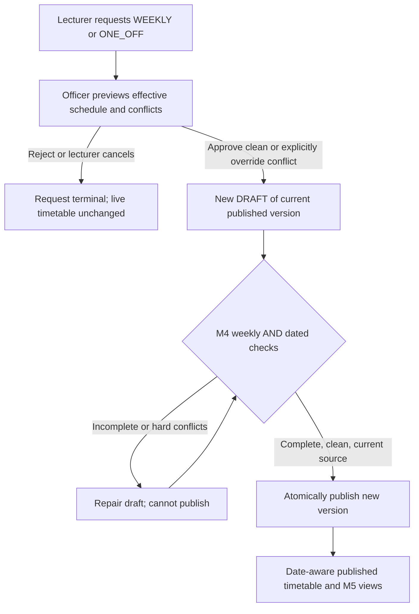
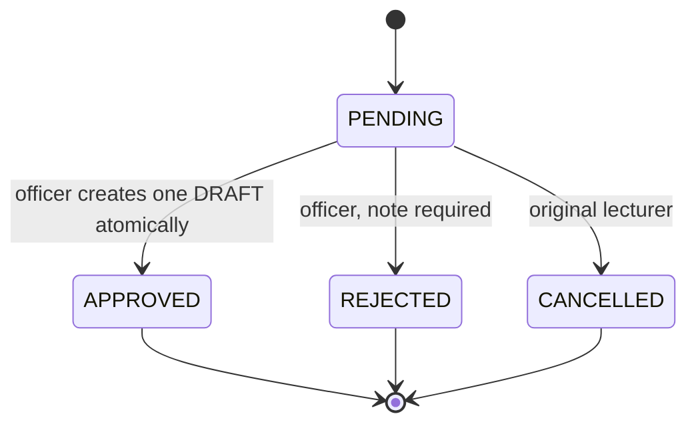
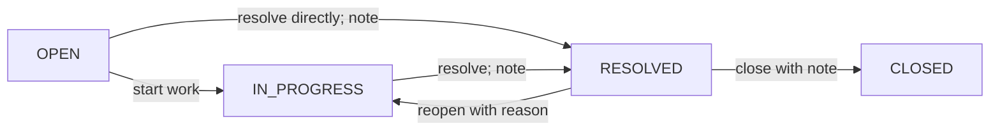

# TAMS Prototype 1 — M6 Full Implementation Blueprint
## Revision 2.0: Recurring weekly AND one-off dated reschedules, plus issue reporting

> Status update, 8 November 2026 (M6-T3b): implemented, automated-verified and **ACCEPTED AND CLOSED** on the user's report of successful manual browser acceptance; see the closure section at the end of this document. The M6-T3a handoff recorded "owner browser acceptance pending" and is superseded, not rewritten. The original design below is retained as the approved scope baseline; its unchecked section 15 boxes and preparation-time status are historical. See M6-IMPLEMENTATION.md for the explicit revised commit boundaries and M6-VERIFICATION.md / M6-verification.txt for actual results.

**Design revision:** 2.0 — 8 November 2026
**Target branch:** `m6-change-handling`
**Verified design starting HEAD:** `2f2df40f5b4910d6d44d2f8befa8db6f5896c0dd`
**Repository:** https://github.com/zoabboaz729-cyber/TAMS-Prototype-1
**Status:** approved *feature scope* by the project owner; technical decisions below are proposed implementation choices, **not verified Kisii University policy**. No M6 implementation or testing was performed in preparing this document.
**Source baseline:** `AGENTS.md`, `PROTOTYPE_SPEC.md`, `PROGRESS.md`, `DECISIONS.md`, `docs/M5-DESIGN.md`, the actual Prisma schema, M3 validator, M4 version/publication services, M5 venue-status services, permission matrix and menu on the named branch. M5-T2g records user acceptance. The repository's `PROGRESS.md` opening status block is stale; its latest M5-T2g log entry governs. At inspection M6 was 9 commits ahead of remote `master` and 0 behind. Recheck before implementation.

> **Scope decision from project owner:** M6 MUST support (1) changing a repeating weekly teaching slot and (2) moving exactly one occurrence on specific calendar dates. **This explicitly supersedes revision 1.0's recurring-only/no-migration premise.** Both kinds use request → officer decision → new DRAFT → existing (extended) M4 publication; no request or approval silently alters live timetables. M6-T2 issue reporting remains required. Design-first only: this file is not permission to start writing code or change GitHub without a separate implementation instruction.

---

## 0. Change control: what changed since revision 1.0

| Area | Revision 1.0 | Revision 2.0 (required) |
|---|---|---|
| Reschedule scope | Weekly only | Explicit `WEEKLY` / `ONE_OFF` choice |
| Date model | No occurrence dates | ISO calendar dates, configured term window, campus time zone |
| Schema | No migration | **Additive Prisma migration required**: request type/dates, version provenance, dated exception model and pending-request guard |
| Scheduling | M3 weekly `validateEntries` only | Reuse M3 for weekly plans **and date-materialized effective occurrences** |
| Approval | New weekly DRAFT | New DRAFT for either kind; one-off represented as a version-scoped occurrence exception |
| Publication | Existing M4 weekly checks | Extend M4 readiness/transaction snapshot and tests to validate exceptions and source provenance |
| Published views | Weekly grid | Preserve weekly grid; add protected date-specific occurrence view |
| M5 board | Weekday/time only | Date-aware live board and optional officer/admin dated demo mode; **do not reveal class details** |
| M7 handoff | Weekly entry identity | Define stable occurrence identity and actual meeting date for later attendance sessions |
| Delivery plan | 21 subtasks | Larger, ordered, small-file-cap slices with explicit migration, M4, M5 and lifecycle gates |

**Do not** implement a one-off change by editing a weekly `TimetableEntry` or by immediately modifying M5's published snapshot. That would move every weekly occurrence and violate the user's confirmed requirement.

## 1. Verified baseline and scope

### 1.1 Existing infrastructure to reuse

- `prisma/schema.prisma`: `TimetableVersion` (`semester`, `DRAFT|PUBLISHED|ARCHIVED`, `publishedAt`); `TimetableEntry` (`versionId`, `teachingId`, `venueId`, `day`, `start`, `end`, `locked`); `RescheduleRequest` (existing proposed weekday/time, `PENDING|APPROVED|REJECTED|CANCELLED`, `reason`, `decisionNote`); `Issue`; `AuditLog`.
- `src/domain/validator.ts`: pure eight-type validator: venue overlap, lecturer overlap, group overlap, capacity, venue type, lecturer unavailable, venue unavailable and out-of-slot. Explicit `status: incomplete` is **not** conflict-free. Uses half-open `[start,end)` time intervals.
- `src/domain/policy.ts`, `types.ts`, `slotValidation.ts`: weekly scheduling rules. Do not duplicate or silently relax them.
- M4's current-DRAFT generator/editor, transactionally validated publication, archive history and least-privilege published timetable reads.
- M5's current published version–derived venue status (live and demo clock), with read-only role-appropriate/sanitized presentation.
- Permissions: `REQUEST_RESCHEDULE` = LECTURER on `OWN_CLASSES`; `DECIDE_RESCHEDULE` = OFFICER on `ALL`; `REPORT_ISSUE` = DEPT_REP/APPROVER/LECTURER on `OWN_DEPARTMENT`; `SEE_ISSUES` = OFFICER `ALL`, DEPT_REP/APPROVER `OWN_DEPARTMENT`. LECTURER has no `SEE_ISSUES`. `ADMIN` does not inherit officer mutations.
- M6 placeholder links already exist in `src/domain/menu.ts`: `/lecturer/reschedule`, `/officer/reschedules`, `/issues/new`, `/issues`, all `built: false` until delivered.

### 1.2 Deliverable boundaries

**In M6:** two reschedule types; lecturer submission/cancellation/history; officer review/decision/override; audited immutable draft branching; additive migration; reliable date projection and date validation; M4 publication integration; M5/date timetable display integration; issues queue and transitions; automated and user-performed acceptance.

**Out:** automatic approval or publication, notifications, native apps, real university calendar/records connection, lecturer substitutions, arbitrary new venues or rooms selected by a lecturer, sensor-based occupancy, actual one-off attendance scanning (M7), events, exams/fees/grades, PostgreSQL/Docker (M9), altering institution policy without the timetabling-office meeting.

**Venue policy for both kinds (proposed minimum):** keep the source venue unchanged. A lecturer chooses a new weekday/time or a new date/time, not a replacement venue. This is a bounded scope choice, not an assertion that Kisii operates this way. The officer may use the existing M3 draft editor to resolve a room conflict. If a later review authorizes venue selection, add `proposedVenueId` via a separately scoped amendment.

## 2. Exactly what the two operations mean

### 2.1 Recurring weekly (`WEEKLY`)

Example: a published **MON 09:00–10:00** session becomes **WED 11:00–12:00** in the new weekly template. After M4 publishes the draft, the template repeats on every applicable future week; prior versions remain archived. The start of legal effectiveness is the **new publication**, not the lecturer's request or officer approval. The current prototype has no official academic-year effective-from model: do not advertise retroactive historical accuracy from the latest published weekly grid.

- Input: `sourceEntryId`, `kind: WEEKLY`, proposed weekday/start/end, bounded reason.
- Calendar `originalDate` and `replacementDate` must both be **null**.
- No effective change is rejected.
- If the source weekly entry already has dated exceptions, **block changing that source entry** with `EXCEPTIONS_REQUIRE_REVIEW`; automatic relocation/reinterpretation of existing individual occurrences is prohibited. Other entries' exceptions are copied and rechecked against the changed template.
- Existing M3 hard constraints apply to the entire new weekly plan; exceptions still receive their own date-scoped validation at publication.

### 2.2 One-off dated (`ONE_OFF`)

Example: the occurrence **MON 16 Nov 2026, 09:00–10:00** becomes **TUE 17 Nov 2026, 11:00–12:00**; other Mondays stay at the published weekly time. This example is illustrative synthetic data, **not a claim about Kisii's calendar**.

- Input: `sourceEntryId`, `kind: ONE_OFF`, `originalDate` (`YYYY-MM-DD`), `replacementDate` (`YYYY-MM-DD`), replacement start/end and reason. `proposedDay` is **derived from replacementDate**, never trusted independently from the browser.
- `originalDate` must fall on `sourceEntry.day` in the chosen publication, and within a configured **semester date window**. `replacementDate` must be within that same window. Same-day time changes are permitted; no change in date/time is rejected.
- One-off does **not** add an extra class: it suppresses one source occurrence on its original date and creates **exactly one replacement occurrence** on the target date/time. Its teaching, lecturer, group and venue are inherited from the source weekly entry.
- Reject a second one-off for an occurrence already overridden in the source version (`ALREADY_OVERRIDDEN`). Do not silently stack exceptions or let a moved occurrence be moved a second time without a separate change policy.
- Reject retroactive modifications: the original occurrence and replacement must not already have started under an injected server clock. If a user wants to make up a class that was missed, that is a distinct future workflow, not falsifying the occurrence's past.
- The default Mon–Fri/hour/lunch rules remain authoritative. A weekend/holiday/out-of-hours proposal is not silently permitted: it produces a validator problem. An override may create an **unpublishable repair draft**, but cannot cause an invalid date to become a live booking.

### 2.3 Shared publication semantics

Both types use this chain:



**Meaning of `RescheduleRequest.status = APPROVED`:** the officer approved creation of a draft candidate, not university publication. The source PUBLISHED version, its entries, exceptions and M5 current board remain untouched until M4 publishes a validated draft. The user-facing text must say this explicitly.

## 3. Non-negotiable invariants (cross-module)

| ID | Invariant |
|---|---|
| INV-01 | Do not update/delete `PUBLISHED` or `ARCHIVED` weekly entries or dated exception records in a request, approval, rejection, cancellation or draft edit. Only M4 publication changes version statuses. |
| INV-02 | On approval, create **one** fresh `DRAFT`, copy **every** weekly entry and existing exception with new child entry IDs, apply **exactly one** weekly change OR append **exactly one** dated exception. Preserve all existing drafts and published versions. |
| INV-03 | Never mutate an existing PUBLISHED version's room/times, and never use DRAFT/ARCHIVED rows for a current-publication source. Current version must be unique for the selected semester. |
| INV-04 | Authorize before restricted reads, repeat record-level checks in the write transaction; `Teaching.lecturer.userId` establishes the lecturer's ownership. No client role/actor/session IDs trusted. |
| INV-05 | Validate the whole candidate weekly grid and every affected effective calendar date. `incomplete`, malformed stored data or unknown term means fail closed. |
| INV-06 | `override=true` plus substantive officer reason may approve a **complete but conflicted DRAFT** only. It never overrides an invalid date, stale source, missing context, access denial or M4's publication hard stop. |
| INV-07 | Do not show a one-off as a weekly move: original date loses precisely one occurrence; target date gains precisely one; all other dates unaffected. |
| INV-08 | When creating/publishing, protect the expected current source publication, snapshot (including stored room/availability, exceptions, term-window configuration and policy) and request state against stale edits. |
| INV-09 | One pending request per source published entry regardless of kind; enforce at database level. Exactly one officer decision can transition a pending request and create its draft. |
| INV-10 | Archived versions and their dated exceptions remain queryable for audit; no request can silently rebase one-off history after a new weekly publication. |
| INV-11 | The M5 public board remains sanitized: venue code, status and generic times only, not lecturer/group/unit or private exception text. Never claim physical occupancy or bookability. |
| INV-12 | All writes are transactional with audit; failed copy/audit/stale check leaves no partial data. No client claims success before server commit. |
| INV-13 | `Africa/Nairobi` is the **prototype campus reference zone**, explicitly labelled and subject to institutional confirmation. Dates are canonical local `YYYY-MM-DD`, not browser-selected UTC instants. |
| INV-14 | Existing M0–M5 tests must still pass; add focused domain and disposable-SQLite lifecycle tests. Never seed, migrate or reset protected user `dev.db`/`walkthrough.db`. |

## 4. Data design and additive migration (required)

### 4.1 Use a dated override, not a second weekly entry

Proposed model: `TimetableOccurrenceException`. It is version-scoped. The entry it references belongs to **the same version**. Its fields define one original occurrence that is suppressed and one replacement occurrence that is added. It does not have its own `PUBLISHED` status: its parent `TimetableVersion.status` determines whether it is a draft candidate or the current authoritative exception.

**Illustrative Prisma-style design — not an executable migration; relation naming/Prisma validation must be resolved in task M6-T1b:**

```prisma
model TimetableOccurrenceException {
  id               String @id @default(cuid())
  versionId        String
  entryId          String
  originalDate     String   // canonical YYYY-MM-DD, local campus date
  replacementDate  String   // canonical YYYY-MM-DD, local campus date
  replacementStart String   // HH:MM
  replacementEnd   String   // HH:MM
  createdAt        DateTime @default(now())

  // Relations to TimetableVersion and TimetableEntry to be defined explicitly.
  // Ensure entry.versionId === versionId. Prefer a composite FK if validated
  // by the installed Prisma version; otherwise enforce transactionally and test.
  @@unique([versionId, entryId, originalDate])
  @@index([versionId, replacementDate])
  @@index([entryId])
}
```

The uniqueness key prevents duplicate overrides for the *same occurrence within one version*. `replacementDate` may equal `originalDate` for a same-day time move; the original slot must still be suppressed. Do not store personal data or a separate occurrence row for every normal weekly class; generate those from the weekly template when needed.

### 4.2 Extend `RescheduleRequest` without breaking existing rows

Add fields; keep current fields/status values and existing relations:

```text
kind                    String  @default("WEEKLY")   // WEEKLY | ONE_OFF
originalDate            String? // ONE_OFF only
replacementDate         String? // ONE_OFF only
pendingKey              String? @unique   // source entry id while PENDING, null at terminal
resultDraftVersionId    String?           // new DRAFT id, APPROVED only
```

- `proposedDay`, `proposedStart`, `proposedEnd`, `reason`, `decisionNote`, `entryId` remain as they are. `proposedDay` is user-chosen for WEEKLY, server-derived from `replacementDate` for ONE_OFF.
- `pendingKey` stores the source PUBLISHED **entry id** for any pending request. `@unique` plus transactional clearing on a terminal transition protects against concurrent submissions **across both kinds**. A race or uniqueness error becomes `DUPLICATE_PENDING`/`STALE`, not a 500 with database details.
- Existing historical requests get default `WEEKLY` and nullable new fields; do not change or erase legacy records. Before introducing enforcement on existing data, audit whether any preexisting `PENDING` rows need a safe, documented backfill of `pendingKey`.
- `resultDraftVersionId` is a genuine stored link, never an ID parsed from free-text audit reasons. Add appropriate FK/relation if it can be done without problematic cascading; historical null remains valid.

### 4.3 Extend `TimetableVersion` for safe base provenance

Add `basePublishedVersionId String?` (indexed) to identify which publication a new **M6-generated** draft copies. A `DRAFT` created by M6 must have it; `PUBLISHED`/`ARCHIVED` original versions may not. At M4 publish time, if the DRAFT has `basePublishedVersionId`, require that it still equals the unique current published version for the same semester. Otherwise reject `STALE_SOURCE`, not silently overwrite a newer approved change. No automatic rebase.

The current M4 generator can create older unbased drafts; preserve its existing behavior on legacy data, but **do not allow an unbased legacy draft to overwrite a published dated-exception schedule without an explicit review/rebase**. The exact compatibility guard and tests must be implemented as an M4 integration slice, not silently added to a UI only. Future new drafts should capture a source-publication reference consistently.

### 4.4 Term-window configuration: explicit and honest

The current schema has **semester 1/2**, but **no academic-year/term date range**. One-off dates cannot be safely validated solely from `Unit.semester` or a WhatsApp calendar assumption.

**Selected minimal prototype design:** add `src/domain/termCalendar.ts` with an injected `TermWindow` mapping for the explicitly chosen sample academic year/semester (`academicYearLabel`, `semester`, `startDate`, `endDate`, `timeZone: 'Africa/Nairobi'`). The server must be configured with the **actual synthetic demonstration window** before enabling dated requests. Do not silently guess the current school year or portray synthetic dates as official. If no window is configured, return `TERM_NOT_CONFIGURED`; avoid creating invalid dated data. The calendar is a typed, pure config object validated from canonical ISO dates, not a database lookup or `new Date()` inside domain logic.

For this bounded prototype, retain **one current published version per semester** rather than reworking M4 into multi-year publication. The chosen term configuration is a known limitation: when future calendar years or parallel programmes are needed, add an `AcademicTerm` entity and associate versions in a separately approved schema change. Include the exact term config in M6's preview/publish snapshot; changing it must invalidate stale previews.

### 4.5 Migration procedure and safety

1. On a **disposable copy** of the pre-M6 SQLite schema, apply the additive Prisma migration. Do not open, back up-over, seed, migrate or rewrite protected working databases without express authorization.
2. Assert existing M0–M5 rows, counts, relationships and seed conflict meaning survive; no destructive drop/recreate of old tables or historical requests.
3. Verify `npx prisma validate`, `npx prisma generate`, migration status and `npm run verify`; run both migrations-from-empty and upgrade-from-M5 fixtures.
4. Verify new uniqueness/foreign-key constraints with **real SQLite** tests, not just TypeScript type tests.
5. Keep current provider SQLite; add **no** package dependency or Docker/PostgreSQL migration. Do not edit `PROTOTYPE_SPEC.md` silently; record the owner-approved scope amendment in `docs/M6-DESIGN.md` and `DECISIONS.md`.

## 5. Date-aware domain model and projection engine

### 5.1 Pure contracts

```ts
type ISODate = string; // validated calendar date in YYYY-MM-DD; never an unparsed string
type RescheduleKind = 'WEEKLY' | 'ONE_OFF';
type TermWindow = {
  academicYearLabel: string;
  semester: 1 | 2;
  startDate: ISODate;
  endDate: ISODate;
  timeZone: 'Africa/Nairobi';
};
type Occurrence = {
  occurrenceKey: string;       // version:source-entry:original-date, stable within version
  versionId: string;
  sourceEntryId: string;
  originalDate: ISODate;
  actualDate: ISODate;
  teachingId: string;
  venueId: string;
  day: string;                 // actual date's weekday
  start: string;
  end: string;
  changedByOneOff: boolean;
};
```

`occurrenceKey` is a logical identity, **not an authentication token or a globally stable ID across version copies**. M7 attendance must store the published version, linked entry, original occurrence date, and actual meeting date so moved classes do not get counted against the wrong day. Existing `AttendanceSession.entryId` alone is insufficient for a dated occurrence; implement that relation as part of M7, not by guessing with M6's UI.

### 5.2 Date validation (no JavaScript rollover acceptance)

- Parse exact `YYYY-MM-DD` with a strict Zod schema plus real Gregorian calendar validation (leap years, month/day bounds, canonical round trip); `2026-02-30`, `2026-2-3`, ambiguous `03/04/2026`, invalid offset or timezone inputs fail.
- Map date to weekday with a deterministic UTC-calendar algorithm **solely for day-of-week**, not for defining local campus midnight; associate wall-clock HH:MM with `Africa/Nairobi` in the server layer.
- `originalDate` and `replacementDate` must be in the same selected `TermWindow` and semester, and `originalDate` weekday must match the weekly source entry. Check both dates are future (or same-day start time still future) against the **injected server clock** at submission, approval and publication.
- `replacementDate` on a different weekday is allowed. Resulting `day` is derived; out-of-slot weekdays/times are flagged by the existing validator, never treated as free.
- Dates with a missing term policy, wrong semester, or corrupt stored exception are refused before a DRAFT can be published.
- The current policies do not encode holidays; a weekday falling on a holiday may still appear schedule-valid. Record this as an institutional question, not as a passed holiday check.

### 5.3 Effective occurrence projection (single source of truth)

Implement `src/domain/occurrences.ts` as pure functions. **Never** create separate conflict/occupancy logic for M4, M5 or a future M7 path.

```text
materializeDate(versionEntries, versionExceptions, chosenDate, term):
  assert chosenDate is a valid in-range campus date
  assert every exception references an entry in the same version
  assert each originalDate matches that entry's weekly weekday
  assert no duplicate (entryId, originalDate)
  assert all exception dates and times are valid for the term

  occurrences = [one instance of each weekly entry where entry.day == weekday(chosenDate)]
  remove any instance where exception.entryId matches and
     exception.originalDate == chosenDate
  append each exception's replacement as ONE instance where
     exception.replacementDate == chosenDate, retaining the
     original entry's teachingId, venueId, originalDate and occurrenceKey
  return deterministic sorted occurrences
```

If a Monday class moves to Tuesday, Monday's list loses that occurrence; Tuesday's list gains it. All other weeks remain unchanged. A same-day move removes the original then inserts its changed-time replacement. Validate internal consistency before projecting; do **not** silently drop corrupt exceptions or render a false FREE venue.

`assessCandidate(candidate, context, policy, term)`:

1. Validate full **weekly template** with existing `validateEntries` (M3).
2. Validate all **affected date materializations**: both original and replacement dates for a newly proposed one-off; all existing exception source/target dates when a recurring template changes or when publishing a whole draft.
3. Convert each date's `Occurrence[]` to M3 `EntryInput[]` with **unique occurrence-scoped IDs** and the actual weekday. Reuse exactly the existing validation context/soft policy; no duplicate overlap algorithm. Include the original occurrence key in a mapping for officer-readable diagnostics.
4. Distinguish **inherited baseline violations** from newly introduced violations by evaluating original and proposed schedule(s) with identical context. Display both, never falsely attribute pre-existing data problems to the request.
5. `incomplete` on any scope → `INCOMPLETE_VALIDATION`. Hard violations → `CONFLICTED`; clean complete candidate → `CLEAN`. Never equate an empty array with success if a required context was missing.
6. For publication validate every future exception-affected date in the term; retain historical existing exceptions for audit but do not silently rewrite their past. Full weekly validity is checked independently. Test a new recurring slot that collides only with a **replacement** date — weekly grid alone must not miss this.

**Important limitation:** Effective projection is from a **selected publication version**; it is not proof of the actual teaching that occurred on a historical date. Historical attendance, once M7 exists, must reference the version/occurrence used when attendance was opened. Do not display archived plans as current.

### 5.4 No phantom clashes when moving across dates

The M3 validator assumes entry IDs/weekday slots. A date-scoped check must not compare a MON 09:00 occurrence in **week A** with MON 09:00 from **week B** as if they were simultaneous. Always materialize and validate **per real date**. Conversely, include recurring entries and every previously approved replacement on the target date so a one-off move cannot bypass a room/lecturer/group clash. A venue's operational `INACTIVE`/`MAINTENANCE` status must also be checked by the M6/M4 date-readiness layer; M4's legacy fingerprint alone does not cover this field.

## 6. Request, preview and approval contracts

### 6.1 Strict request input (illustrative)

```ts
type SubmitReschedule =
  | { kind: 'WEEKLY'; sourceEntryId: string; proposedDay: string;
      proposedStart: string; proposedEnd: string; reason: string }
  | { kind: 'ONE_OFF'; sourceEntryId: string; originalDate: ISODate;
      replacementDate: ISODate; proposedStart: string; proposedEnd: string;
      reason: string };

type DecideReschedule = {
  requestId: string;
  decision: 'APPROVE'|'REJECT';
  override: boolean;
  note: string;                 // required for REJECT or conflict override
  expectedReviewToken: string; // opaque; not a source of authority
};
```

Server sets kind, proposedDay, user, status and dates as stored; Zod `.strict()` denies extra keys. Bounded IDs (e.g. <=100 chars), note/reason trim (request reason 10–500; rejection/override note 10–500), and no raw personal data in a token. The preview token binds request status/proposal, current publication/version and entries, all exceptions, room/teaching/availability/operational metadata, term window and policy. The server **recomputes** these inputs inside the decision transaction; client token cannot authorize a skipped check.

### 6.2 Source eligibility and state machines

- Lecturer sees only published entries for which `Teaching.lecturer.userId` equals the authenticated user; filtered at DB **and** rechecked before projection. Scope by semester without leaking other lecturers' identities.
- Source publication must be unique and current, with a non-null `publishedAt`. Do not choose “first” if two are PUBLISHED. For ONE_OFF, source date matches weekday, is in configured term and is not already overridden.
- Source `locked=true` is blocked for both types (`LOCKED`), per current prototype policy; officer unlocking remains separate from M6.
- One pending request per source entry across kinds, enforced by DB `pendingKey`. The lecturer may cancel only their own `PENDING`; cancelled requests remain auditable. Final request statuses are terminal.



### 6.3 Officer review

The officer queue shows kind (`WEEKLY`/`ONE_OFF`), source entry, original weekly slot, original date (if dated), replacement date/weekday/time (if dated), reason, current status and a computed preview. The preview is derived from the **whole version**, not one class in isolation. Explicit outcomes:

- `CLEAN`: full weekly and relevant date checks complete and zero hard violations.
- `CONFLICTED`: full checks complete; list each violation type, affected dates and representative entries. No default approval.
- `INCOMPLETE`: missing context/term or corrupt data; no approval even with override.
- `STALE`: source version, request, data or preview changed; refresh and inspect.
- `EXCEPTIONS_REQUIRE_REVIEW` for a recurring change on a template already containing dated exceptions; no automatic rebase.

Even with a previously clean preview, an officer must reconfirm the current state when clicking Approve. Any changed fingerprint yields `STALE` with **zero writes**. The UI cannot convert a source publication, source date or venue into arbitrary client-provided IDs.

### 6.4 Atomic approval and immutable draft cloning

One adapter transaction (the accepted Prisma interactive-transaction pattern):

1. Authorize OFFICER, validate strict decision data and same-origin request; reload `PENDING` request.
2. Re-read current unique PUBLISHED source version and exact target weekly entry; require same `entryId`, current semester and trusted lecturer relationship.
3. Re-read all weekly entries, existing exceptions, teachings, venues, operational venue states, lecturer/venue unavailability, current policy and term config. Recompute canonical review snapshot and compare to officer's inspected token. Return `STALE` if different.
4. Compute the complete candidate: for WEEKLY, replace **one template slot**; for ONE_OFF, add **one dated exception**, leaving the weekly template untouched. Block duplicate occurrence and illegal dates.
5. Run M3 weekly checks plus M3 date-materialized effective checks. `incomplete` never overridable; hard violations require explicit `override=true` and a substantive officer reason. A non-hard request cannot use a bogus override for authorization.
6. Create `TimetableVersion { status:'DRAFT', semester, publishedAt:null, createdBy:officer.id, basePublishedVersionId:source.id }`. Do not archive the source.
7. Copy **all** source `TimetableEntry` records under new IDs; build old-entry→new-entry map. Apply the WEEKLY change to just its copied target. Copy **all** existing `TimetableOccurrenceException` rows with remapped entry IDs and unchanged dates; add the ONE_OFF exception to the copied target if applicable. Assert precise counts and no lost entries.
8. Conditionally `PENDING → APPROVED` with `updateMany` matching request ID/status/pendingKey; write real `resultDraftVersionId` and set `pendingKey=null`; require `count===1`. Do not create a second draft for repeated action.
9. Insert audit entries (`RESCHEDULE_APPROVED` or `RESCHEDULE_OVERRIDE_APPROVED`, `RESCHEDULE_DRAFT_CREATED`, `RESCHEDULE_ENTRY_COPY`/`RESCHEDULE_EXCEPTION_COPY` as appropriate). Bound reason text and reference actual IDs. If any write fails, rollback **everything**, including the request transition.
10. Return the actual new draft ID and `requiresRepair` flag only **after transaction commit**. Use `/officer/draft?version=<id>` for officer handoff.

For REJECTED/CANCELLED, transactionally compare-and-set `PENDING` to terminal state, clear `pendingKey`, write audit and create **no** draft. A request's original entry/version remains linked for audit after a later publication archives it.

### 6.5 Safety against competing drafts and publication

Two officers racing to approve one request: at most one success, guarded by pending status/transaction. Two different requests from the same publication can produce separate **alternative** drafts, never a magically combined approved timetable. The M4 publication extension MUST check `basePublishedVersionId == current PUBLISHED version id` for M6-generated drafts and refuse an older alternative after another one publishes; do not silently discard an already-live change. A later lecturer may submit a new request against the new publication instead. Other legacy unbased draft behavior needs explicit compatibility tests, especially when current publication contains dated exceptions.

### 6.6 Typed outcome codes (no raw exception details)

`UNAUTHENTICATED`, `FORBIDDEN`, `INVALID_INPUT`, `IDENTITY_UNRESOLVED`, `NO_PUBLICATION`, `AMBIGUOUS_PUBLICATION`, `SOURCE_NOT_FOUND`, `LOCKED`, `NO_CHANGE`, `DUPLICATE_PENDING`, `TERM_NOT_CONFIGURED`, `DATE_OUT_OF_TERM`, `PAST_OCCURRENCE`, `ALREADY_OVERRIDDEN`, `EXCEPTIONS_REQUIRE_REVIEW`, `NOT_PENDING`, `INCOMPLETE_VALIDATION`, `CONFLICTS_REQUIRE_OVERRIDE`, `NOTE_REQUIRED`, `STALE`, `STALE_SOURCE`, `INVALID_STORED_DATA`, `INTERNAL_ERROR`. Include a fixed accessible message and a next step; do not leak SQL, tokens, hashes, other lecturers' details or credentials. The list is a proposed union; centralize it instead of creating incompatible per-page strings.

## 7. M4 publication and published timetable integration

### 7.1 Publication rules to extend, never bypass

Only M4 can publish; M6 must not create its own publish endpoint. Extend the established `draftPublish.ts`, `draftPublishContract.ts`, and `draftPublishStorePrisma.ts` via **separate bounded tasks**, preserving the existing transaction and tests:

1. Load new candidate's weekly entries **and** version-scoped occurrence exceptions; validate stored relations/date/weekday/term integrity.
2. Run existing M3 whole-week constraints and `assessCandidate` for all future exception-affected dates; validate room operational state and required context.
3. Reject `HARD_VIOLATIONS`, `INCOMPLETE_VALIDATION`, `INVALID_OCCURRENCE_DATA`, `TERM_NOT_CONFIGURED`, `PAST_NEW_EXCEPTION` or `STALE_SOURCE` as appropriate. An M6 override does not change the published hard-constraint policy.
4. Include exception rows, base-publication id, operational room status, calendar config and other used fields in the **extended** publication fingerprint. Recompute the identical snapshot inside the transaction. If any relevant row changes, rollback as stale.
5. Before archive/publish, require M6 candidate's `basePublishedVersionId` to equal the **current same-semester PUBLISHED id**. Refuse stale alternatives. For unbased M4 legacy drafts, enforce a visible compatibility check before they can replace a current publication carrying dated exceptions; do not let older drafts silently erase those exceptions.
6. Archive the old PUBLISHED version, publish the whole new DRAFT and audit **atomically**, as M4 already does. Never update rows in place. Existing no-exception M4 cases must continue passing unchanged.
7. Verify that an older archived version retains its own exceptions and that the new published version exposes only its own exceptions. Retain existing exactly-one-current-version failure states; never guess when zero or multiple are current.

**Publication-time clock:** one-off requests must not become active retrospectively by an approval that was left in draft until after the original/replacement class start. A *new exception* due in the past blocks publication. Existing unchanged historical exceptions copied from the current PUBLISHED baseline may be preserved as audit history; verify they are byte-identical and do not treat them as new retroactive reschedules. Check newly changed future occurrences against the server's Africa/Nairobi date/time.

### 7.2 Date-specific timetable read

Preserve `/timetable`'s accepted M4 **weekly** views and access rules. Add an explicit `/timetable/date` route (or separate date-scoped view on the current protected timetable page after review) with `date=YYYY-MM-DD` and semester. It derives effective occurrences **from the current PUBLISHED version plus exceptions**, then applies existing role scoping per entry:

- STUDENT: only own stored student group; no other-group selection.
- LECTURER: only own teaching sessions in groups they teach.
- DEPT_REP and APPROVER: only sessions for their department's groups, including properly scoped visiting/service lecturers.
- OFFICER: authorized group/lecturer/venue perspectives.
- ADMIN: current read-only oversight, never mutation.

The page labels **“Recurring weekly template”** separately from **“Schedule for [date]”**. A one-off original-date view shows the class removed; destination date shows the replacement, including a **Rescheduled occurrence** marker without exposing unauthorized record details. No private timetable payload to generic client components. All routes and service reads independently authorize; forged date, group, view or actor parameters fail closed.

## 8. M5 venue status integration

M5 currently computes statuses from a **weekly pattern and weekday+HH:MM**. That is insufficient for one-off dated exceptions. Extend its authorized read adapter and contract, not a client-only calculation:

- **Live mode:** server computes current **campus date and time** (`Africa/Nairobi`), selects the unique PUBLISHED version, materializes effective occurrences for that *actual date*, then feeds generic venue/time-only slots to the existing pure M5 status function. A moved class disappears from its original date and appears on replacement date.
- **Dated officer/admin demo:** add a **calendar date** input to current `demo` mode or an explicit `demo-date` mode; server validates it against the configured term and role. Accept an exact date plus HH:MM, not an ambiguous day alone. Show “Simulated date and time — not live.”
- **Existing weekday-only demo:** retain for backwards compatibility as a **generic weekly-template demo** with an explicit caveat: “No dated exceptions applied because no calendar date is selected.” Never pretend it shows a specific dated exception. Existing pre-M6 calls and tests must still work.
- **Generic audience:** all six roles retain read access to sanitized live venue statuses; only OFFICER/ADMIN can simulate. Never include class, student group, unit, lecturer, private request or exception reason in public board responses. Date handling must not become an indirect schedule-enumeration API.
- **No publication:** do not say FREE when no valid unique PUBLISHED version exists. Corrupt or ambiguous occurrence overlays -> typed failure, not false room availability. Operational venue closure/inactive status still takes precedence. M5's 60-second refresh and last published read semantics remain intact.
- **Read-only:** new date projection and clock controls perform no global clock change, timetable edits or database writes. The board updates from the new publication **only after M4 publishes**, never from a pending request or M6 draft.
- **Outside configured term:** display a clear supported-range or weekly-pattern caveat; do not claim actual institution availability. Audit the selected period and refresh behavior with synthetic fixtures.

## 9. M7 attendance interface contract (design only, no M7 implementation)

The existing `AttendanceSession.entryId` references a **weekly template entry**, so it cannot by itself identify which Monday or a replacement Tuesday was attended. For later M7 development, the authoritative effective occurrence should provide:

```text
publishedVersionId, sourceEntryId, originalDate, actualDate,
actualStart, actualEnd, venueId, teachingId, occurrenceKey
```

M7 should bind an opened session to the published version + original occurrence date and record actual meeting date/time. Never open a QR attendance session against a *suppressed* original occurrence; never double count original and replacement as two required classes. Subsequent M4 publications must not rewrite historical attendance references; the archived version and occurrence identity support traceability. Add the M7 schema change only when M7 is separately authorized. Until then, date-specific attendance is **not implemented**, and the UI must not claim it is.

## 10. M6-T2 Issue reporting and status workflow (retained from v1)

### 10.1 Roles, workflow and data

**DEPT_REP, APPROVER, LECTURER** may submit issue text and optional venue (`REPORT_ISSUE: OWN_DEPARTMENT`). Server derives authenticated reporter and **home department**, even when the reported room is shared or belongs to another department. `Issue` already has `departmentId`, nullable `venueId`, nullable `reportedBy`, `text`, `OPEN|IN_PROGRESS|RESOLVED|CLOSED`, timestamps. No schema change is required for issue reporting.

**OFFICER** views all issues and can advance statuses. **DEPT_REP/APPROVER** see only their own department's issue list, read-only (`SEE_ISSUES: OWN_DEPARTMENT`). **LECTURER** may submit but has **no** issue-list permission; give server-confirmed create feedback on `/issues/new`, not unapproved history access. **STUDENT/ADMIN** do not receive issue-create or list powers, and OFFICER does not gain the reporter action.

Add one precise permission: `UPDATE_ISSUE_STATUS` (`OFFICER: ALL`; every other role `NONE`). Update every cell of the explicit permissions matrix and its literal test. Do **not** repurpose the read-only `SEE_ISSUES` permission as a mutation grant.

### 10.2 Validated inputs

```ts
type IssueSubmit = { text: string; venueId?: string | null }; // 10..1000 trimmed chars
type IssueStatusChange = {
  issueId: string;
  expectedStatus: 'OPEN'|'IN_PROGRESS'|'RESOLVED';
  nextStatus: 'IN_PROGRESS'|'RESOLVED'|'CLOSED';
  note?: string;          // required for direct resolve/reopen/close; 3..500 trimmed
};
```

Strict Zod `.strict()` rejects forged actor, reporter, department, status, timestamp, role, extra keys and arrays. Missing actor department is `IDENTITY_UNRESOLVED`. Optional venue must exist; operationally closed rooms remain reportable. React displays text escaped, never via raw HTML. The form must advise: **“Do not enter passwords, student registration numbers or unnecessary personal information.”** Store timestamps as server instants, render EAT-labelled dates where appropriate.

### 10.3 State machine



`CLOSED` terminal. Every transition is a pure-domain decision, executed in a single compare-and-set DB transaction with an audit event. Repeat/stale updates cannot create a second audit. `OPEN → CLOSED` without resolving is forbidden. Corrupt stored status is an explicit error, never silently treated as OPEN.

### 10.4 API/service/presentation structure

- `src/domain/issueRules.ts` — pure transitions, validation, normal/boundary/failure tests.
- `src/server/issueContract.ts`, `issueCreate.ts`, `issueUpdate.ts` — injected-store orchestration, strict status and authorization order.
- `src/server/issueStorePrisma.ts` — transactional create+audit, status+audit; deterministic newest-first 25-row pagination; department-scoped SQL and post-read scoping. No unbounded dump.
- `src/app/issues/actions.ts` — same-origin and current-session guards.
- `src/app/issues/new/page.tsx`, `IssueForm.tsx` — reporter form; server-proven success.
- `src/app/issues/page.tsx`, `IssueStatusControls.tsx` — scoped queue and officer-only mutations.
- `AuditLog` actions: `ISSUE_REPORTED`, `ISSUE_IN_PROGRESS`, `ISSUE_RESOLVED`, `ISSUE_REOPENED`, `ISSUE_CLOSED`; store old/new status, reason/note and actual actor as bounded audit text without personal data dumps.

**Status and roles are separate from M6 rescheduling:** filing an issue must never mutate, publish or reserve any timetable entry or occurrence. The issue system should work even if there is no current timetable publication.

## 11. Granular task/commit plan

**Operating rules:** work only on `m6-change-handling`; **one task = one commit**; `npm run verify` before completing every task, `npm run build` for module gates; no force push, no unexpected deletion, no unrelated refactor. **At most 5 files per subtask including `PROGRESS.md` (P) and `DECISIONS.md` (D)** unless explicitly authorized for that subtask. `PROTOTYPE_SPEC.md` remains historical/source scope; record the authorized addition in M6 docs/decisions rather than silently changing the original spec. Every manifest below includes P and D, and must be revalidated against actual file locations before implementation. New migration files count in the ceiling. Split larger files by responsibility; do not shorten critical tests to meet a limit.

### 11.1 Design and schema foundation

| ID | Exact proposed changed files (P and D included) | Acceptance |
|---|---|---|
| **M6-T0** Design lock | `docs/M6-DESIGN.md`, P, D **(3)** | Record owner-approved both-kind scope, synthetic term choice, state/override rules, open institutional questions, current M5 closure and branch SHA; documentation only |
| **M6-T1a** Calendar/date pure rules | `src/domain/termCalendar.ts`, `src/domain/__tests__/termCalendar.test.ts`, P, D **(4)** | Strict real Gregorian dates/leap years, weekday derivation, term boundaries, EAT clock injection, missing-term failure |
| **M6-T1b** Additive schema migration | `prisma/schema.prisma`, `prisma/migrations/<generated_m6_change>/migration.sql`, `src/server/__tests__/m6Migration.test.ts`, P, D **(5)** | Prisma validate/generate, upgrade pre-M6 disposable DB, fresh DB, preserved existing rows; `pendingKey` unique; exception FK/unique; no protected DB touched |
| **M6-T1c** Pure dated occurrence projector | `src/domain/occurrences.ts`, `src/domain/__tests__/occurrences.test.ts`, P, D **(4)** | Original suppression, replacement insert, same-day move, across-week dates, stable key, corrupt/duplicate fail-closed, no mutation |
| **M6-T1d** Candidate validation rules | `src/domain/rescheduleRules.ts`, `src/domain/__tests__/rescheduleRules.test.ts`, P, D **(4)** | Both-kind state/guard, M3 whole-week + per-date validation, inherited/new conflict separation, override rule and exception-rebase block |

### 11.2 Reschedule server/transaction tasks

| ID | Exact proposed changed files (P and D included) | Acceptance |
|---|---|---|
| **M6-T1e** Reschedule data contracts | `src/server/rescheduleContract.ts`, `src/server/__tests__/rescheduleContract.test.ts`, P, D **(4)** | Discriminated strict inputs, typed outcomes, fingerprint and preview interface, no forged identity, no SQL in client result |
| **M6-T1f** Lecturer create/cancel service | `src/server/rescheduleRequest.ts`, `src/server/__tests__/rescheduleRequest.test.ts`, P, D **(4)** | OWN_CLASSES, current unique PUBLISHED, both request types, locked/duplicate/date guards, cancel own PENDING only, no store calls on denied actor |
| **M6-T1g** Officer preview/decision service | `src/server/rescheduleDecision.ts`, `src/server/__tests__/rescheduleDecision.test.ts`, P, D **(4)** | Complete weekly+dated snapshot, clean/conflicted/incomplete/stale, mandatory reason on override, no preview mutation |
| **M6-T1h** Prisma request adapter | `src/server/rescheduleRequestStorePrisma.ts`, `src/server/__tests__/rescheduleRequestStorePrisma.test.ts`, P, D **(4)** | Real isolated SQLite: create+audit, uniqueness of pendingKey, cancel CAS+audit, stored ownership, no partial failure |
| **M6-T1i** Prisma decision/clone adapter | `src/server/rescheduleDecisionStorePrisma.ts`, `src/server/__tests__/rescheduleDecisionStorePrisma.test.ts`, P, D **(4)** | Atomic full weekly+exception clone/remap, same-semester current source, replay fingerprint, write rollback, resultDraft link, exactly one decision/draft |
| **M6-T1j** Lecturer action wrappers | `src/app/lecturer/reschedule/actions.ts`, `src/server/__tests__/rescheduleRequestActions.test.ts`, P, D **(4)** | Same-origin, authenticated session, kind-aware Zod, safe errors, no client actor/venue rewrite |
| **M6-T1k** Lecturer page | `src/app/lecturer/reschedule/page.tsx`, `src/app/lecturer/reschedule/RescheduleForm.tsx`, `src/server/__tests__/rescheduleRequestPage.test.tsx`, P, D **(5)** | Two modes labelled, accessible date inputs, own class/date only, actual dates displayed in EAT, pending/cancel/history, mobile + empty states |
| **M6-T1l** Officer actions | `src/app/officer/reschedules/actions.ts`, `src/server/__tests__/rescheduleDecisionActions.test.ts`, P, D **(4)** | Officer-only, review token, override-note required, reject/cancel safety, no auto publish |
| **M6-T1m** Officer queue/page | `src/app/officer/reschedules/page.tsx`, `src/app/officer/reschedules/DecisionForm.tsx`, `src/server/__tests__/rescheduleReviewPage.test.tsx`, P, D **(5)** | Type/date/status filters, full scoped conflict preview, DRAFT link after commit, clear stale and repair warnings |

### 11.3 M4 and date-specific timetable publication integration (mandatory before M6-T1 acceptance)

| ID | Exact proposed changed files (P and D included) | Acceptance |
|---|---|---|
| **M6-T1n** M4 publication validation contract | `src/server/draftPublishContract.ts`, `src/server/__tests__/draftPublishFingerprint.test.ts`, P, D **(4)** | Snapshot includes exception/version provenance, relevant venue status/term; canonical ordering; legacy no-exception fixtures pass |
| **M6-T1o** M4 approval/readiness service | `src/server/draftPublish.ts`, `src/server/__tests__/draftPublish.test.ts`, P, D **(4)** | Full-week and exception date checks; reject overriden conflicts, invalid terms, stale base, unbased overwrite risk |
| **M6-T1p** M4 publication transaction adapter | `src/server/draftPublishStorePrisma.ts`, `src/server/__tests__/draftPublishStorePrisma.test.ts`, P, D **(4)** | Recompute extended fingerprint inside atomic transaction; preserve archives+exceptions; stale/rollback tests; no implicit publication |
| **M6-T1q** Protected date-view read service | `src/server/publishedOccurrence.ts`, `src/server/__tests__/publishedOccurrence.test.ts`, P, D **(4)** | Current unique publication only; per-record M4 role policy; invalid date or missing relation refused before private projection |
| **M6-T1r** Date-view Prisma adapter | `src/server/publishedOccurrenceStorePrisma.ts`, `src/server/__tests__/publishedOccurrenceStorePrisma.test.ts`, P, D **(4)** | Read-only coherent snapshot, synthetic SQLite and publication change/stale checks, no cross-role leakage |
| **M6-T1s** Date-specific published UI | `src/app/timetable/date/page.tsx`, `src/server/__tests__/publishedOccurrencePage.test.tsx`, P, D **(4)** | Visible weekly-versus-date distinction, original occurrence absent/destination present, student/lecturer/department scopes, narrow viewport |

### 11.4 M5 dated venue-status integration, navigation and lifecycle

| ID | Exact proposed changed files (P and D included) | Acceptance |
|---|---|---|
| **M6-T1t** M5 contract/service | `src/server/venueStatusContract.ts`, `src/server/venueStatus.ts`, `src/server/__tests__/venueStatus.test.ts`, P, D **(5)** | Add actual date with injected EAT clock and backwards-compatible generic weekday mode; preserve full sanitization and authorization |
| **M6-T1u** M5 published-occurrence store | `src/server/venueStatusStorePrisma.ts`, `src/server/__tests__/venueStatusStorePrisma.test.ts`, P, D **(4)** | Date overlay from PUBLISHED only, exact snapshot and no FREE-on-corruption, no DRAFT leakage, no mutation |
| **M6-T1v** M5 dated demo controls | `src/app/venues/status/VenueStatusControls.tsx`, `src/app/venues/status/page.tsx`, `src/server/__tests__/venueStatusPage.test.tsx`, P, D **(5)** | Officer/admin can simulate actual term date, all roles live, old weekday mode labelled generic; refresh works; responsive |
| **M6-T1w** Reschedule navigation | `src/domain/menu.ts`, `src/domain/__tests__/menu.test.ts`, `src/server/__tests__/rescheduleLifecycle.test.ts`, P, D **(5)** | Activate both reschedule links only after both variants and M4/M5 integrated; full request→draft→publish→date view/M5 timeline |

**Important file-size/typing caveat:** The accepted M4/M5 source files may be too large to extend cohesively within 300–400 lines. If so split a listed slice into consecutive tasks with 5-file caps **instead of** replacing accepted code wholesale or hiding validations behind imports. For adapters whose contract needs a coordinated companion change, implement a temporary internal-compatible seam in a preceding task, or authorize an explicit larger manifest; every intermediate commit still passes `npm run verify`.

### 11.5 M6-T2 issue-reporting tasks (unchanged feature, updated order)

| ID | Exact proposed changed files (P and D included) | Acceptance |
|---|---|---|
| **M6-T2a** Pure issue rules | `src/domain/issueRules.ts`, `src/domain/__tests__/issueRules.test.ts`, P, D **(4)** | Input, complete status graph, required notes, CLOSED terminal and forbidden cases |
| **M6-T2b** Officer-only update permission | `src/domain/permissions.ts`, `src/domain/__tests__/permissions.test.ts`, P, D **(4)** | `UPDATE_ISSUE_STATUS` explicit for six roles; no change to M4/M5 rights |
| **M6-T2c** Issue create service | `src/server/issueContract.ts`, `src/server/issueCreate.ts`, `src/server/__tests__/issueCreate.test.ts`, P, D **(5)** | Session-only reporter/department, optional valid venue, strict text, create+audit contract |
| **M6-T2d** Status/list service | `src/server/issueUpdate.ts`, `src/server/__tests__/issueUpdate.test.ts`, P, D **(4)** | Officer CAS+audit; guarded department-scoped read and pagination contract |
| **M6-T2e** Prisma issue store | `src/server/issueStorePrisma.ts`, `src/server/__tests__/issueStorePrisma.test.ts`, P, D **(4)** | Real SQLite create/transition rollback; scoped list 25-row pages, stable ordering |
| **M6-T2f** Issue actions | `src/app/issues/actions.ts`, `src/server/__tests__/issueActions.test.ts`, P, D **(4)** | Same-origin, session checks, forged fields and forbidden action denied |
| **M6-T2g** Report issue page | `src/app/issues/new/page.tsx`, `src/app/issues/new/IssueForm.tsx`, `src/server/__tests__/issueNewPage.test.tsx`, P, D **(5)** | Reporter-only, no sensitive text instructions, confirmation after commit |
| **M6-T2h** Scoped queue page | `src/app/issues/page.tsx`, `src/app/issues/IssueStatusControls.tsx`, `src/server/__tests__/issueListPage.test.tsx`, P, D **(5)** | Officer all; dept/approver own; lecturer/student/admin refused; only officer update controls |
| **M6-T2i** Menu + lifecycle | `src/domain/menu.ts`, `src/domain/__tests__/menu.test.ts`, `src/server/__tests__/issueLifecycle.test.ts`, P, D **(5)** | Activate both issue links; create→review→status→audit, M4/M5 unchanged |

### 11.6 Final verification, patch delivery and milestone closure

| ID | Proposed changed files | Acceptance |
|---|---|---|
| **M6-T3a** Automated review and handoff | `docs/M6-DESIGN.md`, `docs/M6-verification.txt`, P, D **(4)** | Actual verify/build/Prisma tests, diff and tested patch-replay evidence; docs distinguish agent checks from browser checks |
| **M6-T3b** Closure after user acceptance | `docs/M6-DESIGN.md`, P, D **(3)** | Record actual browser result/fixture and open defects; close M6 only when accepted; do not begin M7 automatically |

**Total planned tasks:** 1 scope lock + 23 reschedule/integration slices (`T1a`–`T1w`) + 9 issue slices (`T2a`–`T2i`) + 2 closure slices = **35 separate commits** if each proposed slice is kept. Task splits may add commits, never silently combine them. This is a planning count, not a claim that those commits exist.

## 12. Automated verification matrix (minimum scenario coverage)

Tests must use real fixture data, actual M3 validation, and disposable SQLite where persistence or concurrency matters. These are requirements, **not executed test results**.

### 12.1 Calendar and occurrence rules

| ID | Scenario | Expected |
|---|---|---|
| C01 | Gregorian leap/nonleap Feb 29, Feb 30, invalid/ambiguous date strings | Exact accept/reject, no silent rollover |
| C02 | Dates at term start/end; immediately outside; missing term | Inclusive boundaries, outside/missing refused |
| C03 | `originalDate` weekday does not match source entry | Refuse without read/write of other classes |
| C04 | Source Monday occurrence moved to Tuesday of same week | Only that Monday suppressed and Tuesday added |
| C05 | Monday moved to Tuesday in later week | Correct date-level projection; no week-A/week-B false clash |
| C06 | Same-day time-only one-off | Remove original and add one replacement; no duplicate |
| C07 | All other Monday occurrences in term | Remain at original time |
| C08 | Source and replacement date identical/time identical | NO_CHANGE, no exception |
| C09 | Two exceptions with same `(versionId,entryId,originalDate)` | Unique constraint rejects second; fail closed |
| C10 | Broken entry/version relation, malformed stored time, date out of term | `INVALID_OCCURRENCE_DATA`; never silently omit |
| C11 | Exception target on Saturday/outside hours/lunch | M3 `OUT_OF_SLOT`; cannot be published as clean |
| C12 | Half-open adjacent sessions at an exact boundary | No false overlap; genuine shared-minute overlap detected |
| C13 | Version has no exceptions | Same weekly behavior as accepted M4/M5 baseline |
| C14 | Recurring request with existing exception for target source entry | `EXCEPTIONS_REQUIRE_REVIEW`; no silent rebase |
| C15 | Existing exception on other entry carried into changed template | Retained; destination date revalidated against weekly change |

### 12.2 Reschedule service/security/transactions

| ID | Scenario | Expected |
|---|---|---|
| R01 | Unauthenticated and each of five disallowed roles submit/decide | Denied **before** restricted store reads |
| R02 | Lecturer submits another lecturer's entry ID | FORBIDDEN; no existence/timetable leak |
| R03 | Stored lecturer has no linked identity/teaching | `IDENTITY_UNRESOLVED`; no write |
| R04 | Source is DRAFT/ARCHIVED or zero/two current publications | Refuse; never choose arbitrary version |
| R05 | Locked source entry | `LOCKED` for both kinds |
| R06 | WEEKLY with valid different weekday/time | One pending request; request and audit committed |
| R07 | ONE_OFF with real valid source/replacement dates | Pending with stored type/dates; derived proposedDay correct |
| R08 | ONE_OFF original date on wrong weekday / outside semester | Rejected with clear date error |
| R09 | ONE_OFF source already overridden | `ALREADY_OVERRIDDEN` |
| R10 | ONE_OFF source/replacement in past by server EAT clock | Rejected as retroactive |
| R11 | Valid request then second pending of other kind on same entry | `DUPLICATE_PENDING` from DB guard |
| R12 | Two simultaneous submitters for same entry | Unique pendingKey permits only one pending request |
| R13 | Cancel own PENDING vs cancel another's | Owner allowed and audited; other denied |
| R14 | Changed/fabricated client kind, dates, actor, venue, status, token/extra keys | Strict schema rejects before sensitive reads |
| R15 | Clean weekly move and clean dated move | Separate one-new-DRAFT approvals, source untouched |
| R16 | ONE_OFF move conflicts with weekly booking on target date | Correct venue/lecturer/group violation in officer preview |
| R17 | ONE_OFF move conflicts with another dated replacement | Detected by date materialization, not missed by weekly-only M3 |
| R18 | WEEKLY move creates usual M3 eight violations | Typed violation, complete conflict preview |
| R19 | Baseline already has an inherited conflict | Before/after diagnostics do not falsely attribute all to proposed move |
| R20 | Hard conflict normal approval | Block with zero writes |
| R21 | Override missing reason vs complete conflict with reason | Missing blocked; valid creates repair DRAFT only |
| R22 | Incomplete validator context or term not configured, override enabled | Still refuses with zero writes |
| R23 | Officer sees clean preview then relevant venue/availability/policy changes | Stale token/refreshed validation blocks erroneous approval |
| R24 | Another publication replaces source between preview and approval | `STALE`; zero draft/request mutation |
| R25 | Two officers approve same request at once | Exactly one draft and terminal decision, one loses |
| R26 | Failure during Nth weekly/exception copy or audit insertion | Full transaction rollback; no orphan rows |
| R27 | Successful WEEKLY clone | All original entries copied, only target recurring slot changed, exceptions remapped if valid |
| R28 | Successful ONE_OFF clone | Weekly entries byte-for-byte same content, all old exceptions copied, exactly one extra exception |
| R29 | Other DRAFTs/other semester's PUBLISHED versions | Unchanged; no cross-semester archive |
| R30 | Rejection and cancellation | Terminal with audit, no DRAFT created |
| R31 | Repeated terminal approve/reject/cancel | `NOT_PENDING`; no repeated audit or draft |
| R32 | `resultDraftVersionId` after approval and reload | Real persisted ID, officer route displays correct DRAFT |

### 12.3 M4 and M5 integration / privacy

| ID | Scenario | Expected |
|---|---|---|
| P01 | M4 attempts publish repair-needed WEEKLY or ONE_OFF draft | Existing hard constraint still blocks |
| P02 | M4 publishes clean new WEEKLY candidate | Valid current version; weekly read reflects move |
| P03 | M4 publishes clean new ONE_OFF candidate | Only chosen dated occurrence changes; weekly pattern unchanged |
| P04 | Current publication changed since candidate created | `STALE_SOURCE`; older alternative DRAFT not published |
| P05 | Legacy draft attempts to erase live published exceptions | Compatibility guard refuses until explicit rebase/review |
| P06 | Exception/room/availability/term changes after M4 precheck but before transaction | Extended fingerprint mismatch causes rollback |
| P07 | Publishing new version archives previous publication | Previous weekly rows AND exception history intact |
| P08 | After request and officer approval **before publish**, M5 board | Unchanged; no DRAFT leaks into occupancy |
| P09 | Live M5 on one-off original date | Suppressed original no longer shown as booking |
| P10 | Live M5 on replacement date | Replacement shown as scheduled/occupied at matching time |
| P11 | M5 generic weekday-only demo | Clearly generic; no false dated exception claim |
| P12 | OFFICER/ADMIN dated demo, forged date in student query | Authorized restricted mode; student refused |
| P13 | Corrupt/ambiguous/missing current published data or exception | Board returns typed unavailable/error, **not** FREE |
| P14 | Student `/timetable/date` for their own group | Authorized only own effective occurrences |
| P15 | Student another-group/venue/lecturer selection or forged role | Refused; no session information leak |
| P16 | Lecturer / dept role date views | Exact M4 scoped teaching/groups; no visiting-lecturer cross-dept leak |
| P17 | M7 seam: suppressed original and moved replacement | Only one effective occurrence identity; proposed attendance metadata consistent |
| P18 | M0–M5 no-exception fixture and existing M5 auto refresh | Behavior preserved and regressions pass |

### 12.4 Issue-reporting tests (retained)

| ID | Scenario | Expected |
|---|---|---|
| I01 | DEPT_REP/APPROVER/LECTURER valid issue | OPEN, own stored department, reporter and atomic audit |
| I02 | Lecturer reports shared or maintenance venue | Allowed, issue stays lecturer's home dept |
| I03 | Student/admin/officer/signed-out attempts report | Denied, no read/write |
| I04 | Forged actor/department/status/timestamp, invalid venue, text too short/long | Strict rejection, no write |
| I05 | Audit failure after issue insert | Full rollback |
| I06 | Officer lists multiple departments | All visible under authorization; deterministic paging |
| I07 | DEPT_REP/APPROVER lists own department | No other-department issues even via forged filters |
| I08 | Lecturer/student/admin direct `/issues` URL | Server refuses |
| I09 | OPEN→IN_PROGRESS→RESOLVED→CLOSED | Allowed transitions audited |
| I10 | OPEN→RESOLVED and RESOLVED→IN_PROGRESS with required notes | Allowed, audited |
| I11 | OPEN→CLOSED, CLOSED→anything, invalid stored status | Refused, no mutation |
| I12 | Dept role attempts issue status action | Denied before issue read |
| I13 | Simultaneous/repeated update | CAS prevents second status/audit |
| I14 | 25+ issue rows, equal timestamp ties | Stable pagination and status/department filters |
| I15 | Issue text contains markup-shaped characters | Escaped rendering, not HTML injection |
| I16 | Existing M4/M5 timetable state before/after issue changes | Identical; issue does not create reservation |

**Minimum scenario identifiers in this matrix:** 15 calendar + 32 request + 18 publication/M5 + 16 issue = **81 scenarios**. They may expand into more than 81 individual test cases. This is a coverage plan, not a tested-pass count.

## 13. User-performed browser acceptance (after automated checks)

Use a **disposable synthetic demo database** configured with an explicit term range covering the chosen test dates. Before testing, publish a conflict-free source version using M4. Record the branch/commit, browser/device, selected dates and source publication ID. Never test using real student records or protected working SQLite files.

### 13.1 Lecturer: recurring path

- [ ] Login as a demo lecturer; only own published classes selectable.
- [ ] Select **Recurring weekly**, change weekday/time and submit a reason; receive real `PENDING` ID.
- [ ] Reload; source published timetable and M5 board unchanged.
- [ ] Submit same/no-op input, forged own-class ID or second pending request; appropriate refusal.
- [ ] Cancel a separate pending request; request becomes `CANCELLED` and source unchanged.

### 13.2 Lecturer: one-off path

- [ ] Select **One class on a date**; page shows original calendar date and replacement date/time, exact time-zone and term range.
- [ ] Pick a date that really matches that class's weekday; propose a different date/time, submit; receive `PENDING`.
- [ ] Invalid date, outside term, wrong weekday, already overridden occurrence and past occurrence all show helpful errors.
- [ ] Other occurrences of this weekly class still appear on their ordinary dates.

### 13.3 Officer: approval and publication

- [ ] Queue distinguishes WEEKLY from ONE_OFF, and shows dates only where relevant.
- [ ] Preview real room/lecturer/group conflict; ordinary approve blocked. Override without note blocked.
- [ ] Explicit override with note creates a DRAFT marked **requires repair**; source published remains current.
- [ ] M4 refuses publishing that conflicted draft; officer repairs it, then publishes after passing validation.
- [ ] Approve a clean one-off request to a second date; click actual `resultDraftVersionId` link; weekly base entries are unmodified and new exception is present.
- [ ] Publish clean one-off DRAFT through M4. The normal weekly grid remains the same; original date's occurrence disappears and replacement date shows it.
- [ ] Check officer/admin dated M5 demo at original and replacement times; only newly PUBLISHED exceptions are reflected.
- [ ] Check an unrelated Monday in another week: original weekly occurrence remains.
- [ ] Open two tabs, decide same pending request in first, try second: stale refused; no second DRAFT.
- [ ] Approve two alternative requests from same current published source, publish the first, then try the second: `STALE_SOURCE`; no silent lost update.
- [ ] Reject a request with note: status REJECTED, no DRAFT and no occupancy change.

### 13.4 Role and issue regression

- [ ] STUDENT date view only own group; LECTURER only own classes; department roles own department groups; OFFICER all approved perspectives; ADMIN read-only.
- [ ] Student cannot activate arbitrary demo date or request/decide reschedule via direct URL or server action.
- [ ] DEPT_REP, APPROVER and LECTURER can report an issue; officer can list and advance statuses; department list is scoped; lecturer cannot list all issues.
- [ ] Narrow phone viewport and keyboard-only controls work; prototype banner and sample-data wording visible.
- [ ] No screen claims physically verified occupancy, official university calendar, or QR attendance for the moved class.

### 13.5 Manual acceptance record

```text
M6 MANUAL ACCEPTANCE — both-mode revision
Branch / actual tested commit: __________________
Demo database: synthetic/disposable, identifier: __________________
Configured sample term / campus timezone: __________________
Browser/version + device/viewport: __________________
Starting PUBLISHED version and semester: __________________
WEEKLY request + produced draft ID: __________________
ONE_OFF sourceDate -> replacementDate; draft ID: __________________
Published new version ID: __________________
Checks PASS / FAIL / BLOCKED: ______ / ______ / ______
Exact defect steps and screenshots (if any): __________________
Unresolved meeting-policy questions: __________________
Acceptance decision + attribution: __________________
```

Automated component tests, static page renders or local HTTP response tests **do not count** as this manual browser acceptance. M6 closes only after these reports are reviewed, as with M5.

## 14. Verification and delivery protocol

### 14.1 At every task and final gate

- `npm run verify` must exit 0 (typecheck → lint → Vitest → seed integrity). Save real output, no fabricated counts.
- `npm run build` must exit 0 for module gates and final. `git diff --check` and runnable `npm run dev` check.
- `npx prisma validate`, `npx prisma generate`, and migration tests on disposable SQLite are **mandatory** for schema slices. Verify original records survive upgrade.
- Real SQLite integration tests must cover CAS, unique pending claim, copy/exception mapping, audit failure rollback, stale publication, retained archive and effective-date projection.
- Server inputs use strict Zod; every page and action performs its **own** guard/same-origin check, not the layout; records are re-authorized before writes.
- Explicitly compare before/after M0–M5 behavior with **no exception records** and with **one published dated exception**. Test published weekly and M5 venue status both before and after M4 publication.
- Agent does **not** claim live browser acceptance. User runs §13 manually and returns actual observations.
- `AGENTS.md` default one-task-per-session limit and five-file cap apply unless the user authorizes bounded multi-task work **as separate commits**; preserve no-dependency rule and unchanged unrelated seed semantics.

### 14.2 Patch ZIP for the existing local-first workflow

If direct GitHub writes fail, deliver an apply-ready ZIP with independently verified local commits, **not** a claim that GitHub already contains them:

```text
TAMS-M6-Verified-Changes.zip
  00-README-START-HERE.md
  docs/M6-DESIGN.md
  patches/0001-M6-T0.patch
  patches/0002-M6-T1a.patch
  ...one patch per committed task in order...
  evidence/verified-base-and-head.txt
  evidence/final-verify.txt
  evidence/build.txt
  evidence/prisma-and-migration.txt
  evidence/focused-sqlite-tests.txt
  evidence/diff-and-preservation.txt
  evidence/patch-replay-tree-comparison.txt
  evidence/changed-file-manifest.txt
  evidence/M6-manual-browser-checklist.md
  APPLY-IN-VSCODE.md
```

Do not modify/delete `prisma/dev.db`, `prisma/walkthrough.db`, journal companions, `.env` or user-owned untracked files. Reconstruct and test against **the exact live M6 base SHA observed immediately before implementation**, not merely the SHA printed in this design. Replay all patches into a fresh **disposable** checkout and compare the replay tree hash with the tested implementation tree. Record exact SHA, commands, stdout/stderr and any failure honestly. Never force-push or work around integration HTTP 403 by unsafe credentials. User controls application, push and merge.

### 14.3 Application directions for the user (after checking clean local state)

```bash
git status
git fetch origin
git switch m6-change-handling
# Confirm the ZIP says this exact branch HEAD is its expected base.
git rev-parse HEAD
# Apply PATCHES in the package's specified ordered sequence:
git am /path/to/unzipped/patches/*.patch
npm ci
npx prisma generate
npm run verify
npm run build
```

Do not run `git reset --hard`, `git clean`, force-push, or migrations against a protected database. If applying a patch fails, STOP and inspect the conflict; don't destroy local work. Future migrations should be applied to a user-approved disposable or backed-up development database under their own instructions. Merge to master only after M6 acceptance and ancestry inspection (remote `master` was behind at design time).

### 14.4 Reusable implementation-agent prompt

> Read `AGENTS.md`, `PROGRESS.md`, `DECISIONS.md`, `PROTOTYPE_SPEC.md` §11, and the **owner-approved revision 2.0** of `docs/M6-DESIGN.md`. Confirm the current HEAD of `m6-change-handling` before changing any file. Implement **only task `<M6-SUBTASK-ID>`** in §11 of the blueprint, one commit, within the stated five-file total including PROGRESS/DECISIONS. Implement WEEKLY and ONE_OFF according to the date-aware versioned-exception design; no direct PUBLISHED edits, no new permission broadening, no partial write and no unverified browser claims. Show proposed files/checks first, write focused tests, execute `npm run verify` and relevant Prisma/build checks, record actual evidence and task report. For remote write failure, retain tested local commits and package ordered Git patches with verified exact-base replay. Never use protected or real student databases for experiments.

## 15. M6 final completion gate

M6 is ready for owner acceptance only when every item is evidenced:

- [ ] Additive schema migration is tested against empty DB **and** prior M5 fixture; existing data preserved; new uniqueness and link integrity verified.
- [ ] WEEKLY reschedule can be requested, cancelled, approved/rejected and published using preserved M4 checks; recurring change has correct future weekly behavior.
- [ ] ONE_OFF reschedule can move just one dated occurrence, including to a different weekday/date, while all unrelated weeks remain unchanged.
- [ ] Every kind has stored source/request/produced-draft provenance; all original publication entries/exceptions and other drafts remain unchanged on approval.
- [ ] Officer preview uses existing M3 hard constraints for full weekly and real date-materialized boards; missing context, stale source and invalid calendar never treated as clean.
- [ ] Conflict override requires a substantive note and creates **only** a repairable DRAFT; M4 publication still forbids hard violations.
- [ ] M4 rechecks exception, term, version provenance and relevant status in an atomic publication; competing drafts cannot silently overwrite newly published changes.
- [ ] Protected date-specific timetable views respect the accepted M4 student/lecturer/department/officer/admin read policy.
- [ ] M5 reads only PUBLISHED effective dates in live/dated-demo mode, remains sanitized and preserves existing weekday-only behavior honestly.
- [ ] Issue reporting, scoped viewing, officer transition/audit, pagination, role denials and transactional rollback all work.
- [ ] All actual test commands, migration evidence, old M0–M5 regressions, patch replay (if used), diff and build evidence are available and attributable.
- [ ] User's manual acceptance covers BOTH reschedule modes and issue reporting, with defects and limitations recorded.
- [ ] `PROGRESS.md` status accurately describes M6 closure; no unapproved M7 implementation, production-readiness or institutional-policy claim.

## 16. Questions to validate with Kisii University's timetabling department

1. Is a repeating weekly change effective immediately at publication, from a specified future week, or for the entire term? The current prototype uses publication as the authority for future displays.
2. Can one-off classes move across days or academic weeks, into weekends or across semester boundaries? The prototype permits cross-date **within the configured term**, while existing Mon–Fri/out-of-slot rules still apply.
3. Are public holidays, examination weeks, campus closures and official term dates available from a trusted institution source? Current term windows are explicitly synthetic config.
4. May a lecturer request a different venue, or must an officer choose it? Prototype retains the original venue.
5. May an already moved occurrence be moved again? Prototype refuses an automatic second override; no unapproved stacking.
6. Who authorizes both change types, and what should an override actually permit? Prototype restricts decisions to OFFICER and never publishes hard conflicts.
7. How should locked sessions be released, and what happens to previously recorded attendance when a timetable version changes?
8. Should one-off changes send notifications or require departmental/registrar approval? Not implemented without institutional policy.
9. Must historic attendance be linked to the original scheduled date, actual meeting date, and published timetable version? The future M7 seam anticipates all three.
10. Which issue status rules, escalation deadlines, reporter visibility and retention periods are required? Current queue is a small proposal.
11. How should concurrent timetable amendments be combined rather than treating each as an alternative draft? Prototype requires deliberate re-request/review after a new publication.
12. Does the institution need multiple active academic years/semesters concurrently? The current version model is one current publication per semester; production will require a richer term key if yes.

These remain **questions**, not claims about how Kisii University currently schedules classes.

---

**Final design position:** Both modes share one safe lifecycle: *authenticated lecturer request → actual weekly/date-aware officer validation → optional reasoned approval into a new DRAFT → immutable, version-checked M4 publication → role-scoped dated timetable and M5 occupancy*. The weekly template remains the source of recurring sessions; a one-off is a versioned exception affecting exactly one original occurrence. M6-T2 remains an independent audited reporting workflow. The entire design is testable with synthetic data and is explicitly provisional pending university consultation.

## M6-T3b user-reported manual acceptance and milestone closure — 8 November 2026

**Current status: M6 ACCEPTED AND CLOSED for the approved prototype scope.** This
supersedes the pending handoff in M6-T3a while preserving that historical record.
On 8 November 2026 the user reported: "I have run the manual browser checklist and
i can confirm that everything is okay." This is recorded as user-performed
acceptance of the section 13 browser checklist, which covers both WEEKLY and
ONE_OFF reschedules, officer preview/rejection/override/repair and M4
publication, dated timetable views, the M5 live and dated-demo board, issue
reporting and status queues, and direct-URL role denials.

The section 13.5 acceptance-record fields (tested commit, database identifier,
browser/version, device/viewport, version/request/draft IDs, per-item
PASS/FAIL/BLOCKED counts and defect notes) were not supplied. They are not
inferred, and this acceptance is not described as an agent-run browser test. The
automated evidence in M6-VERIFICATION.md and the local integration verification
recorded in PROGRESS (M6-APPLY) remain the basis for the automated gates; T3b adds
a fresh `npm run verify` before its documentation-only commit. The section 15
manual and closure gates are satisfied by this dated record.

The user separately authorized this documentation commit and push to
`m6-change-handling`, a merge into `master` with push, and creation/publication of
`m7-qr-attendance` from `master`. No M7 implementation is included in this closure.
Retained limitations still apply: the semester 1 window (2026-09-01 through
2026-12-18, Africa/Nairobi) is synthetic and semester 2 has no dated window; the
section 16 questions remain unvalidated with Kisii University; and no official
calendar, physical occupancy, production load, concurrency, deployment, privacy or
institutional-policy certification is claimed.
