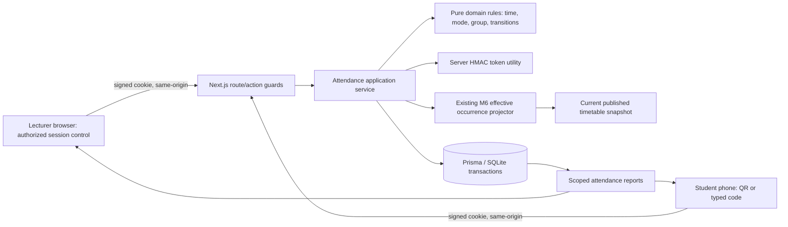
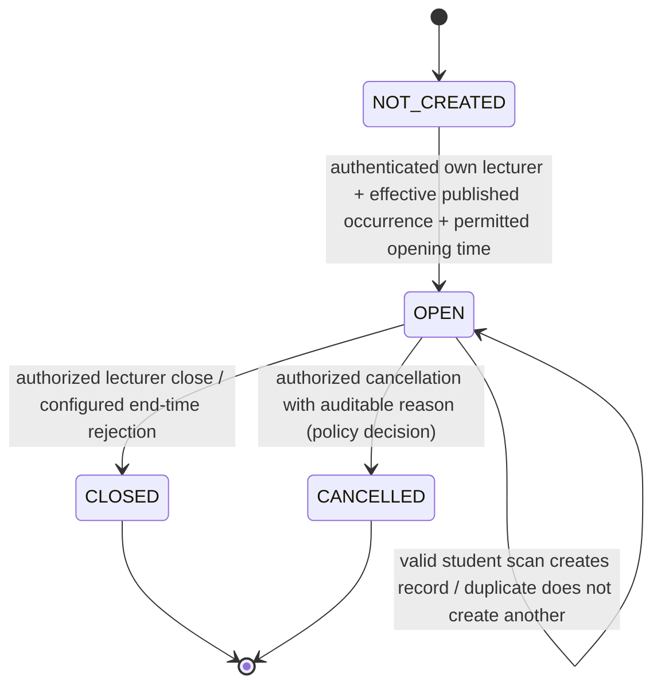

> Historical approved design baseline. Current implementation/evidence status is in M7-IMPLEMENTATION.md and M7-VERIFICATION.md; the original design-only statements below describe the pre-implementation review.

# TAMS Prototype 1 — M7 Full Implementation Blueprint

**Revision:** 1.2 — **owner-approved separation of Start class and Open attendance**; venue-use architecture and implementation contracts finalized for this choice; **not an implementation claim**  
**Prepared:** 9 November 2026  
**Repository:** `zoabboaz729-cyber/TAMS-Prototype-1`  
**Target branch:** `m7-qr-attendance`  
**Reviewed head:** `b33098ff3f0d6bdc031d7ae49450acefe1774723` — **identical to `master` at review**  
**Source specification:** `PROTOTYPE_SPEC.md` §§3–11 (especially M7-T1 through M7-T4), `AGENTS.md`, `docs/M6-DESIGN.md` §9, `docs/M6-IMPLEMENTATION.md`, `docs/M6-VERIFICATION.md`; relevant current source code and Prisma schema.  
**Status:** **VENUE-USE CONTROL CHOICE OWNER-APPROVED; M7 DESIGN REVISED / NOT IMPLEMENTED / NOT TESTED FOR M7.** M6's verification is historical evidence for its own code only; it is not an M7 result.

> **Purpose:** Supply a code-agent-executable, security-conscious, acceptance-testable design for the complete M7 QR Attendance milestone while preserving M0–M6 behavior and the integrity of the M6 dated-occurrence model. No university policy is asserted as confirmed merely because this document proposes a prototype default.

---

## 0. Executive direction, evidence discipline and boundaries

### 0.1 Recommendation

Implement **M7-T1 → M7-T2 → M7-T3 → M7-T4** in separate, tested, traceable increments on `m7-qr-attendance`, with prerequisite schema/security slices and final integration checks. Do **not** combine M7 with M8 meeting tools or M9 PostgreSQL migration. Keep SQLite + Prisma and the current Next.js App Router / TypeScript architecture. The end-to-end feature is: a lecturer sees **two independent controls**, **Start class** and **Open attendance**, for one real dated effective occurrence; either may be used without the other, in either order. Starting class stores lecturer-reported teaching activity; opening attendance creates a QR-enabled session without claiming teaching started. The M5 venue board preserves the published reservation and may overlay labelled lecturer-reported activity, never independently verified physical occupancy. An eligible student may scan or enter a code **only when** a valid attendance session is open; the server verifies and persists one mark; authorized reports show both activities separately. **No combined start+attendance action is to be built in M7.**

### 0.2 Exactly what was verified in source on 9 November 2026

| Finding | Source | Design implication |
|---|---|---|
| Branch `m7-qr-attendance` and `master` have identical HEAD `b33098f…`; no M7 source directories exist | GitHub branch comparison and tree | New M7 is not already implemented; start from this ref and recheck before editing. |
| Next 15 / React 19 / TypeScript strict / Prisma 6 / SQLite / Vitest 3 / Zod 3; `qrcode` and `html5-qrcode` are **not** dependencies | `package.json`; `prisma/schema.prisma` | Do not imply installed QR functionality; obtain explicit permission and pin compatible versions before dependency installation. |
| Auth uses signed HTTP-only cookies; server provides `getCurrentUser`, `requireAnyAction`, `authorizeApi`, `isSameOriginRequest` | `src/server/auth.ts`, `guards.ts`, `origin.ts` | Reuse authentication, origin guard and actor derivation; do not write a second identity system. |
| Permission actions `OPEN_ATTENDANCE`, `SCAN_ATTENDANCE`, `VIEW_ATTENDANCE_REPORT` already exist, and menu destinations are marked `built: false` | `src/domain/permissions.ts`, `menu.ts` | Add resource-level checks and enable menus only after corresponding features work. |
| M6 provides WEEKLY and ONE_OFF scheduling, an occurrence projector and current-publication snapshot | `src/domain/occurrences.ts`, `src/server/m6Snapshot.ts` | Attendance MUST bind to the projected effective occurrence, not only to `TimetableEntry.day`. |
| M6 explicitly hands off `{publishedVersionId, sourceEntryId, originalDate, actualDate, actualStart, actualEnd, venueId, teachingId, occurrenceKey}` | `docs/M6-DESIGN.md` §9 | This is the required M6→M7 interface contract. |
| The schema already has `AttendanceSession` and `AttendanceRecord` with `@@unique([sessionId, studentId])`, but no original date, actual date, published-version snapshot, token epoch or attendance-policy persistence | `prisma/schema.prisma` | Add an **additive, tested migration** without deleting history. |
| `AttendanceSession.entry` currently cascades on deletion; `AttendanceRecord.session` also cascades | `prisma/schema.prisma` | Review/strengthen deletion semantics to prevent historical attendance disappearing when a timetable/version is deleted. |
| Only synthetic term window configured is **semester 1, 2026-09-01 to 2026-12-18, Africa/Nairobi**; semester 2 returns no term | `src/domain/termCalendar.ts` | M7 cannot truthfully open date-specific Semester 2 sessions until a real or explicitly synthetic Semester 2 window is configured. |
| Seeds contain five synthetic **STUDENT** users, all in `SE-Y4`, plus other groups and six synthetic lecturers | `src/domain/seedData.ts` | Report denominators must not confuse five provisioned student accounts with the group size 45. Use isolated negative fixtures for other groups. |
| Existing M5 demo clock is a read-only timetable/venue demonstration control, not an attendance security clock | `src/server/venueStatus.ts`, `src/app/venues/status/page.tsx` | Never use URL/GET-selected M5 demo time to validate actual attendance. |
| M6 is recorded as user-accepted in repository handoff; last M6 verification reported 1,672 tests and 11 seed checks | `docs/M6-VERIFICATION.md` | Preserve those tests; these numbers are **not** claims that they ran for this blueprint. |

**Evidence boundary:** This design is based on reviewed source/connector metadata and existing M6 documentation. No local clone was built and no M7 tests were executed in this design phase. Before coding, confirm working tree and branch HEAD again. If they changed, reconcile the blueprint against the new files rather than applying blindly.

### 0.3 Milestone acceptance map

| Spec item | Exact functional promise | Required demonstrated evidence |
|---|---|---|
| **M7-T1** | HMAC-protected token issue/validation, expiration, `[scanFrom, closesAt)` time window, enrolled-group eligibility, duplicate rejection | Pure normal/boundary/adversarial unit tests; disposable SQLite constraints and concurrent-attempt tests. |
| **M7-T2** | Lecturer opens attendance for **own published, effective class occurrence**, STATIC or ROTATING 30-second mode, QR/count visible | Lecturer authorization tests; wrong-lecturer refusal; temporal and M6 one-off tests; session audit and count tests. |
| **M7-T3** | Student camera scanner plus typed-code fallback; only server-confirmed success; random device-ID **STUB** | Browser/route guard tests, invalid/expired/tampered/duplicate negative cases, accessibility and camera failure checks. |
| **M7-T4** | Session report for lecturer; unit/department reports for authorized roles; accurate totals | Real SQLite aggregation and role-scope tests; reports reconcile with independently counted stored scans. |

### 0.4 In scope versus out of scope

**In:** separate venue reservation and reported class-use indicators (with a safe M5 overlay), explicit lecturer-reported class start, QR image generation, browser scanning, typed fallback, server time and session validation, authorization, group eligibility, HMAC authenticity, static/rotating code support, duplicate/concurrency prevention, sample local-device ID stub, lecturer count, session/aggregated reports, audit, accessible errors, real isolated tests, migration and documentation. **Out:** biometric/GPS proof, production-grade physical presence verification, native mobile apps, real university data/portal integration, SMS/email, payments, M8 assumption-capture/reset UI, M9 Docker/PostgreSQL, attendance mark editing without an approved policy. The owner explicitly approved **separate Start class and Open attendance controls** in this conversation. Other new behavior remains a **recommended prototype design**, not an assumed university policy; the agent must still observe repository change-control rules.

## 1. Decisions and claims hierarchy

Use three statuses throughout this document:

- **[VERIFIED]** means directly evidenced in current repository or its accepted M6 documents.
- **[RECOMMENDED DESIGN]** means the proposed implementation choice, not already coded or institutionally approved.
- **[NEEDS OWNER/UNIVERSITY DECISION]** means behavior cannot be represented as an established university rule; the implementation must use an explicit prototype setting or stop gracefully.

**Preserve `AGENTS.md`:** no hidden deletion, no force push, no secrets in commits, no changing accepted test expectations, one bounded task/commit at a time, `npm run verify` after each task, unchanged M0–M6 functionality. Its ordinary **five-file-per-task limit remains in force** unless the owner explicitly waives it for M7; the previous M6 waiver should not be silently carried forward. Implementation plans below are structured as small slices to respect this. `PROTOTYPE_SPEC.md` must stay unchanged unless a separately approved spec amendment is made.

## 2. Domain definitions and crucial invariants

### 2.1 Terminology

- **Weekly entry:** one `TimetableEntry`, recurring for each occurrence of its weekday in a semester; **not** a particular lesson held on a date.
- **Effective dated occurrence:** a single calendar-date instance of a weekly entry after M6 exceptions are applied. Its identity retains the **original** date even if the meeting has moved.
- **Original date:** date on which the weekly class would have occurred absent the approved one-off change.
- **Actual date / actual start / actual end:** date and local campus wall times on which the effective class is scheduled after the one-off change.
- **Publication:** one specific `TimetableVersion` that was PUBLISHED when the session was opened; it may become ARCHIVED later.
- **Attendance session:** lecturer-authorized server record for **one** occurrence. It is not a weekly or unit-wide attendance link. An open QR attendance session is not conclusive proof a class was taught or a venue is physically occupied.
- **Venue reservation:** an approved effective timetable occurrence allocating a venue, independent of whether attendance was opened.
- **Class activity report:** an audited assertion from an authorized lecturer that teaching began/ended for one exact effective occurrence. It is evidence of reported use, not sensor-verified occupancy.
- **Occupancy evidence:** a distinct claim about actual venue use; cannot be deduced from missing QR activity. The current M5 board is explicitly **schedule-derived**.
- **Attendance record:** one confirmed student/session association stored after server validation.
- **QR proof:** an HMAC-authenticated short-lived bearer code **plus** the mandatory student's authenticated identity and server-side eligibility checks. It is **not** physical-presence proof.
- **Device ID stub:** random client-held opaque identifier for demo visualization, not a reliable identity or gate; no hardware fingerprinting.

### 2.2 Non-negotiable invariants

**I01.** No attendance session against a DRAFT, an unapproved or ambiguous publication, or an ARCHIVED source when opening. **I02.** No new session for a source weekday that has been suppressed by M6 ONE_OFF rescheduling. **I03.** One-off moved occurrence gets one attendance identity based on `(publishedVersionId, sourceEntryId, originalDate)` while storing **actual** date and time. **I04.** Exactly one logical attendance session per `(sourceEntryId, originalDate)` within an accepted publication (reopening policy decided below); never treat original and replacement as two required classes. **I05.** Lecturer identity is the authenticated `User.id` joined through `Teaching.lecturer.userId`, not a supplied lecturer ID. **I06.** Student identity is the authenticated `User.id`; eligibility derives from `User.studentGroupId === Teaching.groupId` (the prototype's single-group model), not a client selection. **I07.** The server, not the device or demo URL, chooses time, token validity, status, actor and attendance timestamp. **I08.** A valid QR does not bypass login, group, session-status, publication or duplicate checks. **I09.** The DB unique constraint is the final duplicate barrier and its errors become typed, safe results. **I10.** Write attendance and significant audit event in a single committed transaction or neither. **I11.** No success UI before receipt of a successful server response; no raw secret/token in URL query parameters, server logs, analytics or audits. **I12.** Reports and counts derive from confirmed stored records, not client state or `StudentGroup.size`. **I13.** Later publications do not rewrite historical session occurrences or silently erase historical records; users must not receive a live-token shortcut into an archived timetable. **I14.** Mutations and private reads enforce exact per-record scope on the server, even if a menu link is hidden. **I15.** The prototype banner and synthetic-data disclosures remain visible. **I16.** Database failures, malformed M6 occurrence overlays, missing term policy and unknown role are errors, not empty valid results. **I17.** A QR scanner or typed fallback failing must never incorrectly record attendance. **I18.** M7 never makes attendance-time results depend on the M5 view-only demo clock. **I19.** Never release an approved venue reservation simply because QR attendance was not opened, has expired, has zero scans, or a lecturer reported absence. **I20.** Opening QR alone must not be labelled *verified physical occupancy*; show an explicit, attributed lecturer report if a class-start action is provided. **I21.** Reservation availability continues to follow M4/M6 effective published schedules and M5 operational-closure rules; attendance overlays never bypass clashes or silently edit publication. **I22.** If students may be present despite no lecturer or QR, venue-use evidence remains UNKNOWN, not EMPTY. **I23.** Historical class-start and attendance events preserve version/occurrence provenance, including one-off moved dates.

### 2.3 One-off reschedule examples

| Scenario | Weekly source | One-off change | What M7 may open |
|---|---|---|---|
| Normal recurring | Entry `E`, Monday 09:00–10:00 | None | Monday **2026-11-16**; occurrence `E / 2026-11-16`; actual `2026-11-16`. |
| Changed day | Entry `E`, Monday 09:00–10:00 | Move **2026-11-16** → Tuesday **2026-11-17** 11:00–12:00 | **Only** Tuesday, identity `E / 2026-11-16`, actual `2026-11-17` 11:00–12:00. Original Monday must not open. |
| Later weekly class | Same entry `E` | Exception affects only previous week | Monday **2026-11-23** has a separate attendance session, identity `E / 2026-11-23`. |
| New timetable published after session | Old published version `V1` becomes archived | `V2` takes over | Already recorded attendance stays linked to `V1`, without migrating records to `V2`. New scans on `V1` are rejected under recommended safe policy. |

Dates above are **illustrative synthetic dates**, not claims about Kisii University teaching days or real courses.

## 3. Architecture and trust boundaries



**Keep existing layers:**

1. `src/domain/`: pure, deterministic attendance policies, `zod` schemas, transition/window/eligibility decisions. All clock values are injected; no Prisma, headers or network calls.
2. `src/server/`: secure HMAC signing/verification with `node:crypto`, reader/snapshot, transactional lifecycle, input validation and error mapping, scoped reports. Inject Prisma and clock in service factories/functions for disposable tests.
3. `src/app/`: guarded Next.js server pages and route handlers/actions. Client-side scanning and QR refresh are presentation only; nothing here decides whether attendance is valid.
4. `prisma/`: one additive migration, compound constraints and optional audited attempts; no raw SQLite-specific application SQL.
5. **M6 reuse:** call `materializeDate` (and integrity checks) from the existing pure occurrence module, or an adapter which delegates to it. Do **not** implement a second, looser one-off projection for attendance.

### 3.1 Trust boundary table

| Untrusted input | Server must independently establish |
|---|---|
| QR content/token | HMAC authenticity, version, strict parse, exact session binding, expiry, current issuance epoch and DB status. |
| Session / entry / version ID in route | Real stored relationships, unique current publication, effective dated occurrence, role and ownership. |
| User ID, lecturer ID, group ID, submitted `role` | Ignore/reject: identity and roles are exclusively from authenticated server session and linked DB rows. |
| Device ID | Optional length-limited opaque metadata only; do not treat as device proof. |
| Browser date, M5 `mode=demo`, scanner time | Never use for signing, opening, closing, scanned-at time or report cutoff. |
| Client-reported scan outcome/count | Treat as display only. Always re-read stored confirmed rows. |
| Search/filter/pagination controls | Strict Zod parse; server-scoped query before pagination and before returning any row. |

## 4. Database design — additive migration

### 4.1 Current model limitations [VERIFIED]

`AttendanceSession(id, entryId, openedBy, opensAt, closesAt, scanFrom, mode, status)` only links to the weekly entry, has no occurrence date and no minted-token revocation generation. `AttendanceRecord` already has `UNIQUE(sessionId, studentId)`, a nullable `deviceId` and `recordedAt`; keep that uniqueness. Existing `onDelete: Cascade` for entry/session relations is dangerous for historical attendance when a prior version is removed. SQLite is the active Prisma provider. M6 already adds `@@unique([id, versionId])` to `TimetableEntry` and a date-override model. These facts dictate an additive change, not replacing M6 data.

### 4.2 Recommended fields on `AttendanceSession`

| Field | Proposed type | Why / constraint |
|---|---|---|
| `id`, `entryId`, `openedBy`, `opensAt`, `scanFrom`, `closesAt`, `mode`, `status` | Existing | Retain and validate. Treat `opensAt` as server-recorded opening instant. |
| `versionId` | `String` FK to `TimetableVersion` | Explicit archived/publication provenance. Enforce version and entry consistency with existing composite `[entryId,versionId]` unique target. |
| `originalDate` | `String`, canonical `YYYY-MM-DD` | Stable date of original weekly source; never overwrite on ONE_OFF. |
| `actualDate` | `String`, canonical `YYYY-MM-DD` | Date class is scheduled to meet; may differ from `originalDate`. |
| `actualStart`, `actualEnd` | `String`, canonical local `HH:MM` | Historical snapshot of effective timing even if future schedules change. |
| `timeZone` | `String`, explicit `Africa/Nairobi` | Make interpretation of stored wall times unambiguous; do not infer from server OS timezone. |
| `groupId`, `teachingId`, `venueId` | `String` provenance snapshots **if approved** | Snapshot stable report dimensions even if teaching/room metadata later changes. Not strictly needed for M7 if referenced historic entities are preserved; choose a single documented strategy. |
| `tokenGeneration` | `Int @default(0)` | Server-incremented rotation/reissue epoch so previously issued QR codes can be invalidated without changing master key. |
| `closedAt`, `cancelledAt` | nullable `DateTime` | Distinguish explicit close/cancel from automatic time expiry. Expiry is always checked from `closesAt` even if status still says OPEN. |
| `openedPolicyVersion` / `windowMinutes` | optional small integer/string | Preserve the explicit policy applied to this session; do not reinterpret historical windows after policy changes. |
| `createdAt`, `updatedAt` | Standard Prisma timestamps | Traceability; never user supplied. |

**Mandatory DB invariant:** `@@unique([entryId, originalDate])` on sessions, because `entryId` is a specific version's unique entry and the occurrence date identifies the week. Add `@@index([versionId, actualDate])`, `@@index([entryId, originalDate])`, `@@index([status, closesAt])`, `@@index([openedBy, opensAt])` as justified by intended queries. Maintain `@@unique([sessionId, studentId])` and add useful `AttendanceRecord` indexes such as `(studentId, recordedAt)` for student-history and `(sessionId, recordedAt)` for sorted sessions. Do not add redundant indexes without an actual query plan rationale.

**Historical retention safety:** Change the parent link(s) that could cascade attendance out of existence to `onDelete: Restrict` or equivalent explicit retained-reference policy. In particular, a timetable entry/version with attendance must be protected from deletion, while seeded local reset intentionally deletes `AttendanceRecord` first, then `AttendanceSession`, and only afterward timetable/version. Avoid a migration that retroactively changes or loses rows. Prisma relation names may require adjustments in **both** models and migration SQL: verify `prisma validate` and real FK behavior against a disposable SQLite database. The final exact Prisma syntax is an **implementation validation item**, not a claim that the sketch above has already compiled.

### 4.3 Recommended optional `AttendanceAttempt` model [HARDENING PROPOSAL]

A short typed code is easier to guess than a full signed QR token. If a human-friendly typed code is shipped, introduce a minimal **failed-attempt counter/throttle** that persists across requests/workers, e.g. `(id, sessionId, studentId, at, outcomeCategory)` with indexes for `(studentId, sessionId, at)` and bounded retention. Count only invalid code submissions; never save submitted raw codes/tokens. On more than the agreed failures within a rolling time window, return `RATE_LIMITED`, and avoid claims of strong resistance without concurrency tests. The rate-limit policy and retention period require an explicit owner decision. An acceptable reduced-scope alternative is a long **pasteable** signed code without a short-code surface, but that is less accessible and less faithful to the envisioned typed fallback.

### 4.4 Migration and old records

- Preserve existing models, M6 FKs, migrations, `TimetableOccurrenceException`, and all non-attendance records. Use a **new** timestamped Prisma migration, not editing previously applied migration files.
- A new non-null date field cannot be safely backfilled from the weekly `day`; **there is no historical occurrence date in the old schema**. Before migration, inspect whether any `AttendanceSession` rows exist in a **user-approved disposable copy**. If none, new required fields can be added via a safe migration path; if some exist, **stop and request source dates** or preserve temporarily nullable fields with a documented repair procedure. Never guess past dates.
- Recreate SQLite tables in a migration only if Prisma requires it; validate all original rows, relationships, unique constraints and FK actions before/after; no migration on the owner's protected working `.db` without explicit authorization.
- Test empty database and upgrade from exact `b33098f…` schema. Run `npx prisma validate`, `npx prisma generate`, `npx prisma migrate deploy`, `npm run verify`, and explicit SQLite PRAGMA FK verification in isolated fixtures. Re-check migration status and generated Prisma types.
- Existing `prisma/seed.ts` deletes attendance records before sessions and timetable entries; do not silently change the meaning of the seed's planted clashes. If an `AttendanceAttempt` table is added, seed deletion must cover it explicitly in dependency order. **Seed reset is destructive; never run against a protected database.**

## 5. Occurrence resolution and current-publication eligibility

### 5.1 Required M6→M7 snapshot

Inside a single consistent Prisma read transaction, get exactly one PUBLISHED `TimetableVersion` for the relevant semester, a non-null `publishedAt`, its entries and exceptions plus joined `Teaching`, `Unit`, `Lecturer`, `StudentGroup`, `Venue` and term window; reject malformed/missing relationships. Reuse `readM6Snapshot` / `materializeDate` when possible, but do not leak full unrelated snapshot data in a response. The returned occurrence is:

```ts
export type AttendanceOccurrence = {
  publishedVersionId: string;
  sourceEntryId: string;
  teachingId: string;
  lecturerUserId: string;
  groupId: string;
  unitId: string;
  venueId: string;
  originalDate: string;   // exact YYYY-MM-DD
  actualDate: string;     // exact YYYY-MM-DD, may differ
  actualStart: string;    // local HH:MM, scheduled effective start
  actualEnd: string;      // local HH:MM, scheduled effective end
  timeZone: "Africa/Nairobi";
  occurrenceKey: string;  // M6 projector's logical identity, not a bearer token
};
```

**Critical resolution algorithm:** server obtains actor and proposed **source entry + target dated occurrence**; resolve current published version; validate configured term; materialize the **actual date**; find exactly one projected occurrence whose `sourceEntryId` and `originalDate` match the authoritative source. If absent because original date is suppressed, fail `OCCURRENCE_NOT_EFFECTIVE`, never fall back to weekly entry. The `actualDate` is derived from projector (not trusted from request). If multiple matching rows occur, fail `INVALID_OCCURRENCE_DATA` rather than choose the first. Validate `Teaching.unit.semester` matches publication; join `Teaching.lecturer.userId` and `Teaching.groupId`; optionally reject operational venue closures according to explicit attendance policy (not automatically infer physical occupancy from M5).

**Design preference:** an opaque, server-sourced occurrence-selection ID or `(sourceEntryId, originalDate)` may appear in form input, but identity and actual timing MUST always be recomputed before a write. A forged `versionId`, `actualDate`, `lecturerId`, `groupId` or `status` field must be rejected by strict input schema.

### 5.2 Historic records, archiving and publication races

When a NEW timetable is published, an old version may become ARCHIVED while an attendance session was OPEN. **Recommended default:** a new scan requires its session's version still to be the **unique currently PUBLISHED version**; an archived version refuses new scans (`STALE_PUBLICATION`), but previously recorded scans remain visible as history. A more elaborate policy that permits continuation of an in-progress session across publication must be explicitly approved and implemented atomically with a documented grace period; it must not silently happen by default.

Do not copy attendance sessions or records when M6 generates a new DRAFT. A dated move to a new version means a new occurrence identity in that new publication; historic rows remain linked to their original source. On M4 publish, avoid a new foreign-key cascade that removes history; if a service marks displaced OPEN sessions CANCELLED as part of publication, both status and audit must be in the **same atomic publication transaction** and M4 tests must cover the change. Alternatively, enforce fail-closed scan-time publication check and show stale status in lecturer UI (less invasive). **No secret re-linking by matching unit/day/time.**

### 5.3 Semester/date and real clock boundaries

`termFor(2)` is currently `null` [VERIFIED]. Semester 2 cannot be enabled by substituting Semester 1 dates. For Semester 1, convert an injected server instant to `Africa/Nairobi` using the existing `campusDateTime` convention. Define scheduled local times as unambiguous campus instants in the service (the university presently uses UTC+03:00); validate ISO date and wall clock strictly rather than accepting JS date rollover. Build tests for boundary instants immediately before/after allowed times. **The M5 demo clock is query-driven read-only view simulation and must not be an M7 mutation clock.** A separate, loudly labelled local/demo-only M7 clock option, if approved, must be server controlled, disabled in production and exclusively synthetic (see §12).

## 6. Attendance lifecycle and policy

### 6.1 Proposed state machine



**Important:** scheduled time expiry may be a computed `EXPIRED` **display state** without writing a new string enum; the current stored statuses are OPEN/CLOSED/CANCELLED. An OPEN row past `closesAt` is **not** valid for scans. Avoid adding a new persisted status unless schema + tests + every consumer are updated. Under the simple prototype default, an occurrence has at most one attendance session; CLOSED/CANCELLED are terminal. If reopening or session corrections are institutionally required, design them as an explicit, audited revision; do not bypass unique constraint by creating a second session and thereby allowing two marks for the same class.

### 6.2 Policy configuration [RECOMMENDED DESIGN, pending owner selection]

Make a dedicated `AttendancePolicy` in `src/domain/attendanceRules.ts`, separate from timetable scheduling policy:

```ts
export type AttendancePolicy = {
  timeZone: "Africa/Nairobi";
  allowedModes: readonly ("STATIC" | "ROTATING")[];
  rotationSeconds: 30;          // fixed for spec's ROTATING mode
  openingBeforeStartMinutes: number;  // recommended 0 by default
  openingAfterEndMinutes: number;     // recommended 0 by default
  scanWindowKind: "FINAL_N_MINUTES" | "AFTER_OPEN_UNTIL_END";
  scanWindowMinutes: number;    // owner decision for final-N mode
  maxDurationMinutes: number;   // prevent arbitrarily long attendance tokens
  allowDeviceIdStub: boolean;   // may store, never enforce as identity
};
```

The original report proposes (as an example) a configurable late-session window around **10–30 minutes**; the repository spec guarantees only the `[scanFrom, closesAt]` concept and a rotating 30-second mode. **It does not establish an approved default scan window**, a minimum opening delay, or class re-opening rules. Those need a decision. Recommended demo-friendly, explicitly synthetic default is configurable `AFTER_OPEN_UNTIL_END`, with a separately selectable `FINAL_N_MINUTES` mode demonstrated for university feedback, but never claim this reflects university policy.

### 6.3 Time semantics

Use **half-open** interval `[scanFrom, closesAt)`: at exactly `scanFrom` allowed, at exactly `closesAt` rejected. A scan is rejected if before server-recorded `opensAt`, if `status !== OPEN`, if the trusted time is outside the policy window, or if token is expired. Compute `scanFrom` and `closesAt` from the selected policy, actual effective class time, server opening instant and documented maximum duration. Never permit `scanFrom >= closesAt`, never extend past the effective scheduled end unless an owner-approved exception policy exists. Server-side input dates are strict real calendar dates; not `Date.parse` of free-form locale text.

**Opening rule:** only within the allowed opening interval of the **actual effective** class date/time and for the lecturer assigned to that teaching. If opening is too early or too late, return `NOT_IN_OPEN_WINDOW` with a helpful time-zone-labelled message. A different lecturer, moderator or student is denied. One session per occurrence is enforced **inside a transaction** with a DB uniqueness guard. A repeated same-user request may return the existing OPEN session id (`ALREADY_OPEN`) without minting a second session, subject to exact stored actor/occurrence match; it must not reset attendance data.

**Closing rule:** lecturer can close only a session for a class they teach. Closing ends eligibility instantly and invalidates all codes server-side. Do not delete records. On duplicate close, return a safe `ALREADY_CLOSED`/`NOT_OPEN` response. If explicit cancellation is enabled, require a reason and a policy for existing recorded marks; no destructive cancellation or silently discarded records.

### 6.4 Transaction and concurrency requirements

Open: one transaction resolves the unique current publication/occurrence, checks actor, policy/time and any existing session, creates session plus audit; a uniqueness race returns `ALREADY_OPEN` or `CONFLICT`, never 500 or duplicated rows. Scan: one transaction re-fetches attendance session + current publication + joined student/group; validates signed code, window, state, eligibility and existence of `(sessionId, studentId)`; creates `AttendanceRecord` and audit; commits atomically. `P2002` duplicate is mapped to `ALREADY_RECORDED` and **no additional audit claiming success**. Concurrent repeated scans from the same student create exactly one record. Separate valid students may each create one. SQLite may return an operational lock/busy failure under contention; record it honestly and return a retriable safe error rather than fabricating success. On PostgreSQL M9, rerun cross-transaction race tests.

## 6A. FINALIZED IN REVISION 1.2 — Separate class activity, attendance and venue reservation

> **Owner-confirmed decision (9 November 2026):** Use **two separate controls**: **Start class** and **Open attendance**. Do **not** implement a combined Start-class-and-attendance button, implicit start when QR is opened, or implicit QR opening when a class is started. This decision is settled for this blueprint. It does not imply that the university has approved the surrounding operational policies. The class activity, attendance and M5 overlay features are still **design only**; they have not been coded.

### 6A.1 Three independent facts; a fourth is unverified

| Dimension | Source of truth | Allowed state/claim | What it does not prove |
|---|---|---|---|
| **A. Venue allocation** | The uniquely **PUBLISHED** M4/M6 timetable, effective `materializeDate()` occurrence, venue closure status and server clock | `RESERVED_NOW`, `UPCOMING`, `NO_SCHEDULED_BOOKING`, or `UNAVAILABLE`; M5 already labels scheduled status as `OCCUPIED (scheduled)` | That people are actually inside the room |
| **B. Class activity** | New, lecturer-authenticated `ClassOccurrenceActivity` record for the specific effective occurrence | `NOT_REPORTED`, `REPORTED_STARTED`, `REPORTED_ENDED`; time **reported by server** | Independent verification that the lecturer was physically there or taught |
| **C. QR attendance** | Existing `AttendanceSession` + `AttendanceRecord`, extended with dated occurrence provenance | `NOT_OPENED`, `OPEN`, `CLOSED`, `CANCELLED`, or computed `EXPIRED`; number of **server-confirmed scans** | That class started, all students were present, or the venue is physically occupied |
| **D. Physical occupancy (unknown)** | No approved independent sensor or manual room-verification system exists in M7 | **UNKNOWN / NOT VERIFIED** | Never claim `EMPTY`, `VACANT`, or `VERIFIED OCCUPIED` from A/B/C alone |

**No reported start, no QR session, zero scans, or no lecturer report must never cause a current published reservation to be marked FREE or released to another class.** The booking remains allocated until its scheduled end or a separately authorized, correctly published timetable change. Even after the booking ends, M5 `FREE` always means **free according to the schedule**, not physically vacant.

### 6A.2 Accepted lecturer controls: independent operations

**Lecturer's current effective-occurrence card** shows, from server-resolved data: unit, group, **assigned venue**, actual date/start/end in Africa/Nairobi, rescheduled indicator and original date if different, class activity, QR attendance, and any warning. Show only the class the authenticated lecturer teaches. No editable venue, actor, `studentId`, `publishedVersionId`, or student group values in the action request; trusted joins establish these.

**Action A — Start class**

1. A clearly labelled **Start class** button asks the lecturer to confirm they are reporting **this published class at its assigned venue**. The message says: *“I am reporting that teaching has started for this class at the scheduled venue; this is not independently location-verified.”* This confirmation is a **recommended prototype UX rule**, not university policy.
2. Server authenticates and authorizes a **new explicit `REPORT_CLASS_ACTIVITY` action** (`OWN_CLASSES` for `LECTURER`, `NONE` for every other role), separate from the existing `OPEN_ATTENDANCE` action. Both use the existing trusted ownership join `Teaching.lecturer.userId`. It re-resolves current unique publication, M6 effective occurrence, lecturer ownership, scheduled venue and real clock **inside the write transaction**. The role matrix and its tests must be updated together; no other role gains rights.
3. On success: create one `ClassOccurrenceActivity` with `REPORTED_STARTED`, server `startedAt`, `startedByUserId`, current published version, original/actual dates, start/end, source entry, teaching and venue snapshots; write a matching audit event in the same transaction. A repeated request cannot create a second record; return idempotent reported status.
4. **Do not** create, open, extend, close or rotate `AttendanceSession`; do not create `AttendanceRecord`; do not write `Venue.status`, `TimetableEntry`, a timetable exception, a booking release, or a global M5 demo clock. An immediate venue overlay is a **read projection** of the persisted event.

**Action B — Open attendance**

1. A separate **Open attendance** button authorizes the lecturer to create the QR/typed-code attendance session for the same current effective occurrence, obeying the separate attendance policy's opening window, token duration, uniqueness, role and ownership rules.
2. Opening attendance must succeed **even if no class-start event exists**, provided all attendance prerequisites are met. It stores only attendance-session state and its audit; **no lecturer-reported teaching start is inferred or inserted**.
3. Opening attendance does **not** require pressing Start class; pressing Start class does **not** require opening attendance. Both orders work: **Start → QR**, **QR → Start**, and the single-action paths **Start only** and **QR only**.
4. The QR itself and confirmed student scans never change class activity to `REPORTED_STARTED`. A student not scanning does not change it to `REPORTED_ENDED` or imply absence.

**Separate completion actions (recommended M7 implementation):**

- **End class** is only available if a class was explicitly started and not already ended. It stores `REPORTED_ENDED`, `endedAt` and actor, with audit. It does **not** release the published venue reservation, move/alter the timetable or silently close the attendance-session DB row.
- **Close attendance** changes only the QR attendance session to `CLOSED`, revoking further scans; it does **not** mark the class ended or the room available.
- **Scan safety if class was ended:** the recommended **server-side** rule rejects new scans against an occurrence with `REPORTED_ENDED` (`CLASS_REPORTED_ENDED`), *even if* the independent QR session row still says `OPEN`. Display **“Attendance still open, but scanning stopped because class end was reported; close attendance separately.”** This is an eligibility rule, **not** an implicit QR state transition. This proposed policy is subject to owner/university review before the scan service is coded; the important owner-approved rule is that the two actions and their persistence remain separate.
- If a lecturer forgot either button, do not fabricate history or backdate. After the current live window ends, show **“No class-start report recorded”** or **“No QR attendance opened”**, not **“lecturer absent”**. An audited late declaration/correction must be separately authorized; no hidden edit/backdate in M7.

**No combined-button shortcut or combined transactional path is part of this design.** If later requested, that is a separately approved change to this explicit decision.

### 6A.3 Time, identity, venue and state transitions

Use the **real, server-injected clock** for all writes. A derived campus clock (`Africa/Nairobi`) is used to compare the instant with the authoritative effective occurrence. The baseline prototype rule to propose is **Start class permitted only during `[actualStart, actualEnd)` on the effective actual date**, with no silent backdating or early/late waiver. Do not use M5's simulated date/time to write an event; a separately authorized **strictly local, synthetic** demonstration clock for QR is covered by Q4, not automatically approved for real class-start reporting.

```text
Class activity (one effective occurrence)
   No row / NOT_REPORTED
        | authenticated own lecturer; real date/time inside scheduled window
        v
   REPORTED_STARTED --(same lecturer End class; server now)--> REPORTED_ENDED
        | repeated Start class: idempotent already-started result
        | cannot silently restart once ended; no row is deleted
        v
   (historical event is retained on timetable archival)

QR attendance (one effective occurrence)
   NOT_OPENED --(own lecturer; QR policy window)--> OPEN
   OPEN --(own lecturer Close attendance)--> CLOSED
   OPEN --(time reaches closesAt)--> EXPIRED (computed eligibility only)
   OPEN --(authorized student and valid code)--> OPEN + one AttendanceRecord
   No QR transition changes class activity; no class-activity transition edits QR state.
```

- If there is a missing/ambiguous current publication, missing or invalid term, invalid occurrence projection, lecturer mismatch, a suppressed original date, wrong operational venue status, or an action outside its authorized window, refuse with a specific sanitized code and **zero writes**.
- **Venue is derived from the effective occurrence**, not from a user-selected room. If the assigned room changed through a published one-off move (M6 currently retains venue on that move), start applies to the actual effective venue/date. Reporting teaching elsewhere is an **issue/request for correction**, not permission to alter occupancy or scheduling through M7.
- When a venue is operationally `MAINTENANCE`/`INACTIVE` or its booked slot contradicts a closure, return a clear discrepancy/issue path, not a success label that hides the closure. If closure is declared **after** a valid class-start report, keep the audit history and show the closure as authoritative with a reported-activity discrepancy.
- The recorded `startedAt` is the **server event time**, not guaranteed physical teaching start. Class start may be reported remotely; the UI and reports must disclose this limitation.
- Start and QR actions revalidate all trusted fields on every request and cannot trust browser-provided `mode`, date, venue, group or lecturer. The QR session may accept an approved mode as input, but server validates it; never let clients author provenance fields.
- Once class activity is marked `REPORTED_ENDED`, an additional Start attempt is refused (`ALREADY_ENDED`). A duplicate End is a safe idempotent `ALREADY_ENDED`; no duplicate success audit.
- Lecturer's QR Close action may be called regardless of class activity; already-closed results remain safe and idempotent. There is no lecturer “mark room vacant” control.

### 6A.4 Display projection and explicit truth table

For an *illustrative* LH1 booking **10:00–12:00 EAT** (not an approved university operating rule), show each layer rather than a single ambiguous “occupied/free” flag:

| When | Current published reservation | Class activity | QR attendance | M5 operator-facing label |
|---|---|---|---|---|
| 09:55, scheduled at 10:00 | UPCOMING | NOT_REPORTED | NOT_OPENED | **Upcoming scheduled booking** |
| 10:15, nobody clicked either button | RESERVED_NOW | NOT_REPORTED | NOT_OPENED | **Reserved — class start not reported** |
| 10:15, lecturer clicked Start only | RESERVED_NOW | REPORTED_STARTED | NOT_OPENED | **Reserved · In use (lecturer-reported)** |
| 10:15, lecturer opened QR only | RESERVED_NOW | NOT_REPORTED | OPEN | **Reserved · Attendance open; class start unconfirmed** |
| 10:15, QR opened and students scanned but no Start | RESERVED_NOW | NOT_REPORTED | OPEN | **Reserved · Attendance recorded; class start unconfirmed** |
| 10:15, lecturer started after QR was opened | RESERVED_NOW | REPORTED_STARTED | OPEN | **Reserved · In use (lecturer-reported); QR open** |
| 11:00, lecturer ended class early, QR separately closed | RESERVED_NOW | REPORTED_ENDED | CLOSED | **Reserved until scheduled end · Class end reported** |
| 11:00, lecturer ended class, forgot Close attendance | RESERVED_NOW | REPORTED_ENDED | OPEN (but scans blocked) | **Reserved until scheduled end · Class end reported; QR needs closing** |
| 10:15, students waiting, lecturer not visible, no records | RESERVED_NOW | NOT_REPORTED | NOT_OPENED | **Reserved · Activity unconfirmed** |
| 10:15, an issue alleges lecturer absence | RESERVED_NOW | NOT_REPORTED / flagged separately | NOT_OPENED | **Reserved · Reported disruption awaiting review** (staff-only issue) |
| 12:01, no subsequent reservation/closure | NO_SCHEDULED_BOOKING | historical report retained | historical record retained | **Free (schedule-derived)** — *not physical vacancy* |
| Venue closed/in maintenance during scheduled class | UNAVAILABLE | any prior report remains evidence | no closure override from QR | **Unavailable · Operational closure**; show restricted discrepancy to staff |

**Do not create new persisted venue states** such as `IN_USE` or toggle the existing `Venue.status` to represent attendance. M5's `OCCUPIED` is **schedule-derived**, and public board output must not leak student identities, lecturer private comments or disciplinary allegations. The lecturer should see their own event; officer internal reports may see actor/time; public per-venue board only shows a minimal status and evidence timestamp as approved.

### 6A.5 Additive Prisma persistence — no hidden coupling

Design an independent `ClassOccurrenceActivity` model; **do not add `reportedStartedAt` to AttendanceSession as a substitute**. The existing attendance session must be able to exist without an activity row and vice versa.

```text
ClassOccurrenceActivity(
  id: String @id,
  publishedVersionId: String -> TimetableVersion.id [RESTRICT onDelete],
  sourceEntryId: String and publishedVersionId -> TimetableEntry(id, versionId)
     [composite FK, Restrict; existing TimetableEntry @@unique([id, versionId])],
  originalDate: ISODate, actualDate: ISODate,
  actualStart: HH:MM, actualEnd: HH:MM,
  venueId: String -> Venue.id [Restrict],
  teachingId: String -> Teaching.id [Restrict],
  state: String storing 'REPORTED_STARTED' | 'REPORTED_ENDED', validated with Zod (SQLite-compatible),
  startedByUserId: String -> User.id [Restrict], startedAt: DateTime,
  endedByUserId?: String -> User.id [Restrict], endedAt?: DateTime,
  createdAt: DateTime, updatedAt: DateTime,
  UNIQUE(publishedVersionId, sourceEntryId, originalDate),
  indexes (publishedVersionId, actualDate, venueId), (startedByUserId, startedAt)
)
```

The composite source-entry relation prevents a class-activity record from pointing to a **different** timetable version's entry. Domain/server validation checks the original/actual M6 dates and stored snapshots. Keep the version/entry rows immutable and prevent deletion of referenced history; a timetable's `ARCHIVED` status is not a delete. Use the existing `AuditLog` for start/end events in the same transaction. `ClassOccurrenceActivity` carries **no token, student ID, device ID or personal location**.

Existing `AttendanceSession` design in §4 must independently add `publishedVersionId`, `sourceEntryId`/`entryId`, `originalDate`, `actualDate`, actual time/venue/teaching snapshots and a unique occurrence key, with a compatible composite version-entry relation and protected historical parent deletes. Both tables use **exactly the same M6 occurrence identity** `(publishedVersionId, sourceEntryId, originalDate)` but **neither requires the other to exist**. This is the central guarantee behind the owner's selected separate-controls design.

**Migration:** strictly additive for existing historical M6+ rows, with carefully audited handling of legacy nullable attendance fields. Test on disposable empty + M6-upgrade SQLite databases; keep the five-file limit unless explicitly waived. No M9/Postgres change, no destructive reset, no protected local `.db` opening.

### 6A.6 Service contracts and atomic behavior

**Suggested pure domain API** (clock injected):

```ts
type ClassActivityState = 'NOT_REPORTED' | 'REPORTED_STARTED' | 'REPORTED_ENDED';
type VenueEvidence = {
  reservation: 'UNAVAILABLE' | 'RESERVED_NOW' | 'UPCOMING' | 'NO_SCHEDULED_BOOKING';
  classActivity: ClassActivityState;
  attendance: 'NOT_OPENED' | 'OPEN' | 'CLOSED' | 'CANCELLED' | 'EXPIRED';
  physicalOccupancy: 'NOT_VERIFIED';
};

// Pure functions, supplied with validated occurrence, event, server clock, policy.
function canReportStart(input: unknown): { ok: true } | { ok: false; code: string };
function canReportEnd(input: unknown): { ok: true } | { ok: false; code: string };
function projectVenueEvidence(input: unknown): VenueEvidence;
```

**Suggested server actions:** `reportClassStart({ occurrenceRef })`, `reportClassEnd({ occurrenceRef })`, `openAttendance({ occurrenceRef, approvedMode })`, `closeAttendance({ attendanceSessionId })`. `occurrenceRef` is a **selection hint** (`sourceEntryId`, `originalDate`), not an authorization token; the server derives the publication ID, actual date/venue, lecturer identity and allowed action. Strict Zod schemas, same-origin check, authenticated actor, denial before mutation, and repeat scoped checks **inside** the transaction are mandatory.

**Start class transaction:** one publication/occurrence read → role/lecturer/venue/time guards → unique insertion → exactly one audited `CLASS_REPORTED_STARTED`; a duplicate gets idempotent `ALREADY_STARTED` and writes no new audit. **End class transaction:** read exact activity row → ownership + state + server-time guard → conditional update `REPORTED_STARTED` → `REPORTED_ENDED` → audit; repeat becomes safe `ALREADY_ENDED`. **Open attendance transaction:** publication/occurrence/own lecturer/attendance-window recheck → create only `AttendanceSession` and audit. **Close attendance:** modify only `AttendanceSession` and audit.

`P2002` race must map to a safe typed conflict or idempotent status; a Prisma busy/lock error may be `RETRYABLE` but must never be reported as success. All four actions require tests proving **zero side effects on forbidden, malformed, stale, duplicate, cancelled or inconsistent source**. No route can derive lecturer or student identity from a request body.

**Publication race safeguard (recommended M7 hardening):** current M4/M6 can publish a new version, changing entry IDs, while an occurrence is active. M7 must not allow scans from an archived occurrence as though it is live. At minimum, recheck unique current publication **in every scan** and return a typed `PUBLICATION_CHANGED` failure without deleting history. To prevent disrupting an active class, add a **separately tested M4 publish-time gate**, executed within its existing atomic transaction, that refuses a same-semester publication while there is an eligible **in-progress** class-activity report or QR session for the superseded publication. Define *in-progress* using the trusted current instant and the occurrence's scheduled interval and QR `closesAt` (do not treat a forgotten End class as permanently live). Gate must be scoped to the candidate semester, never affect other semesters, and never silently rewrite events. Include matching concurrency tests; if user declines the gate, clearly document live-scan interruption when publishing mid-class as an explicit residual risk.

### 6A.7 M5 venue board integration — one read model, no booking write

Build a **read-only overlay**, not a new venue-status writer. The proposed read pipeline is:

```text
read only: uniquely current PUBLISHED timetable for semester/date
  -> M6 materializeDate() / effective occurrence and operational closures
  -> M5 schedule-derived status (including original booking and M6 moved exceptions)
  -> class-activity row matching SAME published version + source entry + original date
  -> independent QR session matching SAME occurrence (optional)
  -> pure projection { scheduleStatus, reportedActivity, attendanceStatus,
                        displayLabel, evidenceAsOf, physicalOccupancy: NOT_VERIFIED }
```

All reads that claim a coherent current booking/activity combination should be made from a **single validated transaction snapshot**; if the existing M5 adapter requires refactoring, add a narrow adapter seam rather than combining data from two snapshots as if simultaneous. Recheck unique current publication and the actual date. If corrupted occurrence data or multiple publications are encountered, **fail closed** and never report the venue as “FREE”.

- **Live mode only** overlays current reported activity and current QR state, derived using the *real server instant*. The M5 demo-clock mode shows **simulated schedule only** and must explicitly state **“Class activity/QR evidence not simulated.”** It must never attach a real past/future event to a simulated current occupancy claim.
- Operational closure (`INACTIVE`/`MAINTENANCE`, authorized `VenueUnavailable`) wins for availability. Preserve evidence as a discrepancy for authorized staff; never let reported use override closure.
- A class that was explicitly ended early still keeps **RESERVED_NOW** until its published scheduled end. A class whose lecturer forgot End does not show `In use` indefinitely after the interval: show **“Past class-start report; end not reported”** in authorized historical view. The board stays schedule-derived.
- A no-show allegation or students waiting may be captured through existing M6 `Issue`; an issue alone does not create physical vacancy and must not trigger room release. Officer investigation/verification policy is outside M7's room allocation authority.
- Never send actor IDs, QR token, attendance counts by student, private issue descriptions or personally identifying timestamps in the public/role-shared venue-board response. Restricted instructor/officer history may show audit details.
- M5 board freshness: retain its established 60-second refresh design; lecturer's mutation result can trigger an immediate **read** refresh in their view. Do not claim real-time pub/sub if not built.

**M3/M4/M6 booking invariant:** no M7 action changes the authoritative occupancy for collision validation or permits another booking. The existing M6 supports weekly/one-off moves, not an unattended-room cancellation workflow. A future officer release function must be a separately reviewed, published change to M3/M4/M5/M6, not a new “Free room” switch in M7.

### 6A.8 Reports, anomalies and privacy

Authorized report columns: **Scheduled occurrence**, **Assigned venue**, **Start reported / server time**, **End reported / server time**, **Attendance QR opened**, **QR closed/expired**, **Confirmed student scan count**, **M6 original/actual date**, **Publication version**, plus `NOT_REPORTED` or `NOT_OPENED` where appropriate. Never compute `lecturer absent`, `class cancelled`, `lecture delivered`, `room vacant`, or `students present` from missing controls, zero scans, or unverified claims.

- Lecturer sees only own teaching; officer sees allowed aggregate/audit, approver/dept rep sees only own **student-group department** summaries; student sees only own attendance history. Preserve M4 department policy for visiting lecturers (lecturer home department does not widen reporting rights).
- Optional internal **“No start report received”** alert is a **data-completeness alert**, not an accusation or attendance/disciplinary outcome. Clear next action: ask lecturer or relevant officer to confirm what happened.
- Store no biometric data or GPS, and no physical occupancy measurement. Device ID remains the explicit stub from M7; do not use it as proof of presence.

### 6A.9 Fine-grained M7 implementation work (new task/commit IDs)

The core attendance tasks in §14 are preserved; the following **venue-use slices** become explicit deliverables **only when M7 implementation of this owner-requested feature is authorized**. Each slice is independently testable, documentable and intended to keep to `AGENTS.md`'s five-file cap; split when necessary. No combined start+QR task exists.

| ID / suggested commit | Expected files (actual manifests checked against fresh HEAD) | Pass gate |
|---|---|---|
| **M7-V0: explicit class-activity permission** | `src/domain/permissions.ts`, `src/domain/__tests__/permissions.test.ts`, `src/domain/__tests__/access.test.ts`, `PROGRESS.md` (**4**) | Add `REPORT_CLASS_ACTIVITY`: lecturer OWN_CLASSES only, all other roles NONE; preserve existing `OPEN_ATTENDANCE`; every role and malformed actor case tested |
| **M7-V1: class activity pure rules and three-layer projection** | `src/domain/classActivityRules.ts`, `src/domain/venueActivity.ts`, respective tests, `PROGRESS.md` (**≤5**) | Immutable occurrence identity, independent action permission/time gates, truthful `RESERVED`/reported/QR projections, no implicit state transition |
| **M7-V2a: class activity schema and migration** | `prisma/schema.prisma`, new additive M7 migration (coordinate with M7-T1b), `src/server/__tests__/m7ActivityMigration.test.ts`, `PROGRESS.md`, `DECISIONS.md` (**≤5**) | Two independent tables, composite FK, one record per `(version,source,originalDate)`, Restrict history, empty/M6 upgrade tests |
| **M7-V2b: start/end activity service and atomic audit** | `src/server/classActivity.ts`, `src/server/__tests__/classActivity.test.ts`, `PROGRESS.md` (**3**) | Server-only actor/occurrence/venue/real-clock checks, Start-only/End-only, duplicate/competing-start, race and rollback tests |
| **M7-V3a: protected lecturer Start/End controls** | `src/app/lecturer/attendance/actions.ts`, `src/app/lecturer/attendance/ClassActivityControls.tsx`, `src/server/__tests__/classActivityActions.test.ts`, `PROGRESS.md` (**4**) | **Start class** does not open QR; **Open attendance** does not start class; no combined button; accessible independent state, cannot forge room/date/actor |
| **M7-V3b: M5 read-only activity overlay** | `src/server/venueActivityStore.ts`, `src/app/venues/status/page.tsx`, `src/server/__tests__/venueActivityPage.test.tsx`, `PROGRESS.md` (**4**) | Single-snapshot M5/M6/venue evidence, closure precedence, live vs demo guard, privacy and no double booking |
| **M7-V4: report/history integration and end-to-end regression** | `src/server/attendanceReports.ts`, `src/server/__tests__/m7VenueLifecycle.test.ts`, `PROGRESS.md` (**3**) | Each of four independent actions and their history, same occurrence in M6 ONE_OFF, no false absentee/vacancy, correct scoped counts |
| **M7-V5: publication-time active-class safeguard** | `src/server/draftPublishStorePrisma.ts` or narrow M4 seam, `src/server/__tests__/m7PublishActive.test.ts`, `PROGRESS.md`, `DECISIONS.md` (**≤4**) | Active class/QR in same semester cannot be invalidated by conflicting publication mid-window; after scheduled end, publication allowed and old history retained |

**Sequence:** M7-T1 foundation → V0 explicit permission → V1 → T1b/V2a schema (coordinate as **one** additive migration if feasible) → T1c effective-occurrence resolution → V2b → M7-T2 attendance service → V3a lecturer UI → M7-T3 QR/student UI → V3b M5 overlay → V5 M4 publication safeguard (before end-to-end acceptance) → M7-T4 reports + V4 → full regression and owner's manual acceptance. Where a task changes an already-modified test/file, consolidate planned edits under separate, traceable commits without discarding previous tests. No M8 or M9 work is implied.

### 6A.10 Expanded acceptance test matrix (required, not claimed executed)

| ID | Scenario | Expected result |
|---|---|---|
| V01 | Current LH1 booking, 10:15, neither Start nor QR opened | **RESERVED**, class activity `NOT_REPORTED`, QR `NOT_OPENED`; never FREE |
| V02 | Lecturer presses **Start class** alone | One audited class activity; QR remains NOT_OPENED and count stays zero |
| V03 | Lecturer presses **Open attendance** alone | One QR session; class activity remains NOT_REPORTED |
| V04 | Start → QR | Both independent rows; one activity/start audit and one QR open audit; consistent venue overlay |
| V05 | QR → Start | Both independent rows; opening QR does not insert/assume Start |
| V06 | QR open, two scans, no Start report | Exact confirmed scan count 2; still class use UNCONFIRMED, reservation unchanged |
| V07 | Lecturer teaches but forgot Start/QR | Missing reports labelled `NOT_REPORTED`/`NOT_OPENED`, not lecturer no-show, occupancy unknown |
| V08 | Student waits inside venue, no lecturer report | Reservation remains; no physical occupancy claim or automatic release |
| V09 | Lecturer End class while booking still runs | Activity REPORTED_ENDED; venue still RESERVED until scheduled end |
| V10 | End class with QR still OPEN | No automatic QR status mutation; further scans denied by server with class-ended reason under proposed policy |
| V11 | Close QR while class activity still STARTED | QR CLOSED; class remains REPORTED_STARTED and venue overlay reports start during scheduled interval |
| V12 | Lecturer forgot End, scheduled interval passes | Not permanently “in use”; historical incomplete-end flag; M5 schedule-derived state applies |
| V13 | Duplicate Start, duplicate End, concurrent Start | At most one activity row; audited first state transitions only; correct idempotent/typed outcomes |
| V14 | Unauthorized lecturer, student or forged venue/date/version | Denied before any mutation; no cross-class information leak |
| V15 | Suppressed Monday M6 ONE_OFF moved to Tuesday | No Start/QR for suppressed Monday; Tuesday matches same original occurrence and actual venue/date |
| V16 | M6 one-off later archived | Historical start and attendance remain attached to original version/date; no projection into new live version |
| V17 | `MAINTENANCE`/`INACTIVE` before Start | Clear protected conflict/issue route; no false successful venue occupancy and no change to closure |
| V18 | Operational closure arrives after recorded Start | Closure stays authoritative, report retained and discrepancy visible to authorized staff |
| V19 | Attempt to allocate same booked venue despite zero QR and no Start | Existing validator rejects conflict; activity has no release authority |
| V20 | Arbitrary M5 demo clock | No synthetic class-start or scan records; no actual evidence overlay misrepresented as simulated occupancy |
| V21 | Missing/multiple PUBLISHED versions, corrupt exception/term | Refusal and safe venue status, never FREE fallback |
| V22 | Publication during active reported class or QR | Same-semester publication gate refuses if approved; archived-token gate always blocks stale scans; no partial write |
| V23 | Independent action transaction fails during audit | Entire action rolled back; no half-written event/audit |
| V24 | Reports across lecturer, officer, approver/dept and student scopes | Only authorized historical events/aggregates, correct M6 visiting-lecturer group policy |
| V25 | Late or retroactive Start attempt after scheduled end | Rejected or separately labelled correction if future approved policy exists; no silent backdate |
| V26 | No attendance activity but venue booked, public board reads | Minimal reserved/unknown wording, no actor IDs or personal attendance leak |
| V27 | Class reported ended without earlier Start | Safe `NOT_STARTED` refusal; no fabricated start/end timestamps |
| V28 | QR closes or expires, class still active and booking current | Venue remains reserved/in-use (reported); QR lifecycle independent |
| V29 | Two simultaneous sessions for same occurrence | DB uniqueness guards QR; activity one-row constraint independently holds |
| V30 | End early then later publication after class slot | No historical deletion; new published schedule shown live, prior report archived |

### 6A.11 Locked owner decisions versus outstanding institutional questions

**DECIDED BY OWNER (this turn):** `VQ1 = SEPARATE`. This means **Start class** and **Open attendance** are separate server mutations, separate UI controls, separate persistence and separate audit; both orders are supported; no combined shortcut or automatic implication. This is settled for M7 design and should be recorded in `DECISIONS.md` during M7-T0a.

**Recommended operational defaults for a demonstrable prototype, not university facts:**

- **VQ2 (reported absence/disruption):** reuse M6 `Issue` for lecturer/eligible student or departmental reporting; officer investigates; unverified reports never automatically label “lecturer absent” or make the venue free. Student's role cannot write activity state.
- **VQ3 (early cancellation/reallocation):** no venue release in M7; any future release requires a separately approved authoritative published schedule/cancellation and conflict check.
- **VQ4 (venue confirmation):** Start class asks the lecturer to acknowledge the **read-only assigned venue**. A lecturer physically in another room uses issue reporting; they cannot overwrite `venueId` through class activity.
- **VQ5 (forgotten button/retroactive editing):** do not backdate; show honest missing-report status; corrections need separately approved audit and institutional policy.
- **VQ6 (End class and scans):** use separate End class and Close attendance buttons; **propose** server-side rejection of scans after a recorded class end without silently setting QR row to CLOSED. Owner/university may choose an explicitly documented alternative before implementation.
- **VQ7 (live time):** Start class uses the true server clock only; any simulated-attendance local demo must be explicitly approved and isolated from live report semantics.
- **VQ8 (publication during a running class):** propose the in-transaction M4 publication gate; this is a cross-milestone integration requiring implementation-scope approval before edits.

None of VQ2–VQ8 is represented as confirmed Kisii University policy. The exact QR scan window, STATIC/ROTATING default, short code, dependency packages, Semester 2 dates, report permissions and file limit remain Q1–Q10 in §19.

---

## 7. QR tokens, typed fallback and security design

### 7.1 QR token format [RECOMMENDED DESIGN]

**Do not use a raw, guessable database session ID as a secret.** Use a compact HMAC-SHA256 signed, versioned token with a dedicated `ATTENDANCE_TOKEN_SECRET` environment variable (different from `SESSION_SECRET`, at least 32 cryptographically random bytes of key material), and verify both its cryptographic proof and the referenced server-side session. A concrete, illustrative wire contract:

```ts
type QrPayloadV1 = {
  typ: "TAMS_ATTENDANCE_V1";  // cross-protocol/domain separation
  sid: string;                 // opaque attendanceSession.id; NOT personal data
  gen: number;                 // tokenGeneration saved on the session
  mode: "STATIC" | "ROTATING";
  bucket: number | null;       // null for STATIC, integer 30-second bucket for ROTATING
  expMs: number;               // absolute maximum token validity (UTC milliseconds)
};
// wire: `tams1.${base64url(canonicalJson(payload))}.${base64url(HMAC_SHA256(secret, signedPart))}`
```

All fields except opaque session ID are protocol metadata; none identifies a student or lecturer. The signed payload should be **strictly** parsed after bounded decoding. Enforce a maximum overall token length (proposed ≤1 KiB) before crypto or DB work; canonicalise JSON/encoding and reject extra segments, unexpected fields, nonintegers, malformed base64 and nonstandard mode. Compare signatures in constant time with a length check, as the existing `src/server/session.ts` already demonstrates. Reject unsupported versions. Never accept a browser-provided session/actor/role as authority just because the payload is signed.

**STATIC:** for a given OPEN session and token generation, signed fields are derived from **stored** opening/closing times and `bucket: null`; GET refresh must return the *same* code until close/cancel, generation increment or expiry. Token maximum expiry equals the session closing instant; the server additionally enforces `[scanFrom, closesAt)` independently. Static does **not** mean a permanently reusable room/class token.

**ROTATING 30 s:** for a given OPEN session and trusted server time `nowMs`, derive a deterministic bucket using **one specified anchor** (recommend `Math.floor(nowMs / 30_000)` in UTC; document the exact rule), embed it in the signed payload and sign. Validity ends at `min((bucket+1)*30_000, closesAtMs)`; under recommended strict semantics, only **the current bucket** verifies. Do not accept a previous bucket without an explicit policy decision and a separate test documenting the grace. A token copied at 11:59:59 may be rejected at 12:00:00 by design; UI should explain “Code refreshed; scan again.” A 30-second rotating token reduces, but does not eliminate, sharing and proxy attendance.

**Revocation:** increment `AttendanceSession.tokenGeneration` on a deliberate reissue/revocation, or close/cancel session. On EVERY scan compare signed `gen` to the DB value, verify OPEN status and permitted time. Changing the master signing key invalidates all sessions signed with that key; plan key rotation as an operational migration, not a casual `.env` change during active class.

**QR contents:** encode the above **plain text** `tams1.…` token (not a URL with the bearer code in query params); the logged-in in-app camera decoder submits it via POST. Never place registration numbers, names, emails, GPS coordinates, password/session cookies or attendance history inside the image. If a tappable URL is later requested, redesign to prevent browser history, referrer and server-access-log leakage rather than simply appending `?token=` to a URL.

### 7.1.1 Secret loading and environment contract

Add to `.env.example` only a placeholder such as `ATTENDANCE_TOKEN_SECRET=replace-with-a-distinct-random-32-byte-or-longer-secret` (never a reusable demo signing key). Fail safely when missing, malformed or too short; server route/action should surface a generic configuration failure while protected server logs state only a fixed safe code. The secret is read server-side only, never through a `NEXT_PUBLIC_` variable or serialized into components. Secret rotation during a session invalidates older tokens and must be documented. If signing keys require a staged rotation, defer that broader operational design to an explicitly authorized task instead of silently accepting both old and new forever.

### 7.2 Pure domain rule interface and server crypto boundary

```ts
// src/domain/attendanceRules.ts — pure; input is trusted structures/clock
export function canOpenAttendance(input: {
  actorUserId: string; lecturerUserId: string;
  occurrence: AttendanceOccurrence;
  nowMs: number; policy: AttendancePolicy;
}): AttendanceDecision;
export function canScanAttendance(input: {
  serverNowMs: number; opensAtMs: number; scanFromMs: number; closesAtMs: number;
  sessionStatus: "OPEN" | "CLOSED" | "CANCELLED";
  actorGroupId: string | null; requiredGroupId: string;
  hasExistingRecord: boolean;
}): AttendanceDecision;
export function computeScanWindow(
  occurrence: AttendanceOccurrence,
  openedAtMs: number,
  policy: AttendancePolicy,
): { scanFromMs: number; closesAtMs: number } | AttendanceFailure;

// src/server/attendanceTokens.ts — deterministic crypto, uses Node crypto
export function signAttendanceToken(
  source: StoredSessionTokenContext, secret: string, nowMs: number,
): string;
export function verifyAttendanceToken(
  untrusted: unknown, secret: string, nowMs: number,
): QrPayloadV1 | null;
```

The token utility can be deterministic and unit tested even though it imports `node:crypto`; keep it in `src/server` to prevent accidental client bundling. Domain function names are proposed, not existing code. Every time/time-window function must use injected values, never `Date.now()` within domain. Server functions should return typed result unions rather than throwing raw Prisma errors across the transport boundary.

### 7.3 Human-friendly typed-code fallback [RECOMMENDED DESIGN]

The **project specification explicitly requires** a typed fallback; displaying a 200-character HMAC token for students to type is not a meaningful fallback. Recommended design:

1. The authenticated student visits `/student/scan` and sees **only their group's currently eligible attendance sessions**, chosen from trusted DB data; no cross-group schedule enumeration.
2. They select the current class/session and enter a short **server-issued code** displayed beside the lecturer QR (e.g., 12 Base32 characters, grouping for readability). The input is case-insensitive after documented normalization; reject ambiguous alphabet, extra separators beyond the accepted grammar, or overlong submissions.
3. Derive the code with a **domain-separated HMAC** over `(sessionId, tokenGeneration, mode, currentRotationBucket)`, truncated to enough bits for the accepted risk level (12 Base32 symbols ≈60 bits). For STATIC, bucket is fixed; for ROTATING, it follows the same 30-second validity rule as the QR. Do not treat a client-generated code as authority.
4. Server resolves the **selected, group-authorized session** and compares the expected code without revealing other sessions or whether a guessed code exists. Count/limit failed attempts using the proposed persistent throttle, and verify the same session, time, published version, group, status and duplicate constraints as QR scanning.
5. Both methods converge on **one shared attendance service and one DB uniqueness rule**. The record should not be distinguishable as “less trustworthy” solely because the student used an approved accessibility fallback; optional `method` provenance requires institutional decision and privacy review.

A 12-character code is a **proposed** usability/security compromise, not a university policy. **Human-factors caveat:** entering 12 symbols inside a 30-second ROTATING window may fail for some students; test it on actual devices. A longer code-entry window, if approved, must use a **separately specified server-validated fallback credential and expiry** rather than secretly accepting old QR buckets. If the user declines the extra attempt/throttle table, prefer a longer code and explicitly document the residual risk; do not silently claim brute-force resistance. Always render accessible manual-code input even if camera code is unsupported or permission denied. Avoid accepting codes over GET URLs or in logs.

### 7.4 Browser scanner, image generator and dependency gate

- The spec §4 nominates `qrcode` for rendering and `html5-qrcode` for scanning. **Neither is currently installed.** `AGENTS.md` explicitly requires permission before adding any dependency, including `@types/qrcode` if its types are needed; update `package.json` **and** `package-lock.json` together, and test compatibility against this repo's Next 15 / React 19 / strict TS build.
- `qrcode` supports server-side image-data generation; render QR through a trusted server component/API without sending it to a third-party QR website. Use accessible text and a manual code next to the image. No static CDN path, server cache or sensitive logs.
- The upstream `html5-qrcode` repository currently states it is in **maintenance mode** (public project README checked during design). This is a concrete maintainability risk; an alternative is a maintained, separately reviewed `@zxing/browser`-style browser decoder with a client-only wrapper. **Do not install a substitution without owner approval**, because `PROTOTYPE_SPEC.md` names `html5-qrcode`.
- The scanner is a React **client** component, dynamically imports browser-only code after mount, chooses a camera with user permission, handles denied/unavailable/busy cameras, decodes only QR format when practical, throttles duplicate callbacks, stops media tracks and destroys scanner on unmount, navigation and successful submission. Never access `navigator`, `window`, or `localStorage` during server rendering.
- Camera access normally requires HTTPS or localhost and user permission; `http://<laptop-LAN-IP>` on a phone is **not automatically a secure context**. Include a real HTTPS phone-test plan and typed fallback for the campus demo. See external reference links in §22.
- Provide a clear Start / Stop camera button and meaningful progress state. Camera alone never marks attendance: only POST plus server success does.

## 8. Role model, scope and server authority

### 8.1 Existing permission matrix [VERIFIED]

| Role | Open/close attendance | Submit a scan | Attendance report | Exact scope |
|---|---|---|---|---|
| ADMIN | No | No | No | Admin may see published timetable, but cannot use attendance report merely because admin exists. |
| OFFICER | No | No | Yes | ALL report data, no ability to forge marks or open sessions. |
| DEPT_REP | No | No | Yes | **Own department's student groups**, consistent with M4/M6 established department relevance. |
| APPROVER | No | No | Yes | **Own department's student groups**, including service units taught by lecturers from other departments. |
| LECTURER | Yes | No | Yes | Only classes assigned through `Teaching.lecturer.userId === actor.id`. |
| STUDENT | No | Yes | Yes | Only current linked student group for scanning; SELF-only own attendance history, no peers' marks. |

The allowed scopes above follow `src/domain/permissions.ts`; **do not broaden** permissions because an admin/officer can see a dashboard. Existing `canAct` uses `ownerUserId` for `OWN_CLASSES`, `groupId` for `OWN_GROUP`, `departmentId` for `OWN_DEPARTMENT` and `subjectUserId` for `SELF`. At service time, derive those resource fields from trusted relations and call the accepted authorization layer. Deny if actor has no corresponding `Lecturer`, `StudentGroup`, or department relationship. Page guards are only initial filters; operations and report rows must be checked independently.

### 8.2 Specific authorization tests that must exist

A student cannot open or close any class. A lecturer cannot open another lecturer's class, even when they share the same department or room. A student in SE-Y4 cannot mark CS-Y2. An APPROVER in Computing cannot see Mathematics-group attendance simply because a Computing lecturer taught it; conversely an approved Computing-group service unit taught by Mathematics faculty remains within Computing group's department report scope. A DEPT_REP cannot retrieve another department's report through URL, action parameters or guessed IDs. A lecturer's session report cannot enumerate their colleague's session. An OFFICER can read authorized reports but cannot create student marks. ADMIN is refused attendance reports under the **current** matrix. A STUDENT can view only records whose `studentId` equals the authenticated actor ID. Unauthenticated access must be denied before protected DB reads when possible.

## 9. API, action and response contract

### 9.1 Suggested route/action split [RECOMMENDED DESIGN]

Use current App Router conventions. The **exact file placements and endpoint names are design choices**, not already implemented; the agent must verify no collision with existing routes. Server Actions work for lecturer open/close; use same-origin JSON POST route for scanner submission because the camera component needs a predictable HTTP boundary. Avoid adding both action and API mutations that can bypass one another.

| UI/operation | Proposed path or function | Guard and result |
|---|---|---|
| Lecturer occurrence selector | `GET /lecturer/attendance` | `requireAnyAction("OPEN_ATTENDANCE")`; server filters to own **current effective occurrences**, not all weekly entries. |
| Open/close an occurrence | `src/app/lecturer/attendance/actions.ts` (`openAttendanceAction`, `closeAttendanceAction`) | Same-origin + server user + `canAct` on trusted teaching owner + strict request + transaction. |
| Retrieve current lecturer QR/code | `GET /api/attendance/sessions/[id]/token` | Authenticated owning lecturer only, no-store; output latest STATIC/ROTATING signed token, typed code, trusted close time and seconds-to-rotation. |
| View permitted session count | `GET /api/attendance/sessions/[id]/summary` | Owning lecturer or appropriately authorized reporting role; return aggregate counts, not classmates' full records. |
| Student scanner screen / active own-group sessions | `GET /student/scan` | `requireAnyAction("SCAN_ATTENDANCE")`, session/eligibility filtered on server. |
| Commit student attendance | `POST /api/attendance/scan` | CSRF/same-origin + signed-in STUDENT + strict Zod discriminated union `{method:"QR", token}` or `{method:"CODE", sessionId, code}` + **one shared scan service**. |
| Attendance reports | `GET /reports/attendance` (+ filtered server component) | `requireAnyAction("VIEW_ATTENDANCE_REPORT")`; all filters/scope applied on server; no unscoped report API. |
| Own student attendance history | Same report route, `view=mine` | SELF-only projection of owned rows; may be provided in M7-T4 without exposing other students. |

The concrete route handlers must disable response caching (`Cache-Control: private, no-store`, and revalidation disabled where applicable). Token endpoint responses must also set `Referrer-Policy: no-referrer`; no cookies/password fields in JSON. Page action responses must be plain serializable objects with permitted fields, never whole Prisma objects/snapshots containing unrelated user info.

### 9.2 Strict transport schemas

```ts
const OpenAttendanceRequest = z.object({
  sourceEntryId: z.string().min(1).max(100),
  originalDate: ISODateSchema,
  mode: AttendanceSessionModeSchema,
}).strict();

const CloseAttendanceRequest = z.object({
  sessionId: z.string().min(1).max(100),
  // close/cancel are separate actions; no implicit 'status' arbitrary patch
}).strict();

const ScanAttendanceRequest = z.discriminatedUnion("method", [
  z.object({ method: z.literal("QR"), token: z.string().min(1).max(1024), deviceId: z.string().max(128).optional() }).strict(),
  z.object({ method: z.literal("CODE"), sessionId: z.string().min(1).max(100), code: z.string().min(1).max(32), deviceId: z.string().max(128).optional() }).strict(),
]);
```

**No `studentId`, `lecturerId`, `groupId`, `actualDate`, `isValid`, `role`, `recordedAt`, `expectedCount`, `scanFrom`, `closesAt`, `tokenGeneration` or `status` as browser-settable mutation keys.** Any such extra key fails `.strict()`. Zod output must not accidentally include unvalidated extras. If the browser supplies an opaque device ID, validate lexical format/length, sanitize it, and document that the same user can reset/spoof it; do not deny participation based on device ID because binding is explicitly a STUB.

### 9.3 Typed result union and suggested status mapping

```ts
type AttendanceResult<T> =
  | { ok: true; value: T }
  | { ok: false; code: AttendanceErrorCode; message: string };
```

| Code | Meaning / UI instruction | Suggested HTTP |
|---|---|---|
| `UNAUTHENTICATED` | Session ended; sign in and retry. | 401 |
| `FORBIDDEN` / `NOT_ELIGIBLE` | Role/class/group not permitted; contact lecturer if a group link is wrong. | 403 (or deliberately generic 404 to avoid enumeration) |
| `INVALID_INPUT` / `INVALID_TOKEN` | Wrong or unreadable QR/code; scan current image or re-enter. | 400 |
| `TOKEN_EXPIRED` / `TOKEN_REFRESHED` | Rotating code stale; scan current one. | 410/409 |
| `NOT_IN_OPEN_WINDOW` / `TOO_EARLY` / `SESSION_EXPIRED` | Attendance not yet open or closed; show trusted EAT window. | 409 |
| `SESSION_NOT_OPEN` / `SESSION_CANCELLED` | Lecturer session not accepting marks. | 409 |
| `ALREADY_RECORDED` | This student's presence already recorded for this session; no extra row. | 409 (or 200 with explicit duplicate flag; choose once) |
| `ALREADY_OPEN` | Lecturer repeated an idempotent open; provide existing session, not duplicate. | 200 |
| `NO_PUBLICATION` / `AMBIGUOUS_PUBLICATION` | No uniquely current published timetable; officer must resolve. | 409 |
| `OCCURRENCE_NOT_EFFECTIVE` / `STALE_PUBLICATION` | Date moved or timetable changed; refresh schedule. | 409 |
| `TERM_NOT_CONFIGURED` / `DATE_OUT_OF_TERM` | Synthetic date/calendar not configured; don't assume valid lessons. | 409 |
| `RATE_LIMITED` | Too many invalid attempts; wait/refer to lecturer. | 429 |
| `INVALID_STORED_DATA` / `INTERNAL_ERROR` | Safe generic failure; no claim of record saved, log fixed redacted operational code. | 500 |

Each code needs a message tested for clarity. Do not send Prisma errors, SQL, DB paths, HMAC payloads, secrets or stack traces to the browser. HTTP tests must assert the exact success/failure shape and that failure never creates an attendance record. Rate limits and unknown-session responses should avoid exposing whether another class exists.

### 9.4 Sequence — student confirmation

```mermaid
sequenceDiagram
    participant Student as Student browser
    participant API as POST /api/attendance/scan
    participant Auth as Cookie+origin guard
    participant Svc as Attendance service
    participant DB as SQLite/Prisma
    Student->>API: QR token or {sessionId, typedCode}
    API->>Auth: Check same-origin and authenticated role
    Auth-->>API: Trusted current user or deny
    API->>Svc: Strict parsed input + actor + server now
    Svc->>DB: Transaction: session, publication, teaching, group, existing record
    DB-->>Svc: Scoped stored facts
    Svc->>Svc: Verify HMAC/code + epoch + current occurrence + window + group
    alt All valid and first scan
        Svc->>DB: Insert unique attendance + audit together
        DB-->>Svc: Committed record and server timestamp
        Svc-->>API: CONFIRMED receipt (no secrets)
        API-->>Student: One successful confirmation
    else Any validation or storage failure
        Svc-->>API: Typed refusal, zero new confirmed records
        API-->>Student: Reason and next action; NEVER confirmed
    end
```

## 10. Lecturer, student and report UI design

### 10.1 `/lecturer/attendance` — lecturer workspace

Show only authenticated lecturer's effective sessions for a carefully bounded date view (recommended current date plus optional explicitly selected date). Display unit, student group, venue, actual date/time EAT, original date if moved, publication version, current status and whether opening is permitted. Do not offer a button on suppressed original Monday. A disabled button explains *why*: “Session moved to Tuesday 17 Nov” / “No published version” / “Outside the configured demonstration term” / “Class already ended”.

When OPEN, show (a) sufficiently sized, high-contrast QR image, (b) typed code with grouping, (c) mode and countdown/expiry, (d) exact server-side scan window in EAT, (e) `N confirmed attendance records` from a scoped server count, (f) refresh/stop controls, (g) accessible announcement when code rotates, and (h) explicit “This does not prove physical presence.” Do not expose participant list by default. The QR image is never rendered for unauthorized access and never cached publicly. On a network failure, show **“Count unavailable / not confirmed”**, not a guessed last count as live.

**Rotation display:** GET token at initial load, schedule refresh before/after 30-second boundary using the **server-provided** expiry/time, not the browser clock as cryptographic authority. On focus/reconnect refresh immediately; on repeated failure state that the displayed code may be stale and stop pretending it is valid. Clearing an expired image is preferable to showing a deceptive QR. Show countdown as a visual aid only; backend validates exact window.

### 10.2 `/student/scan` — student workspace

Before camera: signed-in student role and linked group. Display (i) “Scan QR” with start/stop, (ii) “Enter code” accessible path, (iii) only own group's current eligible sessions for typed-code selection, (iv) permission/camera/network help, (v) transparent device-ID STUB explanation. The camera view must not automatically open without the user's intent. After decode, freeze repeated callbacks while POST is pending; validate response and display a **confirmed receipt** with unit/session/date/server recorded-at only on committed success. On timeout, say **“Status unknown; check your attendance history before retrying”**, not “Failed” or “Confirmed” without server evidence. A retry is safe because of the database unique constraint and explicit `ALREADY_RECORDED` feedback.

The random device ID may be generated once per browser installation via secure random browser API and saved locally; strip it when not allowed, validate max length and treat it solely as **optional metadata**. It is not a security guarantee, geolocation, fingerprint or enrolment substitute. Incognito mode, device reset, shared devices and cross-browser use will not provide reliable binding.

### 10.3 Attendance report layout

- **Lecturer session view:** selecting an owned session shows class, occurrence original/actual date, session window/mode, server-recorded count, and own session's synthetic student records only if institutionally appropriate; include a minimal summary-only view by default.
- **Approver/dept rep view:** by department's **student group**, unit, date range and class occurrence, including visiting lecturers or mathematics service units attended by that group's students; never use `Unit.departmentId` as the *only* departmental filter.
- **Officer view:** all group/unit/semester scope, with server filters and pagination; do not accidentally grant `OPEN_ATTENDANCE`.
- **Student view:** SELF attendance history only (unit, original/actual date, recorded time and status); do not expose peers, lecturer-only analytics or devices.
- **Admin:** current permission matrix denies attendance reports; show a safe forbidden state, not an unexpected admin bypass.

Support an empty-state message for no sessions, no marks, missing publication and no term; distinguish them. Use keyboard-accessible controls, readable focus, `aria-live="polite"` for count/scan state, and text alternatives alongside QR. Do not force camera as sole option. No M8 CSV export is implied by M7's report requirement; CSV exports with student identifiers require a separate explicit decision.

## 11. Reporting data definitions — prevent false metrics

### 11.1 Source and grouping

Read the **stored `AttendanceRecord`**, joined to `AttendanceSession`, its archived/published timetable entry, `Teaching`, `StudentGroup`, `Unit` and lecturer, with the original/actual-date fields captured at opening. Never reconstruct attendance for archived sessions from **today's** current publication or the current weekly template. Scope dataset **in the database** before calculating total/pagination; then re-check returned rows against the pure permission function as defense in depth. Report queries should be deterministic and bounded: e.g. valid date ranges, at most a chosen maximum window, `take: 25` or `50`, stable `recordedAt DESC, id DESC` ordering.

### 11.2 Metric glossary

| Metric | Definition | Caution |
|---|---|---|
| Session confirmed count | `COUNT(AttendanceRecord WHERE sessionId = X)` | One row per student because of DB uniqueness; authoritative for that session. |
| Session eligible account count | `COUNT(User WHERE role=STUDENT AND studentGroupId = session.groupId)` if that denominator is requested | **Not** automatically `StudentGroup.size`. Seeded SE-Y4 group size is 45 but only 5 user accounts are seeded. |
| Session attendance rate | Confirmed / eligible account count | Label as a **demo account coverage ratio** unless actual full enrolment membership exists; cannot infer real class attendance rate. |
| Unit total marks | Sum of confirmed records across effective sessions for chosen unit/group/date range | Can exceed unique student count because one student attends multiple lessons. Never call it “students present” without session dimension. |
| Unique participants | `COUNT(DISTINCT studentId)` over specified filtered set | Different from total marks; state group/unit/date range explicitly. |
| Session scheduled date | `actualDate`, with original date alongside if moved | A moved class appears on actual date, not twice. |
| Historic snapshot | Publication version, originalDate, actualDate, actualStart/end and server recordedAt | Do not silently update when next timetable publishes. |

Never count an unauthenticated scan, an invalid/expired/duplicate submission, a closed session attempt or an unconfirmed browser state as an attendance mark. For an incomplete session set, show actual covered dates and a limitation message. Consider optional report `method` only with approval; do not retain raw device IDs in report output.

### 11.3 Query safety

For an approver with a selected department, use `Teaching.group.departmentId = actor.departmentId` through the session's stored teaching relationship; this retains classes taught to that department by staff from another department. For a lecturer, join `Teaching.lecturer.userId = actor.id`. For a student, `AttendanceRecord.studentId = actor.id`. For an officer, no resource restriction beyond the explicit ALL permission. Do not perform `findMany()` for **all** records and then just hide unauthorized rows in React. Verify no cross-scope data leaks through counts, empty states, errors, selectors, record IDs or pagination metadata. Avoid unrestricted attendance CSV download.

## 12. Demonstration and temporal realism

### 12.1 The real-life demo conflict

The M6 calendar currently gives only semester 1 (Sep–Dec 2026), with classes between scheduled weekday hours. A university meeting held after hours may happen when **no legitimate class is currently openable**. A fake client clock would make the security validation meaningless. Choose one **explicitly labelled** approach before implementation:

**Preferred A — separate local, synthetic M7 demonstration clock:** only when `NODE_ENV !== "production"`, `DEMO_MODE === "true"`, the database is clearly synthetic, and a server-only setting is enabled, inject a single fixed “simulation instant” into the M7 service **for a clearly identified demo environment**. The lecturer/student pages must show “Simulated attendance time — synthetic data only,” and the audit must identify simulated runs. It must never be set from a public query, browser form, local storage or student requests. When production or non-demo mode is set, hard-force the real server clock. Use this mode only if the owner wants out-of-hours rehearsals.

**Alternative B — live-only mode:** open attendance only when a seeded occurrence is actually running in real campus time; at other times demonstrate the token/validator tests and the typed refusal state, not a fabricated successful scan. This is stronger security simplicity but much less practical for a 10-minute department meeting.

**Never** reuse `/venues/status?mode=demo` as an attendance authorizer; M5's existing demo clock is a read-only display feature accessible in particular roles. Do not alter the global time of the application or OS.

### 12.2 Seed/demo account requirements

The existing seed has five students in SE-Y4 and a published/draft dataset [VERIFIED], but it does **not** seed attendance records. Decide whether to (i) keep base seed completely unchanged and create attendance during demo, with a documented disposable reset, or (ii) add **explicitly authorized additive synthetic attendance fixtures** while preserving all existing counts and planted conflicts. Prefer option (i) for genuine end-to-end demonstration. For invalid-group acceptance, create isolated SQLite test users linked to CS-Y2 rather than silently altering the baseline seed's meaning. No real personal data, emails, images, faces, or registration numbers.

### 12.3 Demo walk-through (once built)

1. Present prototype/synthetic banner and current publication/version; show the real or clearly simulated class occurrence with current actual date/time.
2. Lecturer A opens only their assigned class; show STATIC token, typed fallback, server-derived `scanFrom`/`closesAt` and count initially 0.
3. Student 1 signs in on second device, scans QR or types code, receives server-confirmed receipt; lecturer count becomes 1.
4. Student 1 attempts same code again: no second record, explicit `ALREADY_RECORDED`; server count still 1.
5. Student 2 scans: count becomes 2; another group's synthetic student (in isolated test/demo fixture if approved) is refused.
6. Lecturer demonstrates ROTATING mode on a **different** eligible synthetic occurrence (or a specially configured demo instance), observes changing QR every 30 seconds and an expired old code being refused.
7. Show M6 ONE_OFF moved occurrence: original date not openable; replacement date uses original occurrence identity and actual moved date, and report counts it only once.
8. Close session; new scan refused. Lecturer session report and approver's department-unit report show consistent totals; officer sees all allowed reports; student sees SELF history only.
9. Show offline/camera denied path and typed fallback. Record open questions about actual university attendance policies without claiming institutional approval.

Do not rerun destructive seed scripts on working data just to replay the demo; M8 will own the official demo-reset button after M7 is accepted.

## 13. Security, privacy, audit and threat model

### 13.1 Threat-to-control map

| Threat / failure | Primary controls | Honest residual limitation |
|---|---|---|
| QR screenshot shared outside class | Short expiry for ROTATING, class/session/time validation, login + group, duplicates | A valid signed token shared during its lifetime can still be used by another **eligible** absent student. QR alone does not verify presence. |
| Guessing short typed code | 12-symbol HMAC-derived code, selected own-group session, persistent failed-attempt throttle, short window | No mathematical guarantee of real-world location; risk rises if attempts are unbounded. |
| Reusing yesterday's STATIC token | Date-specific session, stored status/time, close/expiry, new occurrence identity | Static code should be valid only for that one session/window. |
| Forged lecturer/student/semester fields | Strict Zod, server session identity and trusted joins | Client-side links are merely convenience. |
| Another lecturer's class | `Teaching.lecturer.userId === actor.id` + `canAct(OWN_CLASSES)` | Deny on missing/inconsistent lecturer relation. |
| Student outside group | `User.studentGroupId` equals session's `Teaching.groupId` | Single-group membership is a prototype simplification; cross-listed individual enrolments need later policy/model change. |
| Simultaneous duplicate requests | DB `UNIQUE(sessionId, studentId)` and transactional write/audit | SQLite writer contention must be measured, not hidden. |
| One-off reschedule double marks | Projector, originalDate identity, unique occurrence and published-version checks | Historical changes are retained as distinct versioned facts. |
| Timetable republished during scan | Recheck current publication inside scan transaction; fail `STALE_PUBLICATION` | Race guarantees need documented SQLite test and later Postgres retest. |
| CSRF/cross-site request | Existing same-origin helper, SameSite cookie, POST for mutations, no GET writes | Verify headers and secure transport on actual devices. |
| Token/session metadata in URLs/logs | QR plain text, POST-only submission, fixed error logs, no-store/no-referrer | Someone physically seeing the projected QR can still read it. |
| Browser camera unavailable | Typed fallback, permissions/error guidance, no auto-confirm | Fallback requires attendance-session code displayed by lecturer. |
| Destroying versions and losing history | Referential `Restrict` for attended entries/versions, migration tests, backup | Does not constitute a university-approved retention policy. |
| Device-ID spoofing | **Explicitly label as STUB**; no security claims or access denial based on it | Actual device binding is not implemented and is policy-dependent. |

### 13.2 Audit events

Use existing `AuditLog` and controlled action codes (proposed): `ATTENDANCE_SESSION_OPENED`, `ATTENDANCE_SESSION_CLOSED`, `ATTENDANCE_SESSION_CANCELLED` **only if supported**, `ATTENDANCE_CONFIRMED`, `ATTENDANCE_TOKEN_REVOKED`, `ATTENDANCE_SIMULATION_USED` **if approved**. Every event stores the server actor and server timestamp; sensitive text such as full QR code, HMAC secret, student password, device ID, or camera frames must never be saved in `reason`/logs. Optional rejected attempts belong in a **bounded** throttle table with categorical reason, not unbounded raw audit detail. For a confirmed scan, the student actor and `AttendanceRecord` ID or session ID can be referenced in appropriately protected audit records; server-only access and privacy considerations apply.

### 13.3 Privacy boundaries and policy decisions

This is a **synthetic prototype**; a real pilot involving named student records would require institutional authorization and rules for retention, correction rights, staff access, exceptions for no device/connectivity, and incident handling. The Kenya Data Protection Act 2019 is mentioned in the project report; do not claim this code automatically achieves legal compliance. Device ID must not be a hardware identifier or fingerprint. No GPS/location capture. Require HTTPS to use live camera on phones. Enforce exact per-resource access on every GET/action/API read. Reports should minimize student identifiers; prefer synthetic display labels or aggregate-only views at the meeting. Define retention/delete policy and backup restore process before any real-data deployment in M9 or beyond.

### 13.4 Logs and observability

Record only controlled action/event code, safe entity ID, count and correlation ID where appropriate; never log signed QR payload, typed code, cookie, secret, SQL connection string, raw exception containing personal data or Prisma query. Use a fixed redacted operational message for unexpected failures, consistent with the stricter M4 publication pattern. Do not introduce a new monitoring service or external telemetry dependency in M7. In automated tests, intercept logs and assert forbidden token/secret strings never appear.

## 14. Precise implementation sequence: task IDs, commits, file maps and gates

**Important:** The **owner-approved separate-controls design** is in §6A; its proposed implementation slices **M7-V0–V5 (§6A.9)** must be coordinated with the core T1–T4 work before editing to avoid duplicate migrations or half-integrated work. The class-start control choice is settled, while the remaining code-scope and operational-policy gates are identified in §6A.11 and §19. This is the primary execution map for an implementation agent. Tasks follow the exact M7 categories specified in `PROTOTYPE_SPEC.md`; lettered suffixes are small implementation slices, **not** new scope. Each slice must preserve the previous passing state, make a separate meaningful commit, run full `npm run verify` and update `PROGRESS.md`. The estimated file lists below name the intended edit surface and may be refined after discovering implementation details; do not exceed five changed files in a single task without an explicit M7-specific waiver. If the design decision about an additional table or QR package changes, adjust tasks **before** coding. No code has been written for these tasks.

### 14.1 Phase M7-T0 — scope lock and preflight

| Task / suggested commit | Files likely to change (maximum five per task) | Work and acceptance |
|---|---|---|
| **M7-T0a: record baseline and decisions** | `docs/M7-DESIGN.md` (new copy of approved blueprint), `DECISIONS.md`, `PROGRESS.md` (**3**) | Check branch and HEAD, read AGENTS/PROGRESS/spec/M6, capture owner-approved policy, dependency decision, local clock policy and schema stance. No feature or DB edits. |
| **M7-T0b: establish disposable test/migration harness** | `src/server/__tests__/m7Fixture.ts` (new), `src/server/__tests__/m7Fixture.test.ts` (new), `PROGRESS.md` (**3**) | Create a strictly test-owned synthetic SQLite fixture harness; enforce cleanup only for created temporary dirs; prove existing M6 publish and ONE_OFF fixture creation. No protected DB access. |

**Preflight must record:** `git status --short`, `git branch --show-current`, `git rev-parse HEAD`, installed Node/npm versions, `npm ci`/lockfile state, `npx prisma validate`, `npm run verify`, `npm run build` where feasible. These are *implementation-time* steps; do not mark as performed in this blueprint. The agent must not undo uncommitted user work. Reconcile any HEAD drift before writing. The target branch is `m7-qr-attendance` exclusively; do not commit M7 directly to `master`.

### 14.2 Phase M7-T1 — attendance rules, schema and token foundation

| Task / suggested commit | Files likely to change | Required behavior and checks |
|---|---|---|
| **M7-T1a: policy + strict input contracts** | `src/domain/attendanceRules.ts`, `src/domain/__tests__/attendanceRules.test.ts`, `DECISIONS.md`, `PROGRESS.md` (**4**) | Typed `AttendancePolicy`, half-open window checks, eligibility/transition rules, explicit demo config. Normal, boundary and failure tests. No Prisma or `Date.now()` in domain. |
| **M7-T1b: additive M7 database schema** | `prisma/schema.prisma`, `prisma/migrations/<new>_m7_attendance/migration.sql`, `src/server/__tests__/m7Migration.test.ts`, `PROGRESS.md`, `DECISIONS.md` (**5**) | Version+occurrence metadata, indexes, uniqueness, historical delete protection; optional failed-attempt table only if approved. Empty and M6-upgrade SQLite tests. All existing rows retained. |
| **M7-T1c: M6 occurrence resolution adapter** | `src/server/attendanceOccurrence.ts`, `src/server/__tests__/attendanceOccurrence.test.ts`, `PROGRESS.md` (**3**) | Resolve unique current publication and actual occurrence using M6 projector; handle suppressed source, moved day, forged dates, missing term and ambiguous publication. |
| **M7-T1d: signing and verification** | `src/server/attendanceTokens.ts`, `src/server/__tests__/attendanceTokens.test.ts`, `.env.example`, `PROGRESS.md` (**4**) | Separate HMAC secret, STATIC and ROTATING 30s, strict canonical parsing, wrong key/tamper/expiry/generation tests, no PII. |
| **M7-T1e: typed-code derivation and validation** | `src/server/attendanceCodes.ts`, `src/server/__tests__/attendanceCodes.test.ts`, `PROGRESS.md` (**3**) | Domain-separated short code, deterministic per session/mode/bucket, strict code formatting, no valid collision in test fixtures, expiry and wrong-session refusals. |
| **M7-T1f: optional persistent throttle** | `src/server/attendanceThrottle.ts`, `src/server/__tests__/attendanceThrottle.test.ts`, `PROGRESS.md` (**3**) | Implement limit using approved M7 schema and DB transaction; tests for per-student/session scope, expiry window, concurrency, no raw code retained. **Conditional** on owner-approved short-code design. |
| **M7-T1g: database-level integrity/race harness** | `src/server/__tests__/m7Integrity.test.ts`, `PROGRESS.md` (**2**) | Test `UNIQUE(entryId, originalDate)`, `UNIQUE(sessionId, studentId)`, composite relation and delete restrictions with **real SQLite**, not mocks. |

**T1 final gate:** the agent presents exact schema/migration SQL, `npx prisma validate`, migration deploy on both empty and M6-upgrade disposable databases, cryptographic edge-case tests, no QR secrets committed, original M6 tests passing. Neither standalone token utility nor an unused Prisma field constitutes M7-T1 acceptance by itself; integrate T2/T3 first.

### 14.3 Phase M7-T2 — lecturer-controlled sessions and server scan transaction

| Task / suggested commit | Files likely to change | Required behavior and checks |
|---|---|---|
| **M7-T2a: snapshot-aware attendance store** | `src/server/attendanceStore.ts`, `src/server/__tests__/attendanceStore.test.ts`, `PROGRESS.md` (**3**) | Scoped Prisma reads of published version/occurrence, lecturer and group relations, session/record queries, injected client; no filtering by browser identity. |
| **M7-T2b: lecturer open transaction** | `src/server/attendanceOpen.ts`, `src/server/__tests__/attendanceOpen.test.ts`, `PROGRESS.md` (**3**) | Own class only; correct M6 effective date; trusted clock; unique occurrence session and atomic audit; typed errors; no opening on suppressed original. |
| **M7-T2c: close/revoke transaction** | `src/server/attendanceClose.ts`, `src/server/__tests__/attendanceClose.test.ts`, `PROGRESS.md` (**3**) | Trusted lecturer ownership; close state machine, immediate scan revocation, optional generation increment, audit/no deletion; no unauthorized close. |
| **M7-T2d: scan acceptance transaction** | `src/server/attendanceScan.ts`, `src/server/__tests__/attendanceScan.test.ts`, `PROGRESS.md` (**3**) | Strict QR or code input; user/group/version/date/time/status/HMAC and duplicate revalidation inside DB transaction; commit record + audit only on success. |
| **M7-T2e: scan response and error mapping** | `src/server/attendanceErrors.ts`, `src/server/__tests__/attendanceErrors.test.ts`, `PROGRESS.md` (**3**) | Safe typed errors and consistent no-PII messages; test API serialization and sanitized logs. |
| **M7-T2f: POST scan API** | `src/app/api/attendance/scan/route.ts`, `src/server/__tests__/attendanceScanRoute.test.ts`, `PROGRESS.md` (**3**) | POST-only, origin/auth/role guard, strict contract, no-store/no-referrer, never trust browser IDs or time; identical service for QR and CODE. |
| **M7-T2g: protected QR/token endpoint** | `src/app/api/attendance/sessions/[id]/token/route.ts`, `src/server/__tests__/attendanceTokenRoute.test.ts`, `PROGRESS.md` (**3**) | Owner-lecturer only, unique current version, valid OPEN session, signed STATIC/ROTATING code, no caching or token leakage. |
| **M7-T2h: scoped live count endpoint** | `src/app/api/attendance/sessions/[id]/summary/route.ts`, `src/server/__tests__/attendanceSummaryRoute.test.ts`, `PROGRESS.md` (**3**) | Count only committed rows; authorize owner or permitted report scope; reject arbitrary cross-session reads; no client-maintained counter as authority. |
| **M7-T2i: M4 publication/archiving seam** | `src/server/draftPublishStorePrisma.ts` **or** `src/server/m6Publication.ts` (only whichever is necessary), `src/server/__tests__/attendancePublication.test.ts`, `PROGRESS.md`, `DECISIONS.md` (**≤4**) | Old OPEN session after new publication must fail scans; no attendance history deleted; validate entire publication race. Prefer no publication change if a scan-time recheck alone suffices. Avoid unrelated refactors. |

**T2 final gate:** a direct API/service test can open a published effective class, sign a code, accept exactly one eligible first scan, reject invalid/duplicate/tampered/late scans, close the session, preserve historical data after publication, and prove no cross-role access. M6 remains passing. **Do not flip menu flags yet.**

### 14.4 Phase M7-T3 — lecturer and student browser journeys

| Task / suggested commit | Files likely to change | Required behavior and checks |
|---|---|---|
| **M7-T3a: lecturer occurrence-selection page** | `src/app/lecturer/attendance/page.tsx`, `src/server/__tests__/attendanceLecturerPage.test.tsx`, `PROGRESS.md` (**3**) | Server role guard; own effective class choices, original/actual dates, window-disabled explanations, synthetic banner; no cross-lecturer leaks. |
| **M7-T3b: lecturer server actions + controls** | `src/app/lecturer/attendance/actions.ts`, `src/app/lecturer/attendance/AttendanceControls.tsx`, `src/server/__tests__/attendanceLecturerActions.test.ts`, `PROGRESS.md` (**4**) | Same-origin actions, strict payload, open/close audit; success only from service; idempotent open. |
| **M7-T3c: QR renderer dependency gate** | `package.json`, `package-lock.json`, `src/components/attendance/AttendanceQr.tsx`, `src/server/__tests__/attendanceQr.test.tsx`, `PROGRESS.md` (**5**) | Only after owner authorizes `qrcode` (and needed types): accessible image, safe string, no third-party API, no static/shared cache; Next build proves compatibility. If separate types package needed and five-file cap applies, split dependency install and renderer into two tasks. |
| **M7-T3d: student session list/typed fallback page** | `src/app/student/scan/page.tsx`, `src/app/student/scan/CodeForm.tsx`, `src/server/__tests__/attendanceStudentPage.test.tsx`, `PROGRESS.md` (**4**) | Current own-group eligible sessions only; accessible typed code and rejected/confirmed states; no forged student selection. |
| **M7-T3e: camera scanner dependency approval/install** | `package.json`, `package-lock.json`, `PROGRESS.md`, `DECISIONS.md` (**4**) | Explicitly chosen scanner package/version after evaluating upstream maintenance. `npm ci`, build, dependency review; no library added before decision. |
| **M7-T3f: client scanner and camera lifecycle** | `src/app/student/scan/ScannerClient.tsx`, `src/server/__tests__/attendanceScannerUi.test.tsx`, `PROGRESS.md` (**3**) | Client-only initialization, scan POST, callback suppression, camera permission denial, cleanup and keyboard usability; no false confirmation offline. |
| **M7-T3g: optional device stub** | `src/app/student/scan/DeviceStub.ts` **or** integrate into existing client, `src/server/__tests__/attendanceDeviceStub.test.ts`, `PROGRESS.md` (**≤3**) | Random per-install ID, local-only storage, explicit stub messaging and server non-enforcement; no hardware ID or GPS. Split only if needed. |
| **M7-T3h: enable role menus after acceptance** | `src/domain/menu.ts`, `src/domain/__tests__/menu.test.ts`, `PROGRESS.md` (**3**) | Flip ONLY attendance-open/scan to built after pages and server tests pass; report menu awaits T4. Home menu links must never imply disabled features work. |

**T3 final gate:** two-account laptop/phone scan and typed code work on a real supported browser context; lecturer cannot open someone else's class, student sees only one confirmed receipt after server commits. On a phone without HTTPS, expected camera restriction is correctly handled and typed fallback works. Dynamic scanner code must not break SSR/production build.

### 14.5 Phase M7-T4 — complete reports and milestone handoff

| Task / suggested commit | Files likely to change | Required behavior and checks |
|---|---|---|
| **M7-T4a: read-only report service** | `src/server/attendanceReports.ts`, `src/server/__tests__/attendanceReports.test.ts`, `PROGRESS.md` (**3**) | Session, unit, department, officer, student SELF scopes; safe joins, aggregate-only projections, date filters and pagination; no cross-scope counts. |
| **M7-T4b: report page and filters** | `src/app/reports/attendance/page.tsx`, `src/app/reports/attendance/ReportFilters.tsx`, `src/server/__tests__/attendanceReportsPage.test.tsx`, `PROGRESS.md` (**4**) | Guarded dynamic page; student SELF view; lecturer session, approver dept, officer all; group-size-versus-account denominator labelled correctly. |
| **M7-T4c: menu activation and permissions regressions** | `src/domain/menu.ts`, `src/domain/__tests__/menu.test.ts`, `src/domain/__tests__/permissions.test.ts`, `PROGRESS.md` (**4**) | Flip report menu built only when real report route works; preserve ADMIN none; other roles exactly scoped. No broadened permissions. |
| **M7-T4d: end-to-end synthetic service acceptance** | `src/server/__tests__/m7Lifecycle.test.ts`, `src/server/__tests__/m7Migration.test.ts`, `PROGRESS.md` (**3**) | Disposable SQLite workflow across M6 ONE_OFF, M4 publication, M7 open/scan/close/report, race and rollback. Run full regression. |
| **M7-T4e: verification, acceptance handoff and closure** | `docs/M7-VERIFICATION.md`, `docs/M7-IMPLEMENTATION.md`, `DECISIONS.md`, `PROGRESS.md` (**4**) | Actual commands/output, tested commit+tree, executable manual browser checklist, explicit pending owner results, known limits; package patch ZIP if remote write blocked. Do **not** claim manual acceptance unless owner reports it. |

### 14.6 Dependencies and forbidden scope drift

**Before `M7-T3c` and `M7-T3e`, stop for an explicit dependency decision.** Proposed `qrcode` and `html5-qrcode` follow the original spec, but the scanner's upstream maintenance-mode notice is material. Evaluate a maintained alternate; document compatibility and whether `PROTOTYPE_SPEC.md` requires amendment. Native `BarcodeDetector` alone cannot be relied on without browser support verification plus typed fallback. Avoid paid QR services, external image URLs containing tokens, native app frameworks, Docker/Postgres migration, new email/SMS, portal integration, and geolocation.

**Per-slice rule:** exact work may need a new unit test, migration SQL or documentation update, so file counts must be checked *before* editing. Keep separate commits, e.g. `M7-T2d: validate and persist student attendance atomically`. Tests are not an optional later afterthought. The old M6 implementation used a larger explicitly authorized multi-file workflow; its exception is not an automatic M7 exception.

## 15. Detailed automated verification matrix

The following IDs specify tests that must actually be run; they are **requirements, not claimed results**. Each test should record name, fixture, expected output, actual output, status and regression evidence. Domain tests cover success, failure and boundaries; services use injected clocks and disposable SQLite; browser checks are separate.

### 15.1 Domain/time and M6 source-of-truth tests

| ID | Input/scenario | Required assertion |
|---|---|---|
| A01 | Valid published weekly class occurrence, current permitted server time | Lecturer may open **that** dated occurrence. |
| A02 | Class moved from Monday to Tuesday by M6 ONE_OFF | Monday source is absent; only Tuesday effective occurrence may open. |
| A03 | Following week's same weekly entry | Separate `(entryId, originalDate)` occurrence/session. |
| A04 | Same-day one-off change to different time | Single effective occurrence with stored original date and updated actual start/end. |
| A05 | Ambiguous or missing PUBLISHED version | Fail; no session inserted. |
| A06 | DRAFT, ARCHIVED, empty publication timestamp or mismatched semester | Fail closed. |
| A07 | Malformed overlay, duplicate M6 exception or wrong source version | Fail `INVALID_OCCURRENCE_DATA`; no fabricated class. |
| A08 | Semester 2 when `termFor(2) === null` | `TERM_NOT_CONFIGURED`, not a guessed date. |
| A09 | Malformed `2026-02-30` or date outside selected term | Rejected by strict calendar schema. |
| A10 | Valid Nairobi clock instant regardless of Node OS timezone | Same canonical campus date and window. |
| A11 | Exact opening/scan boundary at `scanFrom` | Accepted if other conditions valid. |
| A12 | One millisecond before `scanFrom`, exact `closesAt`, and one ms after | All refused with appropriate early/expired code. |
| A13 | Scan on an occurrence whose original meeting moved elsewhere | Original suppressed; never duplicate record. |
| A14 | Unknown user/group/lecturer relation | No inferred identity; denied or `IDENTITY_UNRESOLVED`. |

### 15.2 Crypto and typed-code tests

| ID | Input/scenario | Required assertion |
|---|---|---|
| B01 | Same STATIC session at two successive token reads | Same static token; valid only until session close/expiry. |
| B02 | ROTATING token at same 30s bucket | Deterministic same token; next bucket differs. |
| B03 | ROTATING token at exact bucket boundary | Previous code rejected, new code accepted under declared strict policy. |
| B04 | Expired token at exactly `expMs` | Rejected, no grace silently added. |
| B05 | Wrong HMAC secret / one-bit token mutation | Rejected. |
| B06 | Wrong token generation, version or unsupported mode | Rejected. |
| B07 | Empty, overlong, extra segment, bad base64 or JSON | Bounded safe failure, no DB leakage. |
| B08 | Token `sid` for another attendance session | No cross-session acceptance. |
| B09 | Separate domain labels/contexts for signed QR and short code | Cannot reuse one credential format as another. |
| B10 | Typed code for wrong group/session, expired bucket or wrong case/separator grammar | Correct accepted normalization or refusal; no session enumeration. |
| B11 | Repeated incorrect short-code guesses | Rate-limited at documented threshold (if short-code throttle approved). |
| B12 | QR content inspection | Contains no personally identifying student/lecturer data or auth session cookie. |
| B13 | Deliberate reissue/close increments generation or status | Old token invalid even before original `expMs`. |

### 15.3 Authorization, transaction and concurrency tests

| ID | Input/scenario | Required assertion |
|---|---|---|
| C01 | Unauthenticated open/scan/report | Refused; zero protected changes. |
| C02 | STUDENT calls lecturer-open/close action | Refused; no session/audit write. |
| C03 | LECTURER opens another lecturer's class (same dept and cross-dept) | Refused; server uses `Teaching.lecturer.userId`. |
| C04 | LECTURER opens own class, allowed time | Exactly one OPEN session + one audit; persisted actual date. |
| C05 | Two concurrent open requests for same occurrence | One unique session, no duplicate; typed `ALREADY_OPEN`/conflict. |
| C06 | LECTURER opens already closed/cancelled occurrence | Policy-defined refusal, no duplicate. |
| C07 | Student from correct group scans valid code in open window | One record persisted with authenticated student and server time. |
| C08 | Other-group student scans same signed code | Rejected, zero new record. |
| C09 | Other-lecturer and OFFICER try to scan as student | Denied because role != STUDENT. |
| C10 | Two same-student simultaneous scan requests | Exactly one record and one confirmation audit; uniqueness error mapped. |
| C11 | Two distinct eligible students scan simultaneously | One record each; no loss/duplication. |
| C12 | Repeated duplicate scan after success | No new row; `ALREADY_RECORDED` or agreed idempotency. |
| C13 | Lecturer closes and student scans immediately after | Rejected, count unchanged. |
| C14 | Publish new timetable version while old session open | Old-session scans stale/denied; old records preserved. |
| C15 | Cross-semester session or forged entry/version/date | Strict Zod/FK/auth refusal. |
| C16 | Inject failed attendance/audit DB write | Transaction rolls back both; no falsely reported success. |
| C17 | Inject SQLite busy/timeout | Safe retriable failure, no incorrect record. |
| C18 | Source venue or class information corrupted/missing | Fail closed; no inferred occurrence. |
| C19 | Forbidden user requests another lecturer's QR token or count | No token/metadata leak and zero unauthorized data reads where possible. |
| C20 | POST from wrong `Origin`/cross-site context | Refused before mutation; no success. |
| C21 | Extra fields `studentId`, `role`, `recordedAt`, `versionId` in request | Strict validation rejects whole request. |
| C22 | Simulated device ID absent, changed, invalid length | Valid stub metadata handled safely; no claim of real device binding. |
| C23 | M5 demo clock forged by student in URL | No effect on attendance eligibility. |
| C24 | Local-only M7 simulation disabled or production enabled | Server uses real trusted clock; simulation cannot be forced by URL. |
| C25 | Deletion of a version/entry/session holding attendance | Referential policy preserves history or explicitly refuses deletion. |

### 15.4 Reports and presentation tests

| ID | Input/scenario | Required assertion |
|---|---|---|
| D01 | Lecturer own session report | Count matches DB exactly, no other lecturer's records. |
| D02 | APPROVER / DEPT_REP own group-department report | Includes service units taught by another department's lecturer; excludes other group's data. |
| D03 | OFFICER report | Can view all allowed records; cannot create marks via reporting API. |
| D04 | ADMIN attendance report | Forbidden per existing matrix. |
| D05 | STUDENT own history | Only `AttendanceRecord.studentId === actor.id`; no peer info/selector. |
| D06 | Unit report with two sessions and same two students | 4 total marks, 2 distinct participants; labels not confused. |
| D07 | Seed SE-Y4 has 45 planned group size and 5 seeded accounts | Does NOT display five demo users as 45 real enrolments or claim true attendance percentage. |
| D08 | ONE_OFF moved occurrence | Report uses actual date and original date once; no doubled Monday row. |
| D09 | Archived publication with historical marks | Read-only historic report still works. |
| D10 | Pagination/filter attack | All counts and visible records are scope constrained, stable sort, invalid query rejected. |
| D11 | QR camera permission denied/unsupported | Accessible manual typed-code path shown; no false attendance receipt. |
| D12 | Double scanner callback / mobile page navigation | At most one active mutation, camera tracks stopped on cleanup. |
| D13 | Network dropped after POST / ambiguous response | Shows UNKNOWN/PENDING, never CONFIRMED without acknowledgement; safe retry. |
| D14 | Live count polling stale/offline | Clearly indicates last-known/stale versus confirmed DB count. |
| D15 | `npm run build` with scanner package | No `window`/`navigator`/localStorage reference in server render. |
| D16 | Errors/HTML content with adversarial strings | Escaped, no HTML/script injection or sensitive exception data. |
| D17 | Unknown role/action and hidden menu | Server denies; menu visibility cannot override auth. |
| D18 | Prototype banner and synthetic disclaimer | Visible for each attendance page. |

### 15.5 Required acceptance evidence, not just passing test titles

For T1: table of failure/edge cases with actual output + token structure review + migration copy/upgrade evidence. For T2: seeded disposable SQLite DB row counts before/after first scan, duplicate, closed state and M6 moved occurrence. For T3: actual laptop/phone browser/OS/camera/HTTPS details, screenshots with **synthetic** records and no live signed codes. For T4: one independently calculated `COUNT(*)` comparison against UI report per role; verify first and second class meeting of the same weekly entry are separate. Record exact commit and seed fixture. If concurrency tests are not reproducible due SQLite writer semantics, report blocked/limitations; do not assert production-scale concurrency guarantees.

## 16. Local verification, Git and patch handoff protocol

### 16.1 Checks to execute in M7 implementation, in order

Never claim these commands ran merely because they appear here. Use **the actual project-required commands** and log their real outputs. The following commands are illustrative for the implementer in PowerShell, **assuming a clean, reviewed clone and already installed dependencies**:

```powershell
# Observe only; do not discard the owner's local work.
git status --short
git branch --show-current
git rev-parse HEAD

# Non-destructive static/build checks
npx prisma validate
npx prisma generate
npm run verify
npm run build
```

For migration and seed checks use **a separate disposable database and a documented fixture procedure**, never `prisma/dev.db`, a local walkthrough database, or any user's data without explicit approval. The test harness should set `DATABASE_URL` to a newly created test-owned SQLite path; use `prisma migrate deploy` for controlled migration verification and, where applicable, `npm run seed` only against a known disposable DB. Test (a) a fresh zero-table database, and (b) a backed-up synthetic M6 schema upgraded to M7. Verify PK/FK indices via Prisma and actual SQLite checks; ensure all accepted tests still run. Avoid undocumented `prisma migrate reset`, destructive schema push, force push, `git clean`, `reset --hard`, arbitrary deletion, or deleting an owner's untracked content.

**Dependency change verification:** review `package.json` + lockfile diff; `npm ci` in isolated clone; `npx tsc --noEmit` / `npm run verify` / `npm run build`; manually test scanner on a phone using a secure context. A fresh clone should start using current documented setup commands and a **configured** HMAC secret. Do not store a real HMAC key in `.env.example`; include only placeholders and a safe local key-generation instruction.

### 16.2 Source fingerprint and patch ZIP rules

If connector writes succeed and are explicitly authorized: make separate cohesive task commits on `m7-qr-attendance`, review diffs, avoid rewriting `master`, and provide commit hashes and (if requested) a pull request. If GitHub returns 403/no valid credentials or the work was completed in an isolated environment, follow the accepted M6 fallback:

```text
TAMS-M7-Verified-Changes.zip
  README.md                        # exact base commit, prerequisites, limitations
  PATCHES/001-M7-T0a.patch         # git-format-patch, ordered and complete
  PATCHES/002-...patch             # one commit per cohesive task
  docs/M7-DESIGN.md                # owner-approved blueprint as implemented
  docs/M7-IMPLEMENTATION.md        # exact changed-file manifest and commit map
  docs/M7-VERIFICATION.md          # actual recorded checks, failures, retries
  evidence/npm-run-verify.txt      # full real output (redacted secrets)
  evidence/npm-run-build.txt       # full real output
  evidence/migration-checks.txt    # verified disposable test DB operations
  evidence/git-sha-tree.txt        # exact expected base/head/tree and replay equality
  MANUAL-BROWSER-CHECKLIST.md      # owner-executed final acceptance steps
```

The actual ZIP manifest may differ, but must contain **apply-ready ordered patches**, real checks and a reproducible application procedure. After preparing the ZIP, test patch replay against the **exact remote base** in a fresh isolated clone; compare the resulting Git tree SHA to the tested tree, not just file counts. The M6 handoff required `git am --keep-cr` because of CR line-ending context in existing documentation; use that option **if applicable to the verified patch format**. Do not claim a replay success without actually performing it.

**User's Windows local application:** first verify that the local target branch is the expected base and the working tree is safe. Back up uncommitted work rather than overwriting it. Apply patches in strict order; after a successful application, `npm ci` if the lockfile changed, configure only local secret placeholders, generate Prisma client, migrate only an explicitly approved/test-owned local DB, run verification/build, then perform the owner browser checklist. Pushing or merging must wait for owner confirmation. If patch base is stale, stop and reconcile; never blindly force the patches.

### 16.3 Task report required after every slice

```markdown
## YYYY-MM-DD M7-Txx Short title
- Summary: exact implemented behavior, not aspirational scope
- Files changed: exact git diff manifest, with justification for any exceptions
- Verify: actual command, full output and PASS/FAIL status; no invented counts
- Acceptance: each test/criterion [PASS | FAIL | BLOCKED | NOT RUN] with evidence
- Decisions: which owner approvals/policy settings were used, and why
- Known problems: regressions, security/privacy limits, untested devices
- Next suggested task: only the next approved task; do not begin it silently
```

Update `PROGRESS.md` and `DECISIONS.md` incrementally as tasks warrant. Final closure requires both **automated** pass and explicit **owner manual browser** acceptance, not a claim of working university deployment.

## 17. Manual browser acceptance checklist for the owner

Complete only after M7 tests and build pass. Record device, browser/OS, URL HTTPS/localhost, configured mode (real versus explicitly simulated synthetic), actual time/window policy, commit hash, group/lecturer/session IDs and actual status. Do **not** capture or distribute active QR bearer tokens in screenshots.

### 17.1 Lecturer flow

- [ ] **Owner-selected control layout:** two distinct buttons, **Start class** and **Open attendance**, with **no** combined action or implicit transition. Verify Start-only, QR-only, Start→QR and QR→Start using synthetic accounts.
- [ ] Start class changes only its audited activity state. Open attendance changes only its attendance session and displays QR without marking class started. End class and Close attendance operate separately.
- [ ] M5 venue board displays **Reserved — class start not reported** without either button, **In use (lecturer-reported)** after Start during booked time, and **Reserved · Attendance open; class start unconfirmed** after QR-only.
- [ ] Press End class early: reservation stays until scheduled end. Test missed End and missed Start without a false vacant/no-show claim.

- [ ] Sign in as seeded Lecturer A; `/lecturer/attendance` displays only assigned published, effective dated lessons.
- [ ] A moved M6 one-off session appears **on actual date** with original date label; suppressed original session cannot be opened.
- [ ] A forbidden class URL guessed from Lecturer B produces no own-class token or session data.
- [ ] Open eligible synthetic occurrence; exactly one OPEN session; QR and typed code visible; correct scan window and semester.
- [ ] Refresh token: STATIC remains same, ROTATING changes at 30-second boundary. Closing invalidates both.
- [ ] Repeated open does not create a second active session or erase prior records.
- [ ] The confirmed count increases only after the stored scan commits; show stale/error state when count cannot be fetched.

### 17.2 Student flow

- [ ] Sign in as `student1@demo.tams.test` on a second device; own-group session visible and another group's session absent.
- [ ] Grant camera permission over HTTPS/localhost; successfully scan, POST and display **server-confirmed** receipt.
- [ ] Scan again: explicit duplicate/no second record. Different student marks once each.
- [ ] Try an expired/tampered or prior-rotation QR: refused with a useful next action.
- [ ] Deny camera permission; typed code works under the same rules and never exposes others' attendance.
- [ ] Simulate loss of network: no fake confirmation; safe retry/attendance-history check.
- [ ] Logout and attempt scan route directly: server refuses even with a previously copied valid code.

### 17.3 Reports and M6/M4 integration

- [ ] Class-start/QR/confirmed scans and scheduled reservation appear as **separate facts**, never as physical proof or lecturer absence verdict.
- [ ] M6 ONE_OFF Monday→Tuesday: the Tuesday venue carries the class report and QR session, suppressed Monday does not. An archived published version retains its earlier audit history.
- [ ] Confirm that an active class/QR publication race is safely blocked by the approved publish gate or explicitly produces a typed STALE/PUBLICATION_CHANGED result; no silent loss of marks.

- [ ] Lecturer report for own session matches database count; colleague's session denied.
- [ ] Computing APPROVER sees Computing-group service-unit marks even if lecturer belongs to Mathematics; cannot see Mathematics group's marks.
- [ ] Officer can read allowed reports but cannot open or mark attendance; ADMIN report remains denied.
- [ ] Student SELF history shows only own records, not peers' data or their device IDs.
- [ ] Publish a replacement timetable **in the disposable test fixture**; archived session scans refuse but its confirmed historical rows remain reportable.
- [ ] Original and moved dates are never double-counted; weekly following Monday can have separate attendance.
- [ ] Show group planned size vs seeded account count accurately; do not claim a real university attendance rate.
- [ ] M0–M6 existing timetable, reschedule, issues, venue status and permissions still behave as before.

### 17.4 Owner acceptance record template

| Property | Fill from actual run |
|---|---|
| Tested Git commit SHA and tree | `PENDING` |
| Browser/OS/device/HTTPS | `PENDING` |
| Synthetic demo vs live server clock | `PENDING` |
| Attendance mode/window, selected term/date | `PENDING` |
| M6 original date → moved actual date | `PENDING` |
| Lecturer ID, student IDs, group, session (synthetic only) | `PENDING` |
| Tests passed / failed / blocked, evidence path | `PENDING` |
| Security/privacy exception / remaining defect | `PENDING` |
| Owner decision | `PENDING — NOT YET ACCEPTED` |

## 18. Risk register and exit criteria

### 18.1 Risks requiring deliberate mitigation

| Risk | Severity | Containment / release gate |
|---|---|---|
| QR appears secure but can be photographed/shared with eligible off-site student | High | Clearly explain limitation; do not claim physical-presence verification. Obtain institutional decisions before real deployment. |
| Wrong occurrence due to M6 one-off or date parse | High | Reuse projector, preserve original+actual dates, date-scoped tests; fail closed on missing term/overlay. |
| Loss of attendance after deletion/archiving | High | Change cascade semantics, FK tests, historic report checks; no destructive migration. |
| HMAC secret leaked/weak/reused with sessions | High | Distinct random secret, env placeholder, fixed logging, token test vectors and no query-string bearer codes. |
| Typed short code brute force | High | Strong code length, own-group session selection, throttle+expiry, disabled/explained if threat control not delivered. |
| Unauthorized access by role/department/lecturer | High | Preserve permission matrix, exact stored-resource checks, negative tests for every role and filter. |
| Scanner library maintenance or React/Next incompatibility | Medium | Dependency owner approval, package audit, build and real mobile browser proof; typed fallback. |
| Phone browser camera blocked on local LAN HTTP | Medium | HTTPS/localhost testing and clear manual-code fallback; do not mark camera passed on HTTP-only test. |
| 45-member student group with only five seeded logins | Medium | Honest denominators; clear sample-account counts and aggregate labels. |
| SQLite lock/concurrency and repeated POST | Medium | Unique constraints, transactions, retry-safe errors, real SQLite race tests; re-test M9 Postgres. |
| Calendar only set for Semester 1 | Medium | `TERM_NOT_CONFIGURED` for Semester 2 until owner-approved dates configured. |
| Demo-clock bypass accidentally permits fake attendance | High | No M5 clock reuse; optional server-only local demo simulation explicitly disabled outside synthetic, nonproduction environment. |
| Permission/no-cache or XSS defect leaks token | High | Private no-store headers, safe text encoding, secure-context camera, minimal response, fixed logs. |
| Scope grows into M8/M9 or real university policy | Medium | Strict M7 task boundaries, explicit questions and postponed enhancements. |
| Unverified browser approval is called done | Medium | Separate automated verified and owner manually accepted gates, no invented screenshots or test logs. |

### 18.2 Definition of DONE for each task

**Additional venue-use acceptance:** the implementation must prove *Start-only*, *QR-only*, *Start→QR* and *QR→Start* in real disposable SQLite, plus truthful M5 status for an unreported start and explicit rejection of a false venue-release. A code path implementing a combined Start-and-QR action violates the owner's chosen design.


Each task is DONE only when the specified code and tests exist, no unapproved file limit/dependency violation occurred, tests and `npm run verify` actually ran and passed, the implementation remains demoable, verification output is preserved, and the commit and `PROGRESS.md` entry accurately describe what's done. `npm run build` must also pass when touching Next components, routes, or dependencies. A task does **not** pass merely because code exists or TypeScript compiles.

### 18.3 Definition of DONE for M7 milestone

**All** acceptance requirements of M7-T1 through M7-T4 pass from an isolated fresh install; M6 ONE_OFF, current publication and historical attendance are proven together; role/department scoping is secure; QR and typed-code flows work on the named devices and contexts; aggregate totals match stored synthetic results; `npm run verify`, `npm run build`, Prisma migration/upgrade checks are saved as actual evidence; no secrets/real student data are committed; all new features show as built only after completion; exact codebase and patch/commit are reproducible; the owner completes the browser acceptance record. **M7 acceptance is separate from university approval or real-life attendance accuracy.**

## 19. Decisions I need from the project owner (no silent assumptions)

**Owner decision VQ1 is resolved** in §6A.11: **two separate controls, no combined action**. The remaining venue-use operational choices (VQ2–VQ8) and the ten attendance-policy choices below are recommendations or open questions, **not** confirmed university rules. Implementation should not silently infer decisions from this blueprint.

| ID | Decision / question | Recommended option for this prototype | Effect if not decided |
|---|---|---|---|
| **Q1 — Attendance time** | When should scanning be allowed: **immediately after lecturer opens until scheduled class ends**, or **only during the last N minutes**? If last N, is it 10, 15, 20 or 30? | Implement both as explicit `AttendancePolicy` options; demonstrate `AFTER_OPEN_UNTIL_END` initially while labelling unconfirmed. | Cannot definitively set `scanFrom` for real-policy behavior. |
| **Q2 — QR mode** | Should `STATIC` or `ROTATING 30s` be the default? Can the lecturer choose per session or must a department configure it? | Support both, default **ROTATING** for demo, with lecturer selection allowed **only as prototype policy**, not assumed university governance. | Mode selection and UI remain marked provisional. |
| **Q3 — Reopening/correction** | If a lecturer closes an attendance session mistakenly, may they reopen it? What happens to already recorded marks and audit history? | One session per dated occurrence; CLOSED terminal initially. Explain to user that corrections need university policy. | Need an explicit state transition before implementing reopen. |
| **Q4 — Out-of-hours demonstration** | Do you need to demonstrate a successful scan **at any meeting time**, including when no class would actually be running? | Approve strictly local synthetic M7 server-side demo clock, clearly labelled; never client/M5 clock, never production. | If no approval, use live-only with bounded test demonstrations. |
| **Q5 — Libraries** | May M7 add `qrcode`, type declarations if needed, and a scanner library? The spec names `html5-qrcode`, whose upstream says it is currently in maintenance mode: must we retain it or may we choose a better-maintained decoder after evaluation? | Allow QR generation and evaluate one scanner dependency on compatibility/security; record exact owner-approved packages and versions. | Camera QR implementation must stop rather than silently install packages or mislabel as complete. |
| **Q6 — Human typed code** | Is a short 12-character code acceptable, with persistent per-account/session attempt throttling? Should its validity rotate every 30s like the QR, or have a separately approved longer accessible entry window? | 12-character code and throttle; first use identical 30s validity, but usability-test and approve a separately signed short-code window if needed. | A typed fallback needs both a security and accessibility policy. |
| **Q7 — Semester 2 and calendar** | Do you have a **specific synthetic Semester 2 date window** for the demo, or should M7 refuse all Semester 2 opens until university dates are confirmed? | Keep `TERM_NOT_CONFIGURED` for semester 2 until explicit synthetic dates are provided. | Do not claim whole-year QR demonstration. |
| **Q8 — Reporting/detail** | May lecturers/approvers see individual student attendance entries, or **aggregate-only** at this stage? Should student history be enabled? | Lecturer own-session summary and minimal own-class records; department aggregate; student SELF history; no CSV of personal data. | Actual visibility remains an institutional policy question. |
| **Q9 — File budget** | Do you waive the default `AGENTS.md` **five-file-per-task** ceiling for M7 as you did for M6, or keep each task ≤5 files? | Keep ≤5 where possible to limit regression risk; waive only when a justified atomic slice needs more. | Agent cannot assume past waiver applies. |
| **Q10 — Production historical integrity** | Can the prototype prohibit deleting a timetable/version once real attendance exists, and defer attendance corrections/deletions to later institutional policy? | Yes: `Restrict` on attended resources, preserve history, seed only on disposable synthetic DB. | Parent-delete and terminal-session semantics need approval. |

**Decision record:** VQ1 **OWNER APPROVED — SEPARATE Start class and Open attendance** on 9 November 2026. The next approvals needed before dependent implementation slices are Q1–Q6 (attendance window/mode, reopening, demo, QR packages, fallback), VQ6 (scan eligibility after End class), VQ8 (M4 publication guard) and the remaining scope-specific questions. Missing institutional answers must be documented as **synthetic prototype settings under review**, not claimed policy.

## 20. Agent handoff prompt, once the remaining implementation policy and scope gates are approved

> You are implementing TAMS `M7` on `m7-qr-attendance`, not giving advice. Read `AGENTS.md`, `PROGRESS.md`, `PROTOTYPE_SPEC.md` M7 and `docs/M6-DESIGN.md` §9, then this **approved** `docs/M7-DESIGN.md` with owner decision VQ1 locked in §6A.11 and remaining decisions recorded in §19. Re-confirm HEAD and existing code. Implement **one task ID at a time** from §14 with separate tested commits; do not proceed beyond the owner's approved scope. Keep SQLite, Next.js, Prisma, strict TypeScript, the M6 ONE_OFF occurrence projector, the existing permission model **extended only with REPORT_CLASS_ACTIVITY**, and all previous tests preserved. Never open/modify protected databases or assume client date/identity is trustworthy. Add only explicitly approved dependencies. Preserve old attendance and timetable data through migration; verify real SQLite uniqueness, foreign keys and racing requests. Run `npm run verify` at **every** task, `npm run build` for UI/dependency work, and update `PROGRESS.md` and `DECISIONS.md`. If write access fails, prepare ordered apply-ready patches, exact-tree replay evidence and the M6-style ZIP. Implement the owner-approved separate-control venue design of §6A, including M7-V0 through M7-V5 when the respective code-scope gates are authorized, and never infer room vacancy from missing attendance; M7 is not complete without current-publication, one-off moved attendance, server-confirmed duplicate-safe scanning, exact group/lecturer permission tests, scoped reports and owner browser acceptance. Never invent checks, timing metrics, institutional policy, device-binding security or successful university adoption. When a policy ambiguity is not resolved, stop that dependent slice and request a specific decision instead of guessing silently.

## 21. Repository evidence links (permanent reviewed commit)

The following links identify the **actual reviewed revision** (`b33098ff3f0d6bdc031d7ae49450acefe1774723`). A future implementation should refresh them against the current head rather than assuming the code has not changed.

- [Repository and reviewed commit](https://github.com/zoabboaz729-cyber/TAMS-Prototype-1/commit/b33098ff3f0d6bdc031d7ae49450acefe1774723)
- [AGENTS.md](https://github.com/zoabboaz729-cyber/TAMS-Prototype-1/blob/b33098ff3f0d6bdc031d7ae49450acefe1774723/AGENTS.md)
- [PROTOTYPE_SPEC.md](https://github.com/zoabboaz729-cyber/TAMS-Prototype-1/blob/b33098ff3f0d6bdc031d7ae49450acefe1774723/PROTOTYPE_SPEC.md)
- [M6 design and M7 handoff §9](https://github.com/zoabboaz729-cyber/TAMS-Prototype-1/blob/b33098ff3f0d6bdc031d7ae49450acefe1774723/docs/M6-DESIGN.md)
- [M6 implementation map](https://github.com/zoabboaz729-cyber/TAMS-Prototype-1/blob/b33098ff3f0d6bdc031d7ae49450acefe1774723/docs/M6-IMPLEMENTATION.md)
- [M6 verification and owner closure](https://github.com/zoabboaz729-cyber/TAMS-Prototype-1/blob/b33098ff3f0d6bdc031d7ae49450acefe1774723/docs/M6-VERIFICATION.md)
- [Prisma schema](https://github.com/zoabboaz729-cyber/TAMS-Prototype-1/blob/b33098ff3f0d6bdc031d7ae49450acefe1774723/prisma/schema.prisma)
- [M6 occurrence projection](https://github.com/zoabboaz729-cyber/TAMS-Prototype-1/blob/b33098ff3f0d6bdc031d7ae49450acefe1774723/src/domain/occurrences.ts)
- [Synthetic term calendar](https://github.com/zoabboaz729-cyber/TAMS-Prototype-1/blob/b33098ff3f0d6bdc031d7ae49450acefe1774723/src/domain/termCalendar.ts)
- [Permission matrix](https://github.com/zoabboaz729-cyber/TAMS-Prototype-1/blob/b33098ff3f0d6bdc031d7ae49450acefe1774723/src/domain/permissions.ts)
- [Role menu](https://github.com/zoabboaz729-cyber/TAMS-Prototype-1/blob/b33098ff3f0d6bdc031d7ae49450acefe1774723/src/domain/menu.ts)
- [Authentication and session](https://github.com/zoabboaz729-cyber/TAMS-Prototype-1/blob/b33098ff3f0d6bdc031d7ae49450acefe1774723/src/server/auth.ts)
- [Seed data and accounts](https://github.com/zoabboaz729-cyber/TAMS-Prototype-1/blob/b33098ff3f0d6bdc031d7ae49450acefe1774723/src/domain/seedData.ts)
- [Build/package dependencies](https://github.com/zoabboaz729-cyber/TAMS-Prototype-1/blob/b33098ff3f0d6bdc031d7ae49450acefe1774723/package.json)

## 22. Public technology references and caution

- [MDN — camera `getUserMedia` and secure-context / permission requirements](https://developer.mozilla.org/en-US/docs/Web/API/MediaDevices/getUserMedia) — live browser camera normally needs HTTPS or localhost and permission; provide typed fallback if unavailable.
- [MDN — secure contexts](https://developer.mozilla.org/en-US/docs/Web/Security/Defenses/Secure_Contexts) — `http://localhost` is trusted; ordinary LAN HTTP is not automatically trusted.
- [qrcode / node-qrcode upstream](https://github.com/soldair/node-qrcode) — server/client QR image generation candidate, requires owner-approved package installation.
- [html5-qrcode upstream](https://github.com/mebjas/html5-qrcode) — named in spec, publicly notes maintenance mode; reassess before new dependency commitment.

These external links supplement **only** browser/library facts. The authoritative project source is the user's actual GitHub repository and uploaded TAMS project report; external package examples do not override `AGENTS.md`, the prototype spec or the owner's decisions.

---

**Design handoff status: REVISION 1.2 COMPLETE; the SEPARATE Start class / Open attendance decision is OWNER-APPROVED, other policy choices remain open; implementation intentionally NOT STARTED.** Do not confuse this blueprint with tested code, a complete policy approval, a deployed feature or verified physical occupancy.
